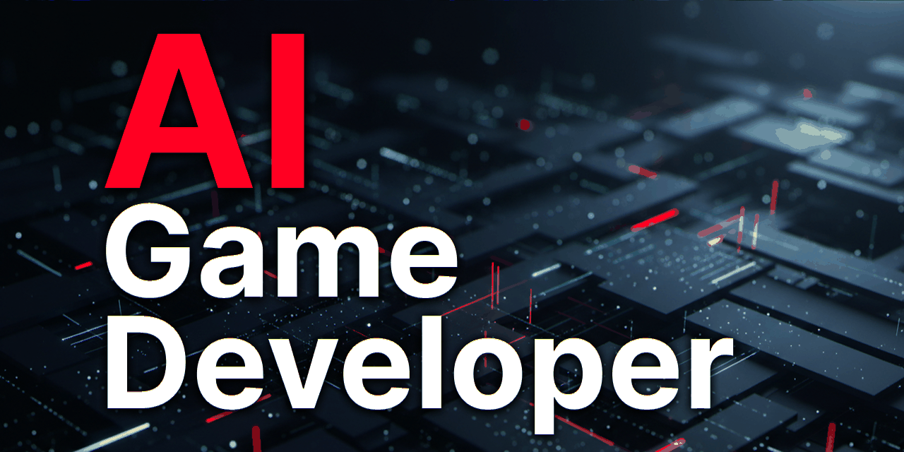

<div align="center" width="100%">
  <h1>Unity MCP — <i>CLI</i></h1>

[](https://www.npmjs.com/package/unity-mcp-cli)
[](https://nodejs.org/)
[](https://github.com/IvanMurzak/Unity-MCP/blob/main/LICENSE)
[](https://stand-with-ukraine.pp.ua)

  

  <p>
    <a href="https://claude.ai/download"></a>&nbsp;&nbsp;
    <a href="https://openai.com/index/introducing-codex/"></a>&nbsp;&nbsp;
    <a href="https://www.cursor.com/"></a>&nbsp;&nbsp;
    <a href="https://code.visualstudio.com/docs/copilot/overview"></a>&nbsp;&nbsp;
    <a href="https://gemini.google.com/"></a>&nbsp;&nbsp;
    <a href="https://antigravity.google/"></a>&nbsp;&nbsp;
    <a href="https://code.visualstudio.com/"></a>&nbsp;&nbsp;
    <a href="https://www.jetbrains.com/rider/"></a>&nbsp;&nbsp;
    <a href="https://visualstudio.microsoft.com/"></a>&nbsp;&nbsp;
    <a href="https://github.com/anthropics/claude-code"></a>&nbsp;&nbsp;
    <a href="https://github.com/cline/cline"></a>&nbsp;&nbsp;
    <a href="https://github.com/Kilo-Org/kilocode"></a>
  </p>

</div>

<b>[中文](https://github.com/IvanMurzak/Unity-MCP/blob/main/cli/docs/README.zh-CN.md) | [日本語](https://github.com/IvanMurzak/Unity-MCP/blob/main/cli/docs/README.ja.md) | [Español](https://github.com/IvanMurzak/Unity-MCP/blob/main/cli/docs/README.es.md)</b>

Cross-platform CLI tool for **[Unity MCP](https://github.com/IvanMurzak/Unity-MCP)** — create projects, install plugins, configure MCP tools, and launch Unity with active MCP connections. All from a single command line.

## 

- :white_check_mark: **Create projects** — scaffold new Unity projects via Unity Editor
- :white_check_mark: **Install editors** — install any Unity Editor version from the command line
- :white_check_mark: **Install plugin** — add Unity-MCP plugin to `manifest.json` with all required scoped registries
- :white_check_mark: **Remove plugin** — remove Unity-MCP plugin from `manifest.json`
- :white_check_mark: **Configure** — show/hide MCP tools, prompts, and resources (what MCP clients see listed)
- :white_check_mark: **Status check** — see Unity process, local server, and cloud server connection status at a glance
- :white_check_mark: **Run tools** — execute MCP tools directly from the command line
- :white_check_mark: **Setup MCP** — write AI agent MCP config files for any of 14 supported agents
- :white_check_mark: **Setup skills** — generate skill files for AI agents via the MCP server
- :white_check_mark: **Wait for ready** — poll until Unity Editor and MCP server are connected and accepting tool calls
- :white_check_mark: **Open & Connect** — launch Unity with optional MCP environment variables for automated server connection
- :white_check_mark: **Cross-platform** — Windows, macOS, and Linux
- :white_check_mark: **CI-friendly** — auto-detects non-interactive terminals and disables spinners/colors
- :white_check_mark: **Verbose mode** — use `--verbose` on any command for detailed diagnostic output
- :white_check_mark: **Version-aware** — never downgrades plugin versions, resolves latest from OpenUPM


# Quick Start

Install globally and run:

```bash
# 1.1 Install unity-mcp-cli                                #  ┌────────────────────┐
npm install -g unity-mcp-cli                               #  │ Available AI agent │
                                                           #  ├────────────────────┤
# 1.2 (Optional) Install Unity                             #  │ antigravity        │
unity-mcp-cli install-unity                                #  │ claude-code        │
                                                           #  │ claude-desktop     │
# 1.3 (Optional) Create Unity project                      #  │ cline              │
unity-mcp-cli create-project ./MyUnityProject              #  │ codex              │
                                                           #  │ cursor             │
# 2. Install "AI Game Developer" in Unity project          #  │ gemini             │
unity-mcp-cli install-plugin ./MyUnityProject              #  │ github-copilot-cli │
                                                           #  │ kilo-code          │
# 3. Sign in to ai-game.dev (OAuth device flow)            #  │ open-code          │
unity-mcp-cli login                                        #  │ rider-junie        │
                                                           #  │ unity-ai           │
# 4. Open Unity project (auto-connects and generates skills)  │ vs-copilot         │
unity-mcp-cli open ./MyUnityProject                        #  │ vscode-copilot     │
                                                           #  └────────────────────┘
# 5. Wait for Unity Editor to be ready
unity-mcp-cli wait-for-ready ./MyUnityProject
```

Or run any command instantly with `npx` — no global installation required:

```bash
npx unity-mcp-cli install-plugin /path/to/unity/project
```

> **Requirements:** [Node.js](https://nodejs.org/) ^20.19.0 || >=22.12.0. [Unity Hub](https://unity.com/download) is installed automatically if not found.


# Contents

- [Quick Start](#quick-start)
- [Contents](#contents)
- [Commands](#commands)
  - [`configure`](#configure)
  - [`create-project`](#create-project)
  - [`update`](#update)
  - [`install-extension`](#install-extension)
  - [`install-plugin`](#install-plugin)
  - [`install-unity`](#install-unity)
  - [`login`](#login)
  - [`open`](#open)
  - [`close`](#close)
  - [`tools`](#tools)
  - [`rql`](#rql)
  - [`run-tool`](#run-tool)
  - [`exec`](#exec)
  - [`test`](#test)
  - [`compile`](#compile)
  - [`dialog`](#dialog)
  - [`commands`](#commands-1)
  - [`wait-for-ready`](#wait-for-ready)
  - [`setup-mcp`](#setup-mcp)
  - [`setup-skills`](#setup-skills)
  - [`remove-plugin`](#remove-plugin)
  - [`status`](#status)
  - [Global Options](#global-options)
  - [Exit Codes and Machine-Readable Output](#exit-codes-and-machine-readable-output)
- [Full Automation Example](#full-automation-example)
- [How It Works](#how-it-works)
    - [Deterministic Port](#deterministic-port)
    - [Plugin Installation](#plugin-installation)
    - [Configuration File](#configuration-file)
    - [Unity Hub Integration](#unity-hub-integration)


# Commands

## `configure`

Configure MCP tools, prompts, and resources in `UserSettings/AI-Game-Developer-Config.json`.

```bash
unity-mcp-cli configure ./MyGame --list
```

| Option | Required | Description |
|---|---|---|
| `[path]` | Yes | Path to the Unity project (positional or `--path`) |
| `--list` | No | List current configuration and exit |
| `--enable-tools <names>` | No | Show specific tools to MCP clients (comma-separated) |
| `--disable-tools <names>` | No | Hide specific tools from MCP clients (comma-separated; a hidden tool still runs when called by name) |
| `--enable-all-tools` | No | Show all tools |
| `--disable-all-tools` | No | Hide all tools |
| `--enable-prompts <names>` | No | Show specific prompts to MCP clients (comma-separated) |
| `--disable-prompts <names>` | No | Hide specific prompts from MCP clients (comma-separated; a hidden tool still runs when called by name) |
| `--enable-all-prompts` | No | Show all prompts |
| `--disable-all-prompts` | No | Hide all prompts |
| `--enable-resources <names>` | No | Show specific resources to MCP clients (comma-separated) |
| `--disable-resources <names>` | No | Hide specific resources from MCP clients (comma-separated; a hidden tool still runs when called by name) |
| `--enable-all-resources` | No | Show all resources |
| `--disable-all-resources` | No | Hide all resources |

**Example — enable specific tools and disable all prompts:**

```bash
unity-mcp-cli configure ./MyGame \
  --enable-tools screenshot-scene-view,script-read \
  --disable-all-prompts
```

**Example — enable everything:**

```bash
unity-mcp-cli configure ./MyGame \
  --enable-all-tools \
  --enable-all-prompts \
  --enable-all-resources
```


## `create-project`

Create a new Unity project using the Unity Editor.

```bash
unity-mcp-cli create-project /path/to/new/project
```

| Option | Required | Description |
|---|---|---|
| `[path]` | Yes | Path where the project will be created (positional or `--path`) |
| `--unity <version>` | No | Unity Editor version to use (defaults to highest installed) |

**Example — create a project with a specific editor version:**

```bash
unity-mcp-cli create-project ./MyGame --unity 2022.3.62f1
```


## `update`

Update everything: the MCP plugin and installed extensions of a Unity project to their latest versions, then the CLI itself.

```bash
unity-mcp-cli update              # the project around the current folder, then the CLI
unity-mcp-cli update ./MyGame      # a project by path
unity-mcp-cli update --check       # only report; exit code 2 when something is outdated
unity-mcp-cli update --no-self     # leave the CLI as it is
unity-mcp-cli update --no-project  # update only the CLI
unity-mcp-cli update --no-extensions
```

Outside a project it updates only the CLI. Installs from `file:` or git are left alone and nothing is downgraded.

## `install-extension`

Install one of the Unity-MCP extensions — the optional tool packs that add MCP tools for Animation, Cinemachine, Input System, Navigation, Particle System, ProBuilder, Splines, Terrain, Tilemap, and Timeline — into a Unity project's `Packages/manifest.json`. This is the command-line equivalent of the **Extensions** section in the *AI Game Developer* editor window, and it installs from the same shared catalogue.

```bash
# See what is installable (no project and no network required)
unity-mcp-cli install-extension --list

# Run from inside the Unity project folder — the path is optional
cd ./MyGame && unity-mcp-cli install-extension Tilemap
```

| Argument / Option | Required | Description |
|---|---|---|
| `[id]` | Yes (unless `--list`) | Extension to install — the OpenUPM package id (`com.ivanmurzak.unity.mcp.tilemap`) or the catalogue name (`Tilemap`). Matched case-insensitively. An unknown id lists every installable extension so you can self-correct. |
| `[path]` | No | Path to the Unity project (positional or `--path`). Defaults to the current directory, verified the same way as `install-plugin`. |
| `--extension-version <version>` | No | Extension version to install (defaults to latest from OpenUPM). **Not `--version`** — that is the CLI's own global version flag. |
| `--list` | No | List the installable extensions and exit. |

This command:
1. Adds the **OpenUPM scoped registry** with all required scopes (the `com.ivanmurzak` scope is what makes the extension resolvable at all)
2. Adds the extension's package id to `dependencies`, resolving OpenUPM's `latest` at install time
3. **Never downgrades** on an auto-resolved version — if a higher version is already installed, it is preserved and a warning is printed. Pass `--extension-version` to force a specific value, including a downgrade.
4. Is **idempotent** — a re-run that finds the extension already up to date reports so and writes nothing

**Example — install a specific extension version:**

```bash
unity-mcp-cli install-extension Cinemachine ./MyGame --extension-version 1.0.17
```

**Example — in-process, from the library:**

```ts
import { installExtension, EXTENSIONS_CATALOG } from 'unity-mcp-cli';

const result = await installExtension({
  unityProjectPath: './MyGame',
  extensionId: 'Tilemap',
});
if (result.kind === 'success') {
  console.log(result.outcome, result.fromVersion, '->', result.toVersion);
}
```

> After running this command, open (or focus) the Unity Editor so the Package Manager resolves the new dependency.


## `install-plugin`

Install the Unity-MCP plugin into a Unity project's `Packages/manifest.json`. Optionally download the RID-matched MCP server binary and redeem a team enrollment code in the same run.

```bash
# Run from inside the Unity project folder — the path is optional
cd ./MyGame && unity-mcp-cli install-plugin
```

| Option | Required | Description |
|---|---|---|
| `[path]` | No | Path to the Unity project (positional or `--path`). Defaults to the current directory; the resolved directory is verified to be a real Unity project (`Packages/manifest.json` marker) and, on a miss, the error lists exactly what was checked. |
| `--plugin-version <version>` | No | Plugin version to install (defaults to latest from [OpenUPM](https://openupm.com/packages/com.ivanmurzak.unity.mcp/)) |
| `--with-server` | No | Also download the RID-matched [GameDev-MCP-Server](https://github.com/IvanMurzak/GameDev-MCP-Server) binary into the CLI-managed directory |
| `--server-version <version>` | No | Server version to download with `--with-server` (default: the CLI's pinned server version) |
| `--server-source <path-or-url>` | No | Offline/CI override — install the server from a local zip path or URL (skips checksum verification) |
| `--enroll <code>` | No | Redeem an enrollment code for a plugin credential (planted in the shared machine store and pinned to this project) |
| `--enroll-stdin` | No | Read the enrollment code from stdin instead of argv (keeps it out of shell history) |

This command:
1. Adds the **OpenUPM scoped registry** with all required scopes
2. Adds `com.ivanmurzak.unity.mcp` to `dependencies`
3. **Never downgrades** — if a higher version is already installed, it is preserved

**Example — install a specific plugin version:**

```bash
unity-mcp-cli install-plugin ./MyGame --plugin-version 0.51.6
```

**Example — redeem a team enrollment code (path defaults to cwd):**

```bash
cd ./MyGame && unity-mcp-cli install-plugin --enroll <code>
```

> After running this command, open the project in Unity Editor to complete the package installation.


## `install-unity`

Install a Unity Editor version via Unity Hub CLI.

```bash
unity-mcp-cli install-unity 6000.3.1f1
```

| Argument / Option | Required | Description |
|---|---|---|
| `[version]` | No | Unity Editor version to install (e.g. `6000.3.1f1`) |
| `--path <path>` | No | Read the required version from an existing project |

If neither argument nor option is provided, the command installs the latest stable release from Unity Hub's releases list.

**Example — install the editor version that a project needs:**

```bash
unity-mcp-cli install-unity --path ./MyGame
```


## `login`

Sign in to **ai-game.dev** and store the credential in the shared machine credential store (`~/.ai-game-dev/credentials.json`). Runs the browser-based **OAuth 2.1 device flow** — there is no personal access token to create or paste. The sign-in authorizes the whole machine: it mints an **agent** credential and derives an engine-tools credential from it, and every consumer (the CLI's cloud commands, the Unity Editor plugin, the desktop app) refreshes it automatically — tokens rotate in the background, so you sign in once per machine, not once per session.

```bash
unity-mcp-cli login
```

| Option | Required | Description |
|---|---|---|
| `--project <path>` | No | Store the credential in a project-local store (`<path>/.ai-game-dev/`) instead of the shared machine store |
| `--force` | No | Re-authenticate even if a credential already exists |
| `--tools-only` | No | Authorize **engine tools only** (no agent credential is stored, so desktop-app pickup is impossible). Intended for CI / automation runners, which then appear as their own revocable device group |
| `--yes` | No | Assume "yes" for prompts — required to confirm an **account switch** non-interactively (signing in as a different account than the machine currently holds) |

The command prints a short user code and a verification URL, opens your browser, and polls until you approve the sign-in. If a credential already exists it exits early with *"Already signed in"* — pass `--force` to replace it. Signing in as a **different account** than the one the machine holds asks for confirmation first (declining leaves everything unchanged); pass `--yes` to confirm in scripts.

**Example — sign in (shared machine store):**

```bash
unity-mcp-cli login
```

**Example — CI runner, engine tools only:**

```bash
unity-mcp-cli login --tools-only
```

**Example — store the credential next to a specific project:**

```bash
unity-mcp-cli login --project ./MyGame
```


## `open`

Open a Unity project in the Unity Editor. By default, sets MCP connection environment variables if connection options are provided. Use `--no-connect` to open without MCP connection.

```bash
# Explicit path
unity-mcp-cli open ./MyGame

# From inside the Unity project folder — path defaults to the current directory
cd ./MyGame && unity-mcp-cli open
```

| Option | Env Variable | Required | Description |
|---|---|---|---|
| `[path]` | — | No | Path to the Unity project (positional or `--path`). Defaults to the current working directory. |
| `--unity <version>` | — | No | Specific Unity Editor version to use (defaults to version from project settings, falls back to highest installed) |
| `--editor-path <path>` | — | No | Explicit path to the Unity Editor executable. Skips Unity Hub discovery, useful for custom install locations. |
| `--no-connect` | — | No | Open without MCP connection environment variables |
| `--url <url>` | `UNITY_MCP_CLOUD_URL` | No | MCP server URL to connect to (the CLI still exports the legacy alias `UNITY_MCP_HOST`, which the plugin also accepts) |
| `--keep-connected` | `UNITY_MCP_KEEP_CONNECTED` | No | Force keep the connection alive |
| `--token <token>` | `UNITY_MCP_TOKEN` | No | Authentication token |
| `--auth <option>` | `UNITY_MCP_AUTH_OPTION` | No | Auth mode: `none`, `oauth`, or `token` |
| `--tools <names>` | `UNITY_MCP_TOOLS` | No | Comma-separated list of tools to enable |
| `--transport <method>` | `UNITY_MCP_TRANSPORT` | No | Transport method: `streamableHttp` or `stdio` |
| `--start-server <value>` | `UNITY_MCP_START_SERVER` | No | Set to `true` or `false` to control MCP server auto-start |
| `--headless` | — | No | Start the editor without a window (`-batchmode`; graphics stay on, so cameras still render) and wait until its MCP server answers. Implies `--keep-connected`. A running editor of the project is reused; one started here is the CLI's own (see [`close --owned-only`](#close)), and parallel calls start only one. |
| `--idle-timeout <seconds>` | `AIGD_SESSION_IDLE_SECONDS` (headless) / `UNITY_MCP_IDLE_TIMEOUT` (window) | No | Quit the editor after this many seconds without a tool call (saves changed scenes and assets first) |
| `--ready-timeout <ms>` | — | No | With `--headless`: how long to wait for the editor to become ready (default: `300000`) |
| `--no-auto-dismiss-launch-errors` | — | No | Disable auto-dismissal of the Unity Editor "compile errors at launch" dialog (default: enabled) |
| `--launch-dismiss-timeout-ms <ms>` | — | No | Overall timeout (milliseconds) for the launch-errors auto-dismiss polling loop (default: `30000`) |
| `--launch-dismiss-poll-interval-ms <ms>` | — | No | Polling tick interval (milliseconds) for the launch-errors auto-dismiss loop (default: `1500`) |

Without `--headless`, a headless editor that the CLI started for the project (`exec`, `open --headless`) is asked to save and quit first, so the window can open.

The editor process is spawned in detached mode. By default, after spawning the editor, `open` polls for Unity's "compile errors at launch" dialog (`"Enter Safe Mode?"` on Unity 2020.2+, `"Hold On" / "Compiler Errors"` on older releases) and clicks `Ignore` so the editor finishes initialising — without this, any in-Editor automation that needs to run after a state where Unity itself can't compile (e.g. the NuGet dependency resolver) cannot self-heal. The dialog is surfaced after Unity has booted, connected to Package Manager, and started compiling — empirically ~6s on a fast machine and longer on a slow one — so the polling loop has a grace window after which it exits early if no dialog has been seen. The grace window has to cover Unity's full startup phase or the loop bails out before the dialog ever appears (issue #737); it never runs the full `--launch-dismiss-timeout-ms` in the no-dialog case. If the dialog is observed (and successfully dismissed), polling continues until the overall timeout so a re-appearing dialog (resolver fixes one error → dialog re-surfaces with the next) is dismissed again. Library-mode callers can supply an `AbortSignal` (`launchDismissAbortSignal` on `OpenProjectOptions`) to abort the loop the instant their own readiness signal fires.

### Auto-dismiss platform requirements

| Platform | Requirement | Notes |
|---|---|---|
| **Windows** | Built-in (Win32 API) | Uses `EnumWindows` / `EnumChildWindows` / `SendMessageW(BM_CLICK)` driven from PowerShell. No extra setup required. |
| **macOS** | **Accessibility permission** must be granted to the terminal (or `unity-mcp-cli` binary). System Settings → Privacy & Security → Accessibility. | Implemented via AppleScript / `osascript`. Without this permission, `osascript` reports an error every poll tick and the dialog cannot be dismissed. |
| **Linux/X11** | `xdotool` on `PATH` (e.g. `sudo apt-get install xdotool`). | Wayland is **not** supported in the first cut — track upstream issues for Wayland support. |

To opt out entirely, pass `--no-auto-dismiss-launch-errors`.

**Example — open with MCP connection:**

```bash
unity-mcp-cli open ./MyGame \
  --url http://localhost:8080 \
  --keep-connected
```

**Example — open without MCP connection (simple open):**

```bash
unity-mcp-cli open ./MyGame --no-connect
```

**Example — open with authentication and specific tools:**

```bash
unity-mcp-cli open ./MyGame \
  --url http://my-server:8080 \
  --token my-secret-token \
  --auth token \
  --tools rql-query,rql-mutate,rql-schema
```


## `close`

Gracefully terminate the Unity Editor instance running for a given project path. Symmetric counterpart of [`open`](#open) — for scripted workflows (CI agents, pipeline executors, integration test fixtures) that need a clean tear-down without resorting to OS-level process kills.

```bash
unity-mcp-cli close ./MyGame
```

| Option | Required | Description |
|---|---|---|
| `[path]` | No | Path to the Unity project (positional, defaults to current directory) |
| `--timeout <seconds>` | No | Polite-quit timeout in seconds (default: 30) |
| `--force` | No | Hard-kill the Editor if it does not exit within `--timeout` |
| `--owned-only` | No | Close only an Editor that the CLI started (`exec`, `open --headless`); an Editor opened by the user is never touched |

**How it works:**

0. An Editor the CLI started is recorded in the project's session lease (`.ai-game-dev/session.json`: PID, process start time, nonce). If the lease names a live Editor, `close` asks its plugin to save and quit (the `editor-session-quit` system tool, checked against the lease nonce, at the server URL the lease recorded when the Editor was started) — this also reaches a headless Editor, which `WM_CLOSE` cannot — and skips the steps below. With `--owned-only` it stops here: no lease, nothing is closed.
1. Resolves the running Editor's PID by reading `<project>/Temp/UnityLockfile` (4-byte little-endian uint32) and cross-checking against process enumeration to handle stale lock files.
2. Sends a polite-quit signal — `SIGTERM` on Linux/macOS, `taskkill` (no `/F`) on Windows — letting Unity finish autosave / asset-import.
3. Polls every 250ms until the process exits or `--timeout` elapses.
4. If the timeout expires AND `--force` is set, falls back to `SIGKILL` / `taskkill /F`.
5. Idempotent — closing an already-closed Editor (or a project whose Editor was never running) exits 0 with `no running Editor for project at <path>`.
6. Refuses to act on any path that is not a Unity project root (`ProjectSettings/ProjectVersion.txt` must exist) — protects against accidental kill-all-Unity-on-host invocations.

> **Windows headless caveat:** the polite-quit step uses `taskkill` (no `/F`), which delivers `WM_CLOSE`. That message only reaches processes owning a top-level window on the **same desktop/session** as the CLI. If Unity was launched by a Windows service in session 0 (or any other non-interactive desktop), the polite-quit will be silently dropped, the `--timeout` will elapse, and `--force` becomes the only path that brings the Editor down. Plan accordingly in headless CI runners. An Editor started by the CLI (step 0) is not affected: it quits through its plugin.

**Example — close, fall back to force after 60s:**

```bash
unity-mcp-cli close ./MyGame --timeout 60 --force
```

**Example — clean tear-down at the end of an automation script:**

```bash
unity-mcp-cli open ./MyGame
unity-mcp-cli wait-for-ready ./MyGame
unity-mcp-cli run-tool tests-run ./MyGame --input '{"testMode":"EditMode"}'
unity-mcp-cli close ./MyGame
```


## `tools`

List the AI tools the project's Unity Editor offers — the scene, assets, tests, screenshots and everything installed
extensions add — with what each does and its inputs, or show one tool in detail (full description, inputs, an example
call, its JSON input schema). Starts a headless editor when none runs, like [`exec`](#exec). The list is read over MCP
(`tools/list`) and saved in the project (git-ignored), so `--cached` answers instantly while the editor is closed.
Hidden tools (not offered to MCP clients) are listed by name; `run-tool` still calls them.

```bash
unity-mcp-cli tools                 # every tool, one line each, with its inputs
unity-mcp-cli tools rql-mutate      # one tool: description, inputs, example call, schema
unity-mcp-cli tools screenshot      # a regex filter over names and descriptions
unity-mcp-cli tools --format json   # full schemas, machine-readable
```

| Option | Required | Description |
|---|---|---|
| `[name]` | No | A tool name (details) or a regex (filter) |
| `--path <path>` | No | Unity project path (default: current directory) |
| `--cached` | No | Answer from the saved list without contacting the editor |
| `--no-start` | No | Never start an editor; use the saved list when none answers |
| `--once` | No | Close the editor afterwards if this call started it |
| `--ready-timeout <ms>` | No | Wait for a started editor (default: 300000) |
| `--url <url>` / `--token <token>` | No | Server overrides |
| `--format <format>` | No | `text`, `json` or `ndjson` |


## `rql`

One RQL query from the command line, without JSON quoting. A query whose last stage is `set` or `call` goes to
`rql-mutate`, any other to `rql-query`; `--schema [type]` runs `rql-schema`. Starts a headless editor like `run-tool`.
Unity saves a change to disk at once, so after a `set` / `call` the CLI prints the scene and asset files it wrote
(`Saved to disk: Assets/Scenes/Forest.unity`). An operator spelled as in another language (`startsWith`, `like`) gets
a hint with RQL's spelling. `rql --help` lists recipes.

```bash
unity-mcp-cli rql 'objects | where name starts-with "Tree" | count'
unity-mcp-cli rql 'objects | where name starts-with "Rock" | set transform.localScale = transform.localScale * 1.5'
```

| Option | Required | Description |
|---|---|---|
| `[query]` | Yes, unless `--schema` / `-f` | The RQL query (single-quote it; strings inside take double quotes) |
| `-f, --file <file>` | No | Read the query from a file (`-`: stdin), for a shell that strips the inner quotes |
| `--schema [type]` | No | List the RQL sources, or one type's members |
| `--dry-run` | No | For `set` / `call`: show what would change, change nothing |
| `--max-targets <n>` | No | For `set` / `call`: more than 200 targets (up to 1000) |
| `--path <path>` | No | Unity project path (default: the current directory) |
| `--no-start` / `--once` | No | As for `run-tool` (`--url`, `--token`, `--raw`, `--timeout`, `--ready-timeout` work too) |
| `--format <format>` | No | `text`, `json` or `ndjson` |


## `run-tool`

Execute an MCP tool directly via the HTTP API. The server URL and authorization token are **automatically resolved** from the project's config file (`UserSettings/AI-Game-Developer-Config.json`), based on the current connection mode (Custom or Cloud).

```bash
unity-mcp-cli run-tool rql-mutate ./MyGame --input '{"query":"editor | call CreateGameObject({name: \"Cube\", primitive: \"Cube\"})"}'
```

| Option | Required | Description |
|---|---|---|
| `<tool-name>` | Yes | Name of the MCP tool to execute |
| `[path]` | No | Unity project path (positional or `--path`) — used to read config and detect port |
| `--url <url>` | No | Direct server URL override (bypasses config) |
| `--token <token>` | No | Bearer token override (bypasses config) |
| `--input <json>` | No | JSON string of tool arguments (defaults to `{}`) |
| `--input-file <file>` | No | Read JSON arguments from a file |
| `--raw` | No | Output raw JSON (no formatting, no spinner) |
| `--format <format>` | No | `text` (default), `json` or `ndjson` — see [machine-readable output](#exit-codes-and-machine-readable-output) |
| `--timeout <ms>` | No | Request timeout in milliseconds (default: 60000) |
| `--no-start` | No | Never start an editor; fail (exit 7) when none answers |
| `--once` | No | Close the editor after the call if this call started it (one-shot CI use) |
| `--ready-timeout <ms>` | No | How long to wait for a started editor to become ready (default: 300000) |

**Starting the editor.** When no editor of the project answers, `run-tool` starts a headless one exactly like
[`exec`](#exec) (shared session lease, never closes an editor it did not start) — but only for a project that names its
Unity version in `ProjectSettings/ProjectVersion.txt`, so it never guesses an editor. `--no-start` turns this off;
`--once` makes the call one-shot: an editor this call started is closed again after the call (and also when it never
became ready). `run-system-tool` behaves the same.

A tool that answers with an error exits 6; an unknown tool 2 (`NOT_FOUND`), a timeout 14, an unreachable editor 7, a busy
editor 17, and a call blocked by a modal dialog 18 — the full table, with the HTTP statuses, is in
[Exit Codes](#exit-codes-and-machine-readable-output).

**URL resolution priority:**
1. `--url` → use directly
2. Config file → `host` (Custom mode) or hardcoded cloud endpoint (Cloud mode)
3. Deterministic port from project path

**Authorization** is read automatically from the project config (`token` in Custom mode, `cloudToken` in Cloud mode). Use `--token` to override the config-derived token explicitly.

**Example — call a tool (URL and auth from config):**

```bash
unity-mcp-cli run-tool rql-query ./MyGame --input '{"query":"objects | where name == \"Player\" | select path name active"}'
```

**Example — explicit URL override:**

```bash
unity-mcp-cli run-tool rql-mutate --url http://localhost:8080 --input '{"query":"editor | call SaveScenes()"}'
```

**Example — pipe raw JSON output:**

```bash
unity-mcp-cli run-tool unity-tool-list ./MyGame --raw | jq .
```

**Example — one-shot call in CI (starts a headless editor, closes it afterwards):**

```bash
unity-mcp-cli run-tool package-list ./MyGame --url http://localhost:28343 --once --format json
```


## `exec`

Run C# in the Unity Editor and print the result. If the project is already open (with a window or headless) `exec` uses that editor and never closes it. Otherwise it starts a headless editor that stays warm for the next calls and quits by itself after `--idle` seconds without tool calls (saving changed scenes and assets). The editor it starts is recorded in the project's session lease (`.ai-game-dev/session.json`) and started under a file lock, so parallel `exec` calls share one editor; `close --owned-only` closes it, and `open` (with a window) closes it before opening the window. These session files are machine-local: `.ai-game-dev/.gitignore` keeps them out of git. If the project is open in an editor the CLI did not start and its plugin does not answer within 60 s (disconnected, or connected to the ai-game.dev cloud), `exec` stops with a hint instead of waiting: connect the plugin, switch its connection to Custom (a local server), or pass `--url`.

```bash
# The last expression is the result
unity-mcp-cli exec 'GameObject.FindObjectsOfType<Camera>().Length'

# From a file or stdin, with extra namespaces and helper files
unity-mcp-cli exec -f ./snippet.cs --using MyGame.Gameplay --include Helpers/
echo 'Application.unityVersion' | unity-mcp-cli exec
```

| Option | Required | Description |
|---|---|---|
| `[code]` | No | C# snippet: plain statements, the last expression is the result. Alternatively `-f` or stdin. |
| `--path <path>` | No | Unity project path (default: current directory) |
| `-f, --file <file>` | No | Read the code from a file (`-` for stdin) |
| `--using <namespace>` | No | Extra namespace, repeatable |
| `--include <path>` | No | Helper `.cs` file or folder (recursive), relative to `<Project>/.ai-game-dev/snippets`, repeatable |
| `--window` | No | Start the editor with a window instead of headless (only when it is not running yet) |
| `--idle <seconds>` | No | Quit an editor started by `exec` after this many idle seconds (default: 300) |
| `--ready-timeout <ms>` | No | How long to wait for the editor to become ready (default: 300000) |
| `--timeout <ms>` | No | Tool call timeout (default: 310000) |
| `--raw` | No | Print the raw tool response JSON |
| `--format <format>` | No | `text` (default), `json` or `ndjson` |
| `--once` | No | Close the editor after the call if this call started it |
| `--url <url>` | No | Server URL override; a local URL also makes a newly started editor start that server |
| `--token <token>` | No | Bearer token override |

`exec` calls the `script-execute` tool, so snippets, `usings` and `include` need a plugin version with Code-Exec support. A compile error or an exception exits with code 6 and points at your own lines.

> **Not signed in?** A fresh project starts in **Cloud** connection mode. Without an ai-game.dev sign-in, `exec`,
> `run-tool`, `compile` and `tools` use the project's **local** MCP server instead (they say so on stderr): an editor
> they start is told to serve it, in memory — the project config is not changed. Run `login` to work through the cloud.
>
> A headless editor started by the CLI keeps running when the project's scripts do not compile
> (`-ignorecompilererrors`), so `compile` can report the errors; its log is `Logs/unity-mcp-cli-editor.log`.

## `test`

Run the project's Unity tests the way CI does: a **batch-mode editor with Unity's own `-runTests`** — no AI Game
Developer plugin and no MCP server are involved, so it works on a project whose plugin is broken or missing. The verdict
comes from the NUnit report the run writes (an earlier report at the same path is deleted first), never from the
editor's exit code alone.

```bash
unity-mcp-cli test ./MyGame                                  # EditMode, report in ./test-results.xml
unity-mcp-cli test ./MyGame --mode PlayMode --filter "MyGame.Tests.Combat" --junit-output junit.xml
unity-mcp-cli test ./MyGame --format github                  # ::error annotations at the failing test's source line
unity-mcp-cli test ./MyGame --format json --timeout 900 -- -nographics
```

| Option | Required | Description |
|---|---|---|
| `[path]` | No | Unity project path (positional or `--path`, default: current directory) |
| `--mode <mode>` | No | `EditMode` (default) or `PlayMode` |
| `--filter <pattern>` | No | Unity `-testFilter`: full test names or a regex, `;` separates several |
| `--category <names>` | No | Unity `-testCategory` |
| `--assembly <names>` | No | Unity `-assemblyNames` |
| `--output <file>` | No | NUnit report path (default: `<project>/Logs/test-results.xml`) |
| `--junit-output <file>` | No | Also write a JUnit report |
| `--log-file <file>` | No | Editor log (default: the report path with `.log`) |
| `--timeout <seconds>` | No | Kill the editor (and its child processes) after this long (default: 3600) |
| `--nographics` | No | Run without a GPU |
| `--unity <version>` / `--editor-path <path>` | No | Editor to use (default: the project's version) |
| `--format <format>` | No | `text`, `json`, `ndjson` or `github` |
| `-- <args>` | No | Extra editor arguments; the ones `test` manages (`-batchmode`, `-runTests`, `-quit`, ...) are rejected |

**Exit codes:** `0` all passed (a run of zero tests passes with a warning), `8` tests failed, `6` no verdict (compile
errors — listed as `file(line,col): error CS...` — a license problem, a crash, or the project is **already open in an
editor**: a second editor cannot open it, so use `run-tool tests-run` on that editor instead), `14` timeout, `2` bad
arguments. Ctrl+C or a cancelled CI job also stops the editor.

## `compile`

"Does my C# compile?" against the project's editor: refreshes assets so changed scripts compile, waits for the compile
and its domain reload, and reports the compiler errors and warnings from the editor's Console with file, line and
column. Starts a headless editor when none runs (kept warm for the next call, like `exec`); a call against a warm
editor takes a few seconds.

```bash
unity-mcp-cli compile ./MyGame
unity-mcp-cli compile ./MyGame --strict --format github   # warnings fail too
```

| Option | Required | Description |
|---|---|---|
| `[path]` | No | Unity project path (positional or `--path`) |
| `--strict` | No | Fail on compiler warnings too |
| `--timeout <seconds>` | No | Wait for the compile and domain reload (default: 180) |
| `--ready-timeout <ms>` | No | Wait for a started editor (default: 300000) |
| `--once` | No | Close the editor afterwards if this call started it |
| `--url <url>` / `--token <token>` | No | Server overrides, as for `exec` |
| `--format <format>` | No | `text`, `json`, `ndjson` or `github` |

**Exit codes:** `0` compiles, `6` compile errors (or warnings with `--strict`), `7` no editor could be reached, `14`
timeout, `18` a modal dialog blocks the editor. Diagnostics go to stderr in the compiler's own
`file(line,col): error CS0103: ...` form.

## `dialog`

A modal dialog (a save prompt, "Enter Safe Mode?", `EditorUtility.DisplayDialog`) blocks the editor's main thread, so
every tool call waits until someone answers it. `dialog` lists the dialogs of the project's editor and can press a
button. `status`, `run-tool`, `exec`, `compile` and `wait-for-ready` report such a dialog as exit code `18`
(`AWAITING_INPUT`) instead of a plain timeout. Windows, macOS and Linux; a headless (`-batchmode`) editor never shows
dialogs.

| Platform | How | Requirement |
|---|---|---|
| **Windows** | Win32 (`EnumWindows`, `BM_CLICK`) through PowerShell | None |
| **macOS** | System Events UI scripting through `osascript -l JavaScript`: the editor's dialog windows and sheets, their texts and buttons | **Accessibility permission** for the app that runs the CLI (your terminal or AI agent app): System Settings → Privacy & Security → Accessibility. Without it `dialog` fails with that hint, and the exit-18 check finds no dialogs. |
| **Linux** | The AT-SPI accessibility bus through a `python3` helper (PyGObject): the editor's dialog and alert windows (GTK, which Unity's `EditorUtility.DisplayDialog` uses), their labels and push buttons, pressed through their `click` action. Works on X11 and Wayland | `python3` with PyGObject and the AT-SPI typelib (Debian/Ubuntu: `python3-gi gir1.2-atspi-2.0`; Fedora: `python3-gobject at-spi2-core`; Arch: `python-gobject at-spi2-core`) and a running accessibility bus (`at-spi2-core`, started on demand in GNOME, KDE and most desktops). Run the CLI in the desktop session that runs the editor. A missing package, an unreachable bus or no graphical session make `dialog` fail with a hint naming the fix, and the exit-18 check finds no dialogs. |

A dialog id comes from the list and stays the same while that dialog is open (Windows: its window handle; macOS and
Linux: a hash of its pid, title, text and buttons). The button label is never put into a script, only passed as data.

On a headless Linux machine, run the editor (without `-batchmode`) and the CLI under `Xvfb` inside one
`dbus-run-session`, with `at-spi2-core` installed. If the same user also has a desktop session, give that private
session its own `XDG_RUNTIME_DIR`: its accessibility bus would otherwise replace (and on exit delete) the desktop's
`at-spi` socket.

```bash
unity-mcp-cli dialog ./MyGame                          # list: title and buttons
unity-mcp-cli dialog ./MyGame --press "Don't Save"     # answer it
```

| Option | Required | Description |
|---|---|---|
| `[path]` | No | Unity project path (positional or `--path`) |
| `--press <button>` | No | Press the button with this label (case-insensitive) |
| `--id <id>` | No | With `--press`: the dialog to answer (from the list) |
| `--format <format>` | No | `text`, `json` or `ndjson` |

## `commands`

Every command with its arguments, options and defaults, plus the exit-code table — read from the CLI itself, so it
never drifts. Meant for agents and tooling.

```bash
unity-mcp-cli commands --format json
```


## `wait-for-ready`

Wait until Unity Editor and MCP server are connected and ready to accept tool calls. Polls the server at a configurable interval until it responds successfully or the timeout is reached. Useful for automation scripts and AI agent orchestration where `open` launches Unity but the agent needs to know when it can start calling tools.

```bash
unity-mcp-cli wait-for-ready ./MyGame
```

| Option | Required | Description |
|---|---|---|
| `[path]` | No | Unity project path (positional or `--path`) — used to read config and detect port |
| `--url <url>` | No | Direct server URL override (bypasses config) |
| `--token <token>` | No | Bearer token override (bypasses config) |
| `--timeout <ms>` | No | Maximum time to wait in milliseconds (default: 120000) |
| `--interval <ms>` | No | Polling interval in milliseconds (default: 3000) |
| `--format <format>` | No | `text` (default), `json` or `ndjson` |

Exits `0` when ready, `14` on timeout and `18` when a modal dialog blocks the editor.

**Example — wait with default timeout (120s):**

```bash
unity-mcp-cli open ./MyGame
unity-mcp-cli wait-for-ready ./MyGame
unity-mcp-cli run-tool tests-run ./MyGame --input '{"testMode":"EditMode"}'
```

**Example — shorter timeout for CI:**

```bash
unity-mcp-cli wait-for-ready ./MyGame --timeout 60000 --interval 2000
```

**Example — explicit server URL:**

```bash
unity-mcp-cli wait-for-ready --url http://localhost:8080 --timeout 30000
```


## `setup-mcp`

Write MCP config files for AI agents, enabling headless/CI setup without the Unity Editor UI. Supports all 14 agents (Claude Code, Cursor, Gemini, Codex, etc.).

The config is **pinned** to this project via a per-project URL (`https://ai-game.dev/mcp/p/<pin>` for http transport, or a `project=<pin>` argument for stdio). For the Cloud http transport it also carries this project's **project key** (`Authorization: Bearer agd_pk_…`) for every agent: a non-expiring, revocable credential bound to this project only, reused from `~/.ai-game-dev/project-keys.json` or minted with the account you signed in with via [`login`](#login). Without a sign-in (or if the key cannot be obtained) the config is URL-only and the agent signs in with its own OAuth. Pass `--oauth` to always write the URL-only config, `--regenerate-key` to replace the key (this project's other agent configs that carry the previous key are moved to the new one and printed, then the previous key is revoked; if any of them cannot be rewritten, the previous key is left active and a warning names it), `--token` to write an explicit PAT instead, or `--no-pin` for the shared, unpinned endpoint. stdio and local-server configs never carry a project key. Antigravity reads either `~/.gemini/config/mcp_config.json` or `~/.gemini/antigravity/mcp_config.json` depending on the install, so both files are written and every path written is printed; if any of them cannot be written the command fails. This output matches the Unity Editor's **Configure** button.

```bash
unity-mcp-cli setup-mcp claude-code ./MyGame
```

| Option | Required | Description |
|---|---|---|
| `[agent-id]` | Yes | Agent to configure (use `--list` to see all) |
| `[path]` | No | Unity project path (defaults to cwd) |
| `--transport <transport>` | No | Transport method: `stdio` or `http` (default: `http`) |
| `--url <url>` | No | Server URL override (for http transport) |
| `--token <token>` | No | Explicit PAT — written as the `Authorization` header instead of the project key |
| `--oauth` | No | Write a URL-only Cloud config (the agent signs in with its own OAuth) instead of the project key |
| `--regenerate-key` | No | Mint a fresh project key, rewrite the config, and revoke the previous key (Cloud http only) |
| `--no-pin` | No | Write an unpinned URL / omit the `project=` argument (default: pin to this project via `/mcp/p/<pin>`) |
| `--list` | No | List all available agent IDs |

**Example — list all supported agents:**

```bash
unity-mcp-cli setup-mcp --list
```

**Example — configure Cursor with stdio transport:**

```bash
unity-mcp-cli setup-mcp cursor ./MyGame --transport stdio
```

**Example — replace this project's key (the old key stops working):**

```bash
unity-mcp-cli setup-mcp claude-code ./MyGame --regenerate-key
```

**Example — write an unpinned config (shared `/mcp` endpoint):**

```bash
unity-mcp-cli setup-mcp claude-code ./MyGame --no-pin
```


## `setup-skills`

Write skill files for an AI agent. Always, offline (no editor, no server): the `unity-mcp-cli` skill, how an agent
uses this CLI from a cold start (the first editor command starts a headless editor; `rql` recipes; `compile` / `test`;
`--format json`; exit codes and `dialog`), with `references/rql.md` and `references/install.md` for depth, plus
`ai-game-dev-app`. The recipes come from the same source as `--help`, so the two cannot drift. Then, when the
project's editor answers, it also asks the plugin for its per-tool skills; a closed editor is not an error.

```bash
unity-mcp-cli setup-skills claude-code ./MyGame
```

| Option | Required | Description |
|---|---|---|
| `[agent-id]` | Yes | Agent to generate skills for (use `--list` to see all) |
| `[path]` | No | Unity project path (defaults to cwd) |
| `--url <url>` | No | Server URL override |
| `--token <token>` | No | Auth token override |
| `--list` | No | List all agents with skills support status |
| `--offline` | No | Only write the `unity-mcp-cli` skill; do not ask the editor |
| `--timeout <ms>` | No | Request timeout in milliseconds (default: 60000) |

**Example — list agents with skills support:**

```bash
unity-mcp-cli setup-skills --list
```


## `remove-plugin`

Remove the Unity-MCP plugin from a Unity project's `Packages/manifest.json`.

```bash
unity-mcp-cli remove-plugin ./MyGame
```

| Option | Required | Description |
|---|---|---|
| `[path]` | Yes | Path to the Unity project (positional or `--path`) |

This command:
1. Removes `com.ivanmurzak.unity.mcp` from `dependencies`
2. **Preserves scoped registries and scopes** — other packages may depend on them
3. **No-op** if the plugin is not installed

> After running this command, open the project in Unity Editor to apply the change.


## `status`

Check Unity Editor and MCP server connection status. Shows whether Unity is running, whether the local MCP server is reachable, and whether the config-resolved server (e.g., cloud) is reachable.

```bash
unity-mcp-cli status ./MyGame
```

| Option | Required | Description |
|---|---|---|
| `[path]` | No | Unity project path (positional or `--path`) |
| `--url <url>` | No | Direct server URL override (bypasses config) |
| `--token <token>` | No | Bearer token override (bypasses config) |
| `--timeout <ms>` | No | Probe timeout in milliseconds (default: 5000) |
| `--format <format>` | No | `text` (default), `json` or `ndjson` |

Exits `0` when the MCP server answers, `7` when it does not, and `18` when a modal dialog blocks the editor (listed in
the output; see [`dialog`](#dialog)).

**Example output:**

```
Unity-MCP Status
  Project: /path/to/MyGame
──────────────────────────────────────────────────
Unity Editor Process
✔  Unity is running (PID: 53740)
Local MCP Server
  URL: http://localhost:22958
✖  Not available (connection refused)
Config Server
  URL: https://ai-game.dev/mcp
✔  Connected
──────────────────────────────────────────────────
✔  MCP server is reachable — ready for tool calls
```


## Global Options

These options are available on all commands:

| Option | Description |
|---|---|
| `-v, --verbose` | Enable verbose diagnostic output for troubleshooting |
| `--version` | Display CLI version |
| `--help` | Display help for the command |

**Example — run any command with verbose output:**

```bash
unity-mcp-cli install-plugin ./MyGame --verbose
```

## Exit Codes and Machine-Readable Output

`unity-mcp-cli`, `unreal-mcp-cli` and `godot-cli` share one exit-code table, so a script or an agent can tell "fix the
command line" from "the editor failed" from "the tests failed" without reading messages:

| Code | Name | Meaning |
|---|---|---|
| `0` | `SUCCESS` | The command succeeded |
| `1` | `ERROR` | Unclassified error |
| `2` | `USAGE` | Bad arguments, an unknown tool; nothing ran. Fix the command line — do not retry it unchanged |
| `6` | `COMMAND_FAILED` | The command ran and failed (tool error, compile errors, test run without a verdict, refused credentials) |
| `7` | `UNREACHABLE` | The editor or MCP server could not be started or reached; retry once the environment is fixed |
| `8` | `TESTS_FAILED` | The tests ran and some failed |
| `14` | `TIMEOUT` | Timed out before a result |
| `17` | `BUSY` | The editor is busy and did not run the call; retry later |
| `18` | `AWAITING_INPUT` | A modal dialog blocks the editor; a human must answer it (see [`dialog`](#dialog)) |

`--format json` (on `run-tool`, `run-system-tool`, `exec`, `test`, `compile`, `dialog`, `status`, `wait-for-ready` and
`commands`) prints exactly one result envelope on stdout; everything else goes to stderr. `--format ndjson` prints the
same envelope as one line and streams progress lines (`{"type":"progress",...}`) on stderr. A command-line error under
`--format json` still prints an envelope (code `USAGE`).

```json
{
  "success": false,
  "command": "test",
  "data": { "verdict": "failed", "summary": { "total": 3, "passed": 2, "failed": 1 } },
  "errors": [{ "code": "TESTS_FAILED", "message": "1 test(s) failed." }],
  "warnings": []
}
```

`errors[].code` is a stable token (`USAGE`, `NOT_FOUND`, `NOT_AUTHENTICATED`, `TOOL_FAILED`, `UNREACHABLE`, `TIMEOUT`,
`BUSY`, `AWAITING_INPUT`, `TESTS_FAILED`, `TEST_RUN_ERROR`, `TEST_TIMED_OUT`, `COMPILATION_FAILED`, `PROJECT_OPEN`,
`ERROR`, ...); match it, never the message.

**A tool call that did not succeed** (`run-tool`, `run-system-tool`, `exec`, `rql`, `tools`) maps to the same exit code
and error code in all three CLIs (the table lives in `@baizor/gamedev-cli-core`; `commands --format json` lists it as
`errorCodes`). When the MCP server answered, its HTTP status decides, and the envelope error carries it:
`errors[{code, message, httpStatus}]`.

| Condition | HTTP status | Exit | `errors[].code` |
|---|---|---|---|
| Bad arguments: a bad flag, tool arguments the CLI or the server rejected (any 4xx not listed here) | 400 (a 422 `[invalid_params]`) | `2` | `USAGE` |
| No tool by that name (list them with `tools`), or no project at the path | 404 | `2` | `NOT_FOUND` |
| No usable credentials, or the server refused them: sign in with `login` | 401, 403 | `6` | `NOT_AUTHENTICATED` |
| The tool ran and reported an error (`status: "error"`, any 5xx not listed here) | 409, 422, 500 | `6` | `TOOL_FAILED` |
| The project's code did not build, so no editor was started | — | `6` | `COMPILATION_FAILED` |
| Connection refused or reset, no engine plugin connected to the server, plugin lost after the call was sent | 502 | `7` | `UNREACHABLE` |
| No answer in time: `--timeout`, or the server's own tool timeout | 408, 504 | `14` | `TIMEOUT` |
| Busy and did not run the call (reloading, rate-limited, another CLI call holds the editor); retry later | 503, 429 | `17` | `BUSY` |
| A modal dialog blocks the editor | — | `18` | `AWAITING_INPUT` |
| Anything else (the call was aborted, an unexpected error) | — | `1` | `ERROR` |


# Full Automation Example

Set up a complete Unity MCP project from scratch in one script:

```bash
# 1. Create a new Unity project
unity-mcp-cli create-project ./MyAIGame --unity 6000.3.1f1

# 2. Install the Unity-MCP plugin
unity-mcp-cli install-plugin ./MyAIGame

# 3. Enable all MCP tools
unity-mcp-cli configure ./MyAIGame --enable-all-tools

# 4. Sign in to ai-game.dev (browser OAuth; credential saved to ~/.ai-game-dev)
unity-mcp-cli login

# 5. Open the project (auto-connects and generates skills for claude-code)
unity-mcp-cli open ./MyAIGame

# 6. Wait for Unity Editor and MCP server to be ready
unity-mcp-cli wait-for-ready ./MyAIGame

# 7. Check that the scripts compile, then close the editor
unity-mcp-cli compile ./MyAIGame
unity-mcp-cli close ./MyAIGame

# 8. Run the tests in a batch-mode editor (no plugin needed); JUnit for the CI dashboard
unity-mcp-cli test ./MyAIGame --junit-output junit.xml
```


# How It Works

### Deterministic Port

The CLI generates a **deterministic port** for each Unity project based on its directory path (SHA256 hash mapped to port range 20000–29999). This matches the port generation in the Unity plugin, ensuring the server and plugin automatically agree on the same port without manual configuration.

### Plugin Installation

The `install-plugin` command modifies `Packages/manifest.json` directly:
- Adds the [OpenUPM](https://openupm.com/) scoped registry (`package.openupm.com`)
- Registers all required scopes (`com.ivanmurzak`, `extensions.unity`)
- Adds the `com.ivanmurzak.unity.mcp` dependency with version-aware updates (never downgrades)

### Configuration File

The `configure` command reads and writes `UserSettings/AI-Game-Developer-Config.json`, which controls:
- **Tools** — MCP tools available to AI agents
- **Prompts** — pre-defined prompts injected into LLM conversations
- **Resources** — read-only data exposed to AI agents
- **Connection settings** — host URL, auth token, transport method, timeouts

### Unity Hub Integration

Commands that manage editors or create projects use the **Unity Hub CLI** (`--headless` mode). If Unity Hub is not installed, the CLI **downloads and installs it automatically**:
- **Windows** — silent install via `UnityHubSetup.exe /S` (may require administrator privileges)
- **macOS** — downloads the DMG, mounts it, and copies `Unity Hub.app` to `/Applications`
- **Linux** — downloads `UnityHub.AppImage` to `~/Applications/`

> For the full Unity-MCP project documentation, see the [main README](https://github.com/IvanMurzak/Unity-MCP/blob/main/README.md).


# Library API (v0.67.0+)

In addition to the CLI binary, `unity-mcp-cli` exposes its core commands as a typed, side-effect-free library so other Node.js / TypeScript tools can embed the same install / configure flow without shelling out.

```ts
import { installPlugin, removePlugin, configure, setupMcp } from 'unity-mcp-cli';

const result = await installPlugin({
  unityProjectPath: './MyUnityProject',
  // version: '0.67.0',        // optional — defaults to latest from OpenUPM
  onProgress: (event) => {
    // phase is one of: 'start' | 'dependencies-resolved' | 'manifest-patched' | 'done'
    console.log(event.phase, event.message);
  },
});

if (!result.success) {
  console.error('Install failed:', result.error?.message);
  return;
}

console.log(`Installed v${result.installedVersion}`);
for (const warning of result.warnings) console.warn(warning);
for (const step of result.nextSteps) console.log(step);
```

Each function returns a typed `{ success, ... }` result object; errors are never thrown past the public boundary. The library entry has no top-level side effects — `import 'unity-mcp-cli'` never parses argv and never writes to stdout or stderr.

See [`CHANGELOG.md`](CHANGELOG.md#0670---2026-04-21) for the full list of exported functions and types.
