<div align="center">

<p align="center"></p>

[](https://www.npmjs.com/package/unity-mcp-cli) [](https://nodejs.org/) [](https://unity.com/releases/editor/archive)\
[](https://github.com/IvanMurzak/Unity-MCP/blob/main/LICENSE) [](https://discord.gg/cfbdMZX99G) [](https://stand-with-ukraine.pp.ua)

<b>[English](https://github.com/IvanMurzak/Unity-MCP/blob/main/cli/README.md) | [中文](https://github.com/IvanMurzak/Unity-MCP/blob/main/cli/docs/README.zh-CN.md) | [日本語](https://github.com/IvanMurzak/Unity-MCP/blob/main/cli/docs/README.ja.md) | [Español](https://github.com/IvanMurzak/Unity-MCP/blob/main/cli/docs/README.es.md) | [हिन्दी](https://github.com/IvanMurzak/Unity-MCP/blob/main/cli/docs/README.hi.md) | [العربية](https://github.com/IvanMurzak/Unity-MCP/blob/main/cli/docs/README.ar.md)</b>

</div>

<div dir="rtl">

‏`unity-mcp-cli` ابزار خط فرمان **[AI Game Developer](https://github.com/IvanMurzak/Unity-MCP)** (Unity-MCP) است. این ابزار از ترمینال یا CI ویرایشگرهای Unity را نصب می‌کند، پروژه می‌سازد، پلاگین را اضافه می‌کند، عامل‌های هوش مصنوعی را وصل می‌کند، ابزارهای MCP را اجرا می‌کند و پروژه‌های Unity را کامپایل و تست می‌کند.

## ویژگی‌ها

‏✅ ‏**نصب** — ویرایشگرهای Unity، پروژه‌های جدید و پلاگین، همراه با تنظیم رجیستری OpenUPM\
‏✅ ‏**اتصال** — یک بار وارد شوید؛ پیکربندی MCP یا Skills برای Claude Code، Codex، Cursor…\
‏✅ ‏**اجرای ابزارها** — کوئری‌های RQL، هر ابزار MCP و کد C# در ویرایشگر\
‏✅ ‏**کامپایل و تست** — خطاهای کامپایلر با فایل و خط؛ تست‌های EditMode و PlayMode\
‏✅ ‏**قابل اسکریپت** — `--format json`، کدهای خروج پایدار، خروجی مناسب CI\
‏✅ ‏**کتابخانه** — همان دستورها به صورت یک API نوع‌دار Node.js\
‏✅ ‏**چندسکویی** — Windows، macOS و Linux

## شروع سریع

</div>

```bash
npm install -g unity-mcp-cli
unity-mcp-cli install-unity                  # optional: install a Unity Editor
unity-mcp-cli create-project ./MyGame        # optional: create a project
unity-mcp-cli install-plugin ./MyGame        # add the plugin
unity-mcp-cli login                          # sign in to ai-game.dev in the browser
unity-mcp-cli open ./MyGame                  # open Unity; it connects and generates skills
unity-mcp-cli wait-for-ready ./MyGame        # until tools can be called
```

<div dir="rtl">

بدون نصب سراسری: `npx unity-mcp-cli <command>`. به Node.js 22.14 یا جدیدتر نیاز دارد؛ اگر Unity Hub نباشد خودکار نصب می‌شود.

</div>

<p align="center"></p>

<div dir="rtl">

## استفاده

</div>

```bash
unity-mcp-cli setup-skills claude-code ./MyGame                  # Skills for your agent
unity-mcp-cli rql 'objects | where name starts-with "Tree" | count'
unity-mcp-cli compile ./MyGame --strict --format github
unity-mcp-cli test ./MyGame --mode PlayMode --junit-output junit.xml
unity-mcp-cli install-extension Tilemap ./MyGame
```

<div dir="rtl">

اگر ویرایشگری در حال اجرا نباشد، `rql` و `compile` یک ویرایشگر بدون رابط گرافیکی اجرا می‌کنند؛ `test` مانند CI یک ویرایشگر در حالت batch اجرا می‌کند.

## دستورها

| حوزه | دستورها |
| --- | --- |
| راه‌اندازی | `install-unity` · `create-project` · `install-plugin` |
| پکیج‌ها | `install-extension` · `update` · `remove-plugin` |
| حساب | `login` · `unity-account` |
| عامل‌های هوش مصنوعی | `setup-mcp` · `setup-skills` · `configure` |
| ویرایشگر | `open` · `close` · `wait-for-ready` · `status` · `dialog` |
| ابزارها | `tools` · `rql` · `run-tool` · `run-system-tool` · `exec` |
| ساخت و تست | `compile` · `test` |
| کشف | `commands` |

همه گزینه‌ها، کدهای خروج و خروجی JSON: **[مرجع دستورها](https://github.com/IvanMurzak/Unity-MCP/blob/main/cli/docs/commands.fa.md)**، یا `unity-mcp-cli <command> --help`.

## کتابخانه

دستورها به صورت یک کتابخانه نوع‌دار و بدون اثر جانبی هم در دسترس‌اند؛ نتیجه‌ها از نوع `kind: 'success' | 'failure'` هستند.

</div>

```ts
import { installPlugin } from 'unity-mcp-cli';

const result = await installPlugin({ unityProjectPath: './MyGame' });
if (result.kind === 'success') console.log(`Installed v${result.installedVersion}`);
```

<div dir="rtl">

## پیوندها

[Unity-MCP](https://github.com/IvanMurzak/Unity-MCP) · [راهنمای نصب](https://github.com/IvanMurzak/Unity-MCP/blob/main/docs/installation.fa.md) · [Wiki](https://github.com/IvanMurzak/Unity-MCP/wiki) · [Changelog](https://github.com/IvanMurzak/Unity-MCP/blob/main/cli/CHANGELOG.md) · [Discord](https://discord.gg/cfbdMZX99G)

## مجوز

[Apache-2.0](https://github.com/IvanMurzak/Unity-MCP/blob/main/LICENSE)

</div>
