<div align="center">

<p align="center"></p>

[](https://www.npmjs.com/package/unity-mcp-cli) [](https://nodejs.org/) [](https://unity.com/releases/editor/archive)\
[](https://github.com/IvanMurzak/Unity-MCP/blob/main/LICENSE) [](https://discord.gg/cfbdMZX99G) [](https://stand-with-ukraine.pp.ua)

<b>[English](https://github.com/IvanMurzak/Unity-MCP/blob/main/cli/README.md) | [中文](https://github.com/IvanMurzak/Unity-MCP/blob/main/cli/docs/README.zh-CN.md) | [日本語](https://github.com/IvanMurzak/Unity-MCP/blob/main/cli/docs/README.ja.md) | [Español](https://github.com/IvanMurzak/Unity-MCP/blob/main/cli/docs/README.es.md) | [فارسی](https://github.com/IvanMurzak/Unity-MCP/blob/main/cli/docs/README.fa.md) | [العربية](https://github.com/IvanMurzak/Unity-MCP/blob/main/cli/docs/README.ar.md)</b>

</div>

`unity-mcp-cli` **[AI Game Developer](https://github.com/IvanMurzak/Unity-MCP)** (Unity-MCP) का कमांड-लाइन टूल है। यह आपके टर्मिनल या CI से Unity Editor इंस्टॉल करता है, प्रोजेक्ट बनाता है, प्लगइन जोड़ता है, AI एजेंट जोड़ता है, MCP टूल चलाता है, और Unity प्रोजेक्ट कंपाइल और टेस्ट करता है।

## विशेषताएँ

✅ **इंस्टॉल** — Unity Editor, नए प्रोजेक्ट और प्लगइन, OpenUPM रजिस्ट्री सेटअप के साथ\
✅ **कनेक्ट** — एक बार साइन इन; Claude Code, Codex, Cursor… के लिए MCP कॉन्फ़िग या Skills\
✅ **टूल चलाएँ** — RQL क्वेरी, कोई भी MCP टूल और Editor में C# कोड\
✅ **कंपाइल और टेस्ट** — फ़ाइल और लाइन के साथ कंपाइलर त्रुटियाँ; EditMode और PlayMode टेस्ट\
✅ **स्क्रिप्ट के लायक** — `--format json`, स्थिर एग्ज़िट कोड, CI के अनुकूल आउटपुट\
✅ **लाइब्रेरी** — वही कमांड एक टाइप्ड Node.js API के रूप में\
✅ **क्रॉस-प्लेटफ़ॉर्म** — Windows, macOS और Linux

## जल्दी शुरू करें

```bash
npm install -g unity-mcp-cli
unity-mcp-cli install-unity                  # वैकल्पिक: Unity Editor इंस्टॉल करें
unity-mcp-cli create-project ./MyGame        # वैकल्पिक: प्रोजेक्ट बनाएँ
unity-mcp-cli install-plugin ./MyGame        # प्लगइन जोड़ें
unity-mcp-cli login                          # ब्राउज़र में ai-game.dev पर साइन इन
unity-mcp-cli open ./MyGame                  # Unity खोलें; यह जुड़ता है और skills बनाता है
unity-mcp-cli wait-for-ready ./MyGame        # जब तक टूल कॉल न हो सकें
```

बिना ग्लोबल इंस्टॉल के: `npx unity-mcp-cli <command>`। Node.js 22.14 या नया चाहिए; Unity Hub न हो तो अपने-आप इंस्टॉल हो जाता है।

<p align="center"></p>

## उपयोग

```bash
unity-mcp-cli setup-skills claude-code ./MyGame                  # आपके एजेंट के लिए Skills
unity-mcp-cli rql 'objects | where name starts-with "Tree" | count'
unity-mcp-cli compile ./MyGame --strict --format github
unity-mcp-cli test ./MyGame --mode PlayMode --junit-output junit.xml
unity-mcp-cli install-extension Tilemap ./MyGame
```

कोई एडिटर न चल रहा हो तो `rql` और `compile` एक हेडलेस एडिटर शुरू करते हैं; `test` CI की तरह बैच-मोड एडिटर चलाता है।

## कमांड

| क्षेत्र | कमांड |
| --- | --- |
| सेटअप | `install-unity` · `create-project` · `install-plugin` |
| पैकेज | `install-extension` · `update` · `remove-plugin` |
| खाता | `login` · `unity-account` |
| AI एजेंट | `setup-mcp` · `setup-skills` · `configure` |
| Editor | `open` · `close` · `wait-for-ready` · `status` · `dialog` |
| टूल | `tools` · `rql` · `run-tool` · `run-system-tool` · `exec` |
| बिल्ड, टेस्ट | `compile` · `test` |
| खोज | `commands` |

हर विकल्प, एग्ज़िट कोड और JSON आउटपुट: **[कमांड संदर्भ](https://github.com/IvanMurzak/Unity-MCP/blob/main/cli/docs/commands.hi.md)**, या `unity-mcp-cli <command> --help`।

## लाइब्रेरी

कमांड एक टाइप्ड, साइड-इफ़ेक्ट-रहित लाइब्रेरी के रूप में भी उपलब्ध हैं; परिणाम `kind: 'success' | 'failure'` होते हैं।

```ts
import { installPlugin } from 'unity-mcp-cli';

const result = await installPlugin({ unityProjectPath: './MyGame' });
if (result.kind === 'success') console.log(`Installed v${result.installedVersion}`);
```

## लिंक

[Unity-MCP](https://github.com/IvanMurzak/Unity-MCP) · [इंस्टॉलेशन गाइड](https://github.com/IvanMurzak/Unity-MCP/blob/main/docs/installation.hi.md) · [Wiki](https://github.com/IvanMurzak/Unity-MCP/wiki) · [Changelog](https://github.com/IvanMurzak/Unity-MCP/blob/main/cli/CHANGELOG.md) · [Discord](https://discord.gg/cfbdMZX99G)

## लाइसेंस

[Apache-2.0](https://github.com/IvanMurzak/Unity-MCP/blob/main/LICENSE)
