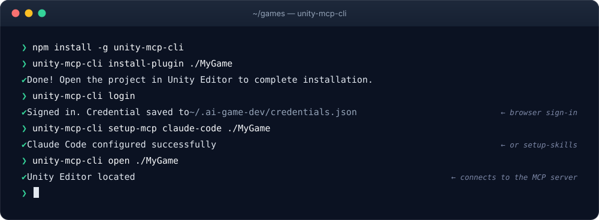
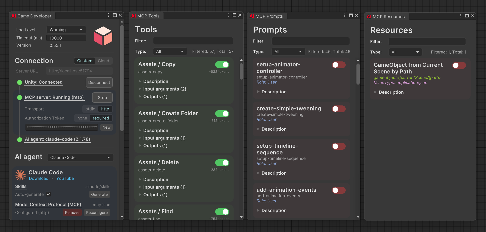

<div align="center" width="100%">

<p align="center"></p>

[](https://openupm.com/packages/com.ivanmurzak.unity.mcp/) [](https://openupm.com/packages/com.ivanmurzak.unity.mcp/) [](https://www.npmjs.com/package/unity-mcp-cli) [](https://unity.com/releases/editor/archive)\
[](https://github.com/IvanMurzak/Unity-MCP/actions/workflows/release.yml) [](https://discord.gg/cfbdMZX99G) [](https://github.com/IvanMurzak/Unity-MCP/blob/main/LICENSE) [](https://stand-with-ukraine.pp.ua)

  <p>
    <a href="https://claude.ai/download"></a>&nbsp;&nbsp;
    <a href="https://openai.com/index/introducing-codex/"></a>&nbsp;&nbsp;
    <a href="https://www.cursor.com/"></a>&nbsp;&nbsp;
    <a href="https://code.visualstudio.com/docs/copilot/overview"></a>&nbsp;&nbsp;
    <a href="https://gemini.google.com/"></a>&nbsp;&nbsp;
    <a href="https://antigravity.google/"></a>&nbsp;&nbsp;
    <a href="https://code.visualstudio.com/"></a>&nbsp;&nbsp;
    <a href="https://www.jetbrains.com/rider/"></a>&nbsp;&nbsp;
    <a href="https://visualstudio.microsoft.com/"></a>&nbsp;&nbsp;
    <a href="https://opencode.ai/"></a>&nbsp;&nbsp;
    <a href="https://github.com/cline/cline"></a>&nbsp;&nbsp;
    <a href="https://github.com/Kilo-Org/kilocode"></a>
  </p>

  <b>[English](https://github.com/IvanMurzak/Unity-MCP/blob/main/README.md) | [中文](https://github.com/IvanMurzak/Unity-MCP/blob/main/docs/README.zh-CN.md) | [日本語](https://github.com/IvanMurzak/Unity-MCP/blob/main/docs/README.ja.md) | [Español](https://github.com/IvanMurzak/Unity-MCP/blob/main/docs/README.es.md) | [فارسی](https://github.com/IvanMurzak/Unity-MCP/blob/main/docs/README.fa.md) | [العربية](https://github.com/IvanMurzak/Unity-MCP/blob/main/docs/README.ar.md)</b>

</div>

**AI Game Developer** (Unity-MCP) आपके AI एजेंट को Unity से जोड़ता है। Claude Code, Codex, Cursor, GitHub Copilot, Gemini या कोई भी दूसरा [MCP](https://modelcontextprotocol.io/) क्लाइंट **Unity Editor** में सीन, प्रीफ़ैब, एसेट और C# कोड पढ़ और बदल सकता है, टेस्ट चला सकता है और स्क्रीनशॉट ले सकता है, और **आपके कंपाइल किए गए गेम के अंदर** आपके लिखे टूल कॉल कर सकता है। यह एक मुफ़्त Unity पैकेज (`com.ivanmurzak.unity.mcp`), एक कमांड-लाइन टूल (`unity-mcp-cli`) और वैकल्पिक एक्सटेंशन के रूप में आता है।

**स्थिति:** [नवीनतम रिलीज़](https://github.com/IvanMurzak/Unity-MCP/releases/latest) और [चेंजलॉग](https://github.com/IvanMurzak/Unity-MCP/blob/main/Unity-MCP-Plugin/Packages/com.ivanmurzak.unity.mcp/CHANGELOG.md)। प्लगइन और `unity-mcp-cli` का वर्ज़न एक ही होता है। **Windows, macOS और Linux** पर टेस्ट किया गया और समर्थित। Unity **2022.3** या नया चाहिए; CI Unity 2022.3, 6000.0, 6000.3 और 6000.6 पर EditMode, PlayMode और स्टैंडअलोन-बिल्ड टेस्ट चलाता है।

## यह कैसे काम करता है

<p align="center"></p>

प्लगइन अपने टूल एक MCP सर्वर में रजिस्टर करता है; आपका एजेंट उन्हें उसी सर्वर के ज़रिए कॉल करता है। MCP टूल की जगह एजेंट जनरेट किए गए **Skills** भी इस्तेमाल कर सकता है। सर्वर कहाँ चले, यह आप चुनते हैं:

| | **Local** (Custom मोड, अकाउंट नहीं) | **Cloud** (डिफ़ॉल्ट सेटिंग) |
| --- | --- | --- |
| सर्वर | [GameDev-MCP-Server](https://github.com/IvanMurzak/GameDev-MCP-Server), जिसे प्लगइन `127.0.0.1` पर शुरू करता है, या आपका होस्ट किया हुआ | `https://ai-game.dev/mcp` |
| अकाउंट | ज़रूरत नहीं | ai-game.dev पर साइन इन करें |
| आपके प्रोजेक्ट का डेटा | आपकी मशीन पर ही रहता है | टूल कॉल एक stateless रिले से होकर जाते हैं, जो उनकी सामग्री की न जाँच करता है न उसे संग्रहीत करता है; रिले इवेंट मेटाडेटा दर्ज करता है ([गोपनीयता नीति](https://ai-game.dev/legal/privacy)) |
| लागत | मुफ़्त | मुफ़्त |

**Cloud डिफ़ॉल्ट क्यों है:** इसमें कोई पोर्ट खोलने की ज़रूरत नहीं होती, यह दूसरे प्रोग्रामों के साथ पोर्ट टकराव से बचाता है, और यह मुफ़्त है। ऑफ़लाइन या एयर-गैप्ड काम के लिए Local एक बराबर का विकल्प है। विवरण: [सुरक्षा और गोपनीयता](#सुरक्षा-और-गोपनीयता)।

## विशेषताएँ

✅ **Editor को कवर करता है** — Unity Editor में आप जो कुछ कर सकते हैं, एजेंट लगभग वह सब कर सकता है\
✅ **कॉम्पैक्ट और कुशल** — एजेंटों के लिए बने टूल: कम कॉल और कम टोकन, ताकि एजेंट तेज़ी से और सस्ते में काम करे ([मापा गया](https://github.com/IvanMurzak/RQL/blob/main/RESULTS.md#33-rql-vs-conventional-reflection-tools))\
✅ **RQL** — एक ही क्वेरी भाषा से सीन, ऑब्जेक्ट, एसेट और सेटिंग्स पढ़ें और बदलें\
✅ **C# और टेस्ट** — Roslyn से C# कंपाइल और रन करें; EditMode और PlayMode टेस्ट चलाएँ\
✅ **Skills या MCP** — एक क्लिक में Skills बनाएँ, या MCP क्लाइंट के रूप में जोड़ें\
✅ **कोई भी एजेंट** — Claude Code, Codex, Cursor, Copilot, Gemini और दूसरे MCP क्लाइंट\
✅ **Runtime** — बने हुए गेम के अंदर वही टूल: NPC लॉजिक, लाइव डीबगिंग\
✅ **अपने टूल** — कोई भी C# मेथड एक `[AiTool]` एट्रिब्यूट से टूल बन जाता है\
✅ **CLI** — टर्मिनल या CI से इंस्टॉल, ओपन, क्वेरी, कंपाइल और टेस्ट करें\
✅ **एक्सटेंशन** — Animation से Timeline तक वैकल्पिक टूल पैक

## जल्दी शुरू करें

**Unity 2022.3** या नया चाहिए।

**1. प्लगइन इंस्टॉल करें** (सुझाया गया: इंस्टॉलर, इसके अलावा कुछ इंस्टॉल नहीं करना पड़ता):

[](https://github.com/IvanMurzak/Unity-MCP/releases/latest/download/AI-Game-Dev-Installer.unitypackage)

प्रोजेक्ट खुला रखते हुए डाउनलोड किया गया `.unitypackage` खोलें (उस पर डबल-क्लिक करें, या **Assets ▸ Import Package ▸ Custom Package**)।

<details>
<summary>इंस्टॉल करने के दूसरे तरीके: OpenUPM / Package Manager, या स्क्रिप्टिंग और CI के लिए CLI</summary>

- **OpenUPM** — `openupm add com.ivanmurzak.unity.mcp`, या बिना किसी CLI के: **Edit ▸ Project Settings ▸ Package Manager** में एक scoped registry जोड़ें (URL `https://package.openupm.com`, scopes `com.ivanmurzak` और `extensions.unity`), फिर **Window ▸ Package Manager ▸ + ▸ Add package by name** → `com.ivanmurzak.unity.mcp`।
- **unity-mcp-cli** (Node.js 22.14+) — स्क्रिप्ट और CI के लिए, Editor की ज़रूरत नहीं:

  ```bash
  npm install -g unity-mcp-cli
  unity-mcp-cli install-plugin ./MyUnityProject   # प्लगइन को Packages/manifest.json में जोड़ें
  unity-mcp-cli open ./MyUnityProject             # प्रोजेक्ट को Unity में खोलें
  ```

  <p align="center"></p>

</details>

**2. अपना एजेंट जोड़ें** — कोई एक चुनें; दोनों पूरी तरह समर्थित हैं:

| | **Local** (अकाउंट नहीं) | **Cloud** (डिफ़ॉल्ट सेटिंग) |
| --- | --- | --- |
| **Window ▸ AI Game Dev** में | कनेक्शन **Custom** | कनेक्शन **Cloud**, फिर **Authorize** (ब्राउज़र में साइन इन) |
| एजेंट कॉन्फ़िग | अपने एजेंट के लिए **Configure** | अपने एजेंट के लिए **Configure** |
| CLI से यही | `unity-mcp-cli setup-mcp claude-code ./MyUnityProject --transport stdio` | `unity-mcp-cli login`, फिर `unity-mcp-cli setup-mcp claude-code ./MyUnityProject` |

उसी विंडो में Skills के लिए **Auto-generate** MCP का विकल्प है। दूसरे एजेंट: [क्लाइंट सेटअप](#क्लाइंट-सेटअप)।

**3. केवल Local: चुनें कि आपके टूल कौन कॉल कर सकता है।** लोकल सर्वर auth `none` के साथ शुरू होता है: यह केवल `127.0.0.1` पर सुनता है और बाहरी ब्राउज़र origin अस्वीकार करता है, लेकिन आपकी मशीन का कोई भी प्रोग्राम उस तक पहुँच सकता है। अगर मशीन का उपयोग दूसरे लोग या अविश्वसनीय प्रोग्राम करते हैं, तो एक कदम में `token` पर स्विच करें: **Window ▸ AI Game Dev** → **Authorization Token** → `token`। सर्वर एक जनरेट किए गए सीक्रेट के साथ फिर से शुरू होता है; **Configure** फिर से दबाएँ ताकि आपका एजेंट उसे भेजे।



अपने एजेंट से कहें *"त्रिज्या 2 वाले वृत्त पर 3 क्यूब बनाओ"* और इसे होते देखें। पूरे चरण, मैनुअल MCP कॉन्फ़िगरेशन और अनइंस्टॉल: **[इंस्टॉलेशन गाइड](installation.hi.md)**।

https://github.com/user-attachments/assets/228baf4d-4f00-4dce-939d-fb985ebdd8dd

## उपयोग

**अपने एजेंट से बात करें।** जो नतीजा चाहिए उसका वर्णन करें; जितना सटीक, उतना बेहतर।

```text
मेरे सीन की हायरार्की समझाओ
धातु जैसा सुनहरा मटीरियल बनाओ और उसे एक नए स्फ़ीयर पर लगाओ
Rigidbody के बिना हर दुश्मन प्रीफ़ैब ढूँढो और उसमें एक जोड़ो
```

**आपका एजेंट क्या कर सकता है** (डिफ़ॉल्ट रूप से दिखने वाले टूल):

| क्षमता | टूल | उदाहरण प्रॉम्प्ट |
| --- | --- | --- |
| सीन और GameObject | `rql-query`, `rql-mutate` | *"खुले सीन में हर निष्क्रिय GameObject की सूची दो"* |
| एसेट और प्रीफ़ैब | `rql-query`, `rql-mutate` | *"एक लाल मटीरियल बनाओ और उसे सभी क्यूब पर लगाओ"* |
| कंसोल और Editor की स्थिति | `rql-query` | *"कंसोल में कौन-सी एरर हैं?"* |
| Editor में C# | `script-execute` | *"ऐसा C# चलाओ जो टेरेन पर रैंडम जगहों पर 100 पेड़ रखे"* |
| टेस्ट | `tests-run` | *"EditMode टेस्ट चलाओ और जो फ़ेल हों उन्हें ठीक करो"* |
| स्क्रीनशॉट | `screenshot-isolated` | *"मुझे Player मॉडल सामने से दिखाओ"* |
| पैकेज और Asset Store | `package-*`, `assetstore-*` | *"Cinemachine इंस्टॉल करो"* |
| टूल की सूची | `unity-tool-list` | *"तुम यहाँ कौन-से टूल इस्तेमाल कर सकते हो?"* |

आपको RQL सीखने की ज़रूरत नहीं: एजेंट उसे खुद लिखता है और जिस भी सोर्स, टाइप और कॉल की उसे ज़रूरत हो, उसके लिए `rql-schema` से पूछता है। एक सैंडबॉक्स गेम वर्ल्ड पर मापा गया: RQL के साथ एजेंट को प्रति टास्क लगभग 2–3 टूल कॉल और 7–8k टोकन लगते हैं और सफलता 100% रहती है, जबकि साधारण रिफ़्लेक्शन टूल के साथ 30–37 कॉल और 125–170k टोकन लगते हैं और सफलता 67–91% रहती है ([नतीजे](https://github.com/IvanMurzak/RQL/blob/main/RESULTS.md#33-rql-vs-conventional-reflection-tools))। और टूल इंस्टॉल हैं पर जब तक आप उन्हें न दिखाएँ, छिपे रहते हैं। पूरी सूची: **[डिफ़ॉल्ट MCP टूल](default-mcp-tools.hi.md)** या [ai-game.dev/docs/tools](https://ai-game.dev/docs/tools)।

**टर्मिनल से** (कोई एडिटर न चल रहा हो तो एक हेडलेस एडिटर शुरू करता है):

```bash
unity-mcp-cli rql 'objects | where name starts-with "Tree" | count'
unity-mcp-cli compile ./MyGame
unity-mcp-cli test ./MyGame --mode PlayMode
```

**आपका अपना टूल।** `[AiToolType]` वाली एक क्लास और `[AiTool]` वाला एक मेथड काफ़ी है:

```csharp
[AiToolType]
public class Tool_Score
{
    [AiTool("score-reset", Title = "Reset the score")]
    [Description("Sets the player's score to zero.")]
    public string Reset()
    {
        return MainThread.Instance.Run(() =>
        {
            ScoreManager.Instance.Score = 0;
            return "[Success] Score reset.";
        });
    }
}
```

प्रॉम्प्ट, रनटाइम (गेम के अंदर) टूल और पूरा उदाहरण: **[कस्टम टूल और रनटाइम](custom-tools.hi.md)**।

## क्लाइंट सेटअप

AI Game Developer विंडो का **Configure** बटन, या `unity-mcp-cli setup-mcp <agent> ./MyUnityProject`, ये फ़ाइलें आपके लिए लिख देता है (डिफ़ॉल्ट रूप से Cloud, `--transport stdio` के साथ लोकल)। लोकल सर्वर के लिए हाथ से: प्लगइन को **Custom** पर सेट करें, विंडो से `<port>` लें, और अपने प्लेटफ़ॉर्म की बाइनरी `<project>/Library/mcp-server/<rid>/` से इस्तेमाल करें (`win-x64/gamedev-mcp-server.exe`, `osx-arm64/gamedev-mcp-server`, `linux-x64/gamedev-mcp-server`, …)।

<details>
<summary><b>Claude Code</b> — प्रोजेक्ट रूट में <code>.mcp.json</code></summary>

```json
{
  "mcpServers": {
    "ai-game-developer": {
      "command": "<project>/Library/mcp-server/win-x64/gamedev-mcp-server.exe",
      "args": ["port=<port>", "client-transport=stdio"]
    }
  }
}
```

</details>

<details>
<summary><b>Cursor</b> — <code>.cursor/mcp.json</code></summary>

```json
{
  "mcpServers": {
    "ai-game-developer": {
      "type": "stdio",
      "command": "<project>/Library/mcp-server/win-x64/gamedev-mcp-server.exe",
      "args": ["port=<port>", "client-transport=stdio"]
    }
  }
}
```

</details>

<details>
<summary><b>Codex</b> — <code>.codex/config.toml</code></summary>

```toml
[mcp_servers.ai-game-developer]
enabled = true
command = "<project>/Library/mcp-server/win-x64/gamedev-mcp-server.exe"
args = ["port=<port>", "client-transport=stdio"]
tool_timeout_sec = 300
```

</details>

दूसरे एजेंट और मैनुअल सेटअप: [इंस्टॉलेशन गाइड](installation.hi.md)।

## सुरक्षा और गोपनीयता

**सबसे निजी सेटअप:** कनेक्शन **Custom** (`127.0.0.1` पर लोकल सर्वर, अकाउंट नहीं, प्रोजेक्ट का डेटा आपकी मशीन पर ही रहता है), साथ में **Window ▸ AI Game Dev** में **Authorization Token** को `token` पर सेट करें, फिर **Configure** दोबारा दबाएँ ताकि आपका एजेंट सीक्रेट भेजे।

✅ **प्लगइन कोई पोर्ट नहीं खोलता** — यह MCP सर्वर से बाहर की ओर कनेक्ट होता है।\
✅ **लूपबैक पर लोकल सर्वर** — `gamedev-mcp-server` `127.0.0.1` पर बाइंड होता है, जब तक आप होस्टिंग के लिए `MCP_BIND` सेट न करें।\
✅ **Origin जाँच** — जिन ब्राउज़र अनुरोधों का `Origin` अनुमत नहीं है, वे हर auth मोड में अस्वीकार (403) होते हैं।\
✅ **Auth मोड** — `none` (लोकल डिफ़ॉल्ट), `token` (एक साझा सीक्रेट जिसे एजेंट और प्लगइन दोनों को भेजना होगा), `oauth` (ai-game.dev अकाउंट)।\
✅ **Cloud रिले** — एक stateless रिले: यह आपके एजेंट और Editor के बीच टूल कॉल पहुँचाता है, उनकी सामग्री की जाँच या संग्रह किए बिना, और बातचीत, सोर्स कोड, प्रोजेक्ट फ़ाइलें, एसेट या सीन डेटा एकत्र नहीं करता। यह MCP इवेंट मेटाडेटा (इवेंट का प्रकार, समय, स्थिति, सेशन पहचानकर्ता, टूल, प्रॉम्प्ट या रिसोर्स का नाम, त्रुटि विवरण) दर्ज करता है, जिसका उपयोग 90 दिनों की रोलिंग अवधि के भीतर होता है ([गोपनीयता नीति](https://ai-game.dev/legal/privacy))।\
⚠️ **सुरक्षित नहीं** — `none` मोड में आपकी मशीन की कोई भी प्रोसेस जो पोर्ट तक पहुँचती है, टूल कॉल कर सकती है, और टूल Editor के अधिकारों के साथ चलते हैं (`script-execute` C# चलाता है)। साझा मशीनों पर `token` मोड इस्तेमाल करें।

सर्वर विकल्प और Docker: [MCP सर्वर और कनेक्शन](mcp-server.hi.md)।

## एक्सटेंशन

एक्सटेंशन वैकल्पिक UPM पैकेज हैं जो Unity की खास सुविधाओं के लिए टूल जोड़ते हैं।

```bash
unity-mcp-cli install-extension com.ivanmurzak.unity.mcp.cinemachine ./MyUnityProject
```

| एक्सटेंशन | क्या जोड़ता है | ज़रूरत |
| --- | --- | --- |
| [Animation](https://github.com/IvanMurzak/Unity-MCP/blob/main/extensions/Animation/README.md) | AnimationClip और AnimatorController |  |
| [Cinemachine](https://github.com/IvanMurzak/Unity-MCP/blob/main/extensions/Cinemachine/README.md) | वर्चुअल कैमरा, टारगेट और कैमरा पाइपलाइन | `com.unity.cinemachine` 3.1.6+ |
| [InputSystem](https://github.com/IvanMurzak/Unity-MCP/blob/main/extensions/InputSystem/README.md) | इनपुट एक्शन एसेट, मैप, एक्शन और बाइंडिंग | `com.unity.inputsystem` 1.8.2+ |
| [Navigation](https://github.com/IvanMurzak/Unity-MCP/blob/main/extensions/Navigation/README.md) | NavMesh सरफ़ेस, बेकिंग, एजेंट और लिंक | `com.unity.ai.navigation` 1.1.7+ |
| [ParticleSystem](https://github.com/IvanMurzak/Unity-MCP/blob/main/extensions/ParticleSystem/README.md) | ParticleSystem का एमिशन, शेप, कर्व और ग्रेडिएंट |  |
| [ProBuilder](https://github.com/IvanMurzak/Unity-MCP/blob/main/extensions/ProBuilder/README.md) | एडिट करने योग्य मेश: शेप, एक्सट्रूड, बेवल, मटीरियल | `com.unity.probuilder` 5.2.4+ |
| [Splines](https://github.com/IvanMurzak/Unity-MCP/blob/main/extensions/Splines/README.md) | स्प्लाइन कंटेनर, नॉट और टैंजेंट | `com.unity.splines` 2.8.4+ |
| [Terrain](https://github.com/IvanMurzak/Unity-MCP/blob/main/extensions/Terrain/README.md) | टेरेन: हाइटमैप, स्कल्प्टिंग और सैंपलिंग |  |
| [Tilemap](https://github.com/IvanMurzak/Unity-MCP/blob/main/extensions/Tilemap/README.md) | Grid और Tilemap: टाइल पेंट, फ़िल और पढ़ना | `com.unity.2d.tilemap.extras` 3.1.3+ |
| [Timeline](https://github.com/IvanMurzak/Unity-MCP/blob/main/extensions/Timeline/README.md) | Timeline एसेट, ट्रैक, क्लिप और मार्कर | `com.unity.timeline` 1.8.12+ |

ज़रूरी Unity पैकेज एक्सटेंशन के साथ इंस्टॉल हो जाते हैं। आप AI Game Developer विंडो के **Extensions** सेक्शन से भी एक्सटेंशन इंस्टॉल कर सकते हैं।

## दस्तावेज़

| पेज | इसमें क्या है |
| --- | --- |
| [इंस्टॉलेशन गाइड](installation.hi.md) | इंस्टॉल के विकल्प, एजेंट जोड़ना, मैनुअल MCP कॉन्फ़िग, टीम सेटिंग्स, अनइंस्टॉल |
| [डिफ़ॉल्ट MCP टूल](default-mcp-tools.hi.md) | हर बिल्ट-इन टूल, RQL सोर्स, 1.0.0 में हटाए गए टूल और उनके RQL विकल्प |
| [कस्टम टूल और रनटाइम](custom-tools.hi.md) | टूल और प्रॉम्प्ट लिखें; अपने गेम के अंदर MCP इस्तेमाल करें |
| [MCP सर्वर और कनेक्शन](mcp-server.hi.md) | Cloud और Custom मोड, प्लगइन एनवायरनमेंट वेरिएबल, लोकल सर्वर |
| [Docker डिप्लॉयमेंट](DOCKER_DEPLOYMENT.hi.md) | MCP सर्वर को कंटेनर में चलाएँ |
| [CI में बंद करें](ci-disable.hi.md) | प्लगइन को सामान्य CI टेस्ट रन से बाहर रखें |
| [CLI संदर्भ](../cli/docs/README.hi.md) | `unity-mcp-cli` के सभी कमांड और विकल्प |
| [Wiki](https://github.com/IvanMurzak/Unity-MCP/wiki) | ट्यूटोरियल, गाइड और FAQ |
| [डेवलपमेंट गाइड](dev/Development.hi.md) | योगदानकर्ताओं के लिए रिपॉज़िटरी संरचना, कोड स्टाइल, टेस्ट और CI |

संबंधित: [GameDev-MCP-Server](https://github.com/IvanMurzak/GameDev-MCP-Server) (साझा MCP सर्वर) · [ai-game.dev](https://ai-game.dev) · [Discord](https://discord.gg/cfbdMZX99G)

## योगदान

विचार, बग रिपोर्ट और पुल रिक्वेस्ट का स्वागत है। [डेवलपमेंट गाइड](dev/Development.hi.md) पढ़ें, रिपॉज़िटरी को fork करें, Unity में `./Unity-MCP-Plugin` खोलें और `main` पर पुल रिक्वेस्ट भेजें। अगर प्रोजेक्ट आपके काम आए, तो इसे स्टार दें।

## लाइसेंस

**गेम डेवलपमेंट के लिए मुफ़्त, व्यावसायिक गेम सहित।** प्लगइन [Apache-2.0](https://github.com/IvanMurzak/Unity-MCP/blob/main/LICENSE) के तहत है। यह [RQL](https://github.com/IvanMurzak/RQL) और [Code-Exec](https://github.com/IvanMurzak/Code-Exec) का उपयोग करता है, जो PolyForm Shield 1.0.0 के तहत लाइसेंस हैं: यह लाइसेंस केवल उन कंपनियों पर रोक लगाता है जो गेम डेवलपमेंट के लिए प्रतिस्पर्धी AI टूल बनाती हैं। गेम डेवलपर सब कुछ स्वतंत्र रूप से इस्तेमाल कर सकते हैं।
