[English](benchmark.md) | <b>中文</b> | [日本語](benchmark.ja.md) | [Español](benchmark.es.md) | [فارسی](benchmark.fa.md) | [हिन्दी](benchmark.hi.md) | [العربية](benchmark.ar.md)

# 基准测试：Unity 编辑器中的紧凑工具

返回 [README](README.zh-CN.md)。

AI Game Developer 为智能体提供少量基于 **RQL**（一种针对编辑器数据的查询语言）构建的紧凑工具，而不是每个操作对应一个工具。我们在真实的 Unity 编辑器中，用两套工具集运行了相同的任务。智能体完成的任务数量相同，但**提示 token 约少 5 倍**，轮次和工具调用更少，每个任务完成得也更快。在沙盒游戏世界中进行的第二项规模更大的测试也呈现出相同的规律。

## 关键数据（Unity 编辑器）

| 5.3× | −31% | −39% | 59 / 60 |
| :---: | :---: | :---: | :---: |
| 每个任务的提示 token 减少倍数 | 每个任务的工具调用 | 每个任务的耗时 | 完成的任务数（两套工具集相同） |

## Unity 编辑器结果

| 指标 | 逐操作工具 | RQL 工具 |
| --- | ---: | ---: |
| 完成的任务（任务检查通过，且无意外更改） | 59 / 60 | 59 / 60 |
| 每个任务的提示 token | 138,272 | **26,013** |
| 每个任务的补全 token | 673 | **306** |
| 每个任务的模型轮次 | 5.4 | **4.1** |
| 每个任务的工具调用 / 错误 | 5.5 / 0.5 | **3.8 / 0.2** |
| 每个任务的工具结果大小（字符） | 6,273 | **657** |
| 每次请求附带的工具定义（字符） | 93,194 | **22,439** |
| 每个任务的实际耗时 | 8.8 s | **5.4 s** |
| 每个任务的工具执行时间 | 169 ms | **42 ms** |
| 每个任务的成本 | 1× | **约 ⅓** |

**为什么更便宜。** 差距主要来自两处：智能体每次请求收到的工具定义小了 4.2 倍，工具结果小了 9.5 倍。对于批量和查询类任务，逐操作工具集会退而编写 C#（所有运行中共调用 `script-execute` 68 次，而使用 RQL 时为 7 次）；使用 RQL 时，智能体只需编写一条查询。

**对照运行。** 在完成扩展迁移和核心修复（所有者链的撤销、资源路径、`unity.find`、数字格式化）之后，RQL 工具集完成了 **60 / 60** 个任务，每个任务使用 23,274 个提示 token、3.4 次工具调用，耗时 4.8 s。

## 沙盒游戏世界结果

RQL 项目在 Unity 之外单独评估这门语言：一个生成的游戏世界，以及一个使用 RQL 或普通反射工具（`find_objects`、以 JSON 转储形式返回的 `get_object`、`describe_type`、`set_value`、`call_method`）的智能体。最干净的检验使用了 30 个在所有调优冻结之后编写的新任务，只运行一轮，每个任务 3 次。

| 运行 | 完成的任务 | 每个任务的 token | 每个任务的工具调用 | 每次成功的成本 |
| --- | ---: | ---: | ---: | ---: |
| 反射工具，调优后编写的任务 | 66.7% | 169,190 | 36.9 | 40× |
| RQL，调优后编写的任务 | **100%** | **7,817** | **1.9** | **1×** |
| 反射工具，留出任务 | 91.4% | 125,566 | 34.0 | 22× |
| RQL，留出任务 | **100%** | **7,444** | **1.9** | **1×** |

反射工具失败的主要原因是在“搜索全部”类任务中耗尽步数：它们一次只能读取世界中的一个对象。

## 方法

**Unity 编辑器。** 在 Unity-MCP 0.93.4（启用全部工具，每个操作一个工具：`gameobject-*`、`assets-*`、`scene-*`、`object-*`、`console-get-logs`、`script-execute`、`tests-run`……）与 RQL 工具集（`rql-query`、`rql-mutate`、`rql-schema`、`script-execute`、`tests-run`、`screenshot-isolated`、`unity-tool-list`）之间对比测量。两者使用相同的测试框架、场景和模型：`deepseek-flash`，关闭推理，temperature 0。20 个任务 × 3 次运行，Unity 6000.6.4f1。每种条件都恰好获得 MCP 客户端看到的那些工具，包括其各自的名称、描述和输入 schema，并通过插件调用。只有当任务检查通过且场景中没有其他任何更改时，任务才算通过。

**沙盒。** 两种工具接口使用相同的任务、评分器、模型和预算，只有工具不同。模型为 DeepSeek V4.1-Flash，每个任务最多 12 步，每个任务运行 3 次。隐藏的评分器独立计算预期答案；修改类任务只要出现任何意外更改即判为失败。留出任务从未用于调优；第二组任务在调优冻结之后编写，并且只运行一轮。

## 注意事项

- **单一模型系列。** 两项测试都使用 DeepSeek 模型。其他模型的数据可能不同。
- **测量的版本。** Unity 编辑器的数据是在一个场景和一个 Unity 版本上，对比 Unity-MCP 0.93.4 与 RQL 工具集得出的；工具和模型会随时间变化。
- **样本量小。** 编辑器中每种条件 60 次运行；上述沙盒结果中每种条件 81 到 90 次运行。
- **同一作者。** RQL 任务和沙盒由该语言的作者设计。留出任务和调优后编写的任务集可以减轻这种偏差，但无法消除。
- **成本是一个比率。** 提示缓存使成本部分取决于其他流量；token 数量和工具调用是更稳定的指标。

## 原始数据

- Unity 编辑器报告：RQL 仓库中的 [`evaluation/reports/unity-mcp-old-vs-rql-branch.md`](https://github.com/IvanMurzak/RQL/blob/main/evaluation/reports/unity-mcp-old-vs-rql-branch.md)。
- 沙盒结果：[RQL `RESULTS.md`](https://github.com/IvanMurzak/RQL/blob/main/RESULTS.md) 的第 3.3 和 3.4 节，以及[评估方法](https://github.com/IvanMurzak/RQL/blob/main/docs/evaluation-methodology.md)。

两项测量均来自 [RQL](https://github.com/IvanMurzak/RQL) 项目的评估框架。
