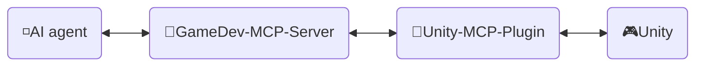
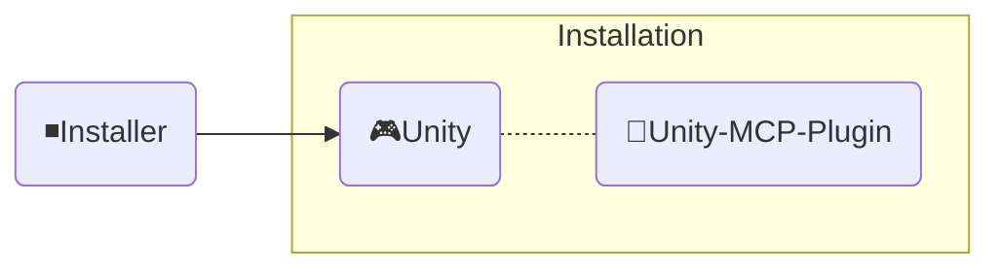

<div align="center" width="100%">
  <h1 dir="rtl">🛠️ التطوير ─ AI Game Developer</h1>

[](https://modelcontextprotocol.io/introduction)
[](https://openupm.com/packages/com.ivanmurzak.unity.mcp/)
[](https://hub.docker.com/r/aigamedeveloper/mcp-server)
[](https://unity.com/releases/editor/archive)
[](https://unity.com/releases/editor/archive)
[](https://github.com/IvanMurzak/Unity-MCP/actions/workflows/release.yml)</br>
[](https://discord.gg/cfbdMZX99G)
[](https://openupm.com/packages/com.ivanmurzak.unity.mcp/)
[](https://github.com/IvanMurzak/Unity-MCP/stargazers)
[](https://github.com/IvanMurzak/Unity-MCP/blob/main/LICENSE)
[](https://stand-with-ukraine.pp.ua)

  <span dir="rtl">[English](Development.md) | [中文](Development.zh-CN.md) | [日本語](Development.ja.md) | [Español](Development.es.md) | [فارسی](Development.fa.md) | [हिन्दी](Development.hi.md) | <b>العربية</b></span>

</div>

<div dir="rtl">

تشرح هذه الوثيقة البنية الداخلية لـ Unity-MCP وتصميمه وأسلوب كتابة الشيفرة فيه ومبادئه الرئيسية. استخدمها إذا كنت مساهمًا أو ترغب في فهم المشروع بعمق.

> **[💬 انضم إلى خادم Discord الخاص بنا](https://discord.gg/cfbdMZX99G)** - اطرح الأسئلة، واعرض أعمالك، وتواصل مع مطورين آخرين!

## المحتويات

- [الرؤية والأهداف](#الرؤية-والأهداف)
- [المتطلبات المسبقة](#المتطلبات-المسبقة)
- [إعداد بيئة التطوير المحلية](#إعداد-بيئة-التطوير-المحلية)
- [المساهمة](#المساهمة)
- [بنية المشاريع](#بنية-المشاريع)
  - [🔹خادم MCP (GameDev-MCP-Server المشترك)](#خادم-mcp-gamedev-mcp-server-المشترك)
    - [صورة Docker](#صورة-docker)
  - ‏[🔸Unity-MCP-Plugin](#unity-mcp-plugin)
    - [حزمة UPM](#حزمة-upm)
    - [المحرر](#المحرر)
    - [وقت التشغيل](#وقت-التشغيل)
    - [ميزات MCP](#ميزات-mcp)
      - [إضافة `MCP Tool`](#إضافة-mcp-tool)
      - [إضافة `MCP Prompt`](#إضافة-mcp-prompt)
  - [◾المثبّت (Unity)](#المثبّت-unity)
- [أسلوب كتابة الشيفرة](#أسلوب-كتابة-الشيفرة)
  - [الأعراف الرئيسية](#الأعراف-الرئيسية)
- [تشغيل الاختبارات](#تشغيل-الاختبارات)
  - [التشغيل محليًا](#التشغيل-محليًا)
  - [أوضاع الاختبار](#أوضاع-الاختبار)
  - [تفسير نتائج CI](#تفسير-نتائج-ci)
- ‏[CI/CD](#cicd)
  - [للمساهمين](#للمساهمين)
  - [نظرة عامة على سير العمل](#نظرة-عامة-على-سير-العمل)
    - ‏[🚀 release.yml](#-releaseyml)
    - ‏[🧪 test\_pull\_request.yml](#-test_pull_requestyml)
    - ‏[🔧 test\_unity\_plugin.yml](#-test_unity_pluginyml)
  - [حزمة التقنيات](#حزمة-التقنيات)
  - [اعتبارات الأمان](#اعتبارات-الأمان)
  - [أهداف النشر](#أهداف-النشر)

---

</div>


<div dir="rtl">

# الرؤية والأهداف

نؤمن بأن الذكاء الاصطناعي سيكون (إن لم يكن قد أصبح بالفعل) جزءًا مهمًا من تطوير الألعاب. هناك واجهات ذكاء اصطناعي مذهلة مثل `Claude` و`Copilot` و`Cursor` وغيرها الكثير، وهي تتحسن باستمرار. نحن نربط تطوير الألعاب *مع* هذه الأدوات، لا ضدها — فـ Unity MCP أساس لأنظمة الذكاء الاصطناعي في منظومة محرك Unity، وليس نافذة محادثة معزولة.

**أهداف المشروع**

- تقديم حل عالي الجودة لتطوير الألعاب بالذكاء الاصطناعي **مجانًا** للجميع
- توفير منصة قابلة للتخصيص بدرجة كبيرة لمطوري الألعاب كي يوسّعوا ميزات الذكاء الاصطناعي بحسب احتياجاتهم
- إتاحة استخدام أفضل أدوات الذكاء الاصطناعي لتطوير الألعاب، كلها في مكان واحد
- صيانة تقنيات الذكاء الاصطناعي المتطورة ودعمها، خصوصًا في محرك Unity وما بعده

---

</div>


<div dir="rtl">

# المتطلبات المسبقة

قبل المساهمة، تأكد من تثبيت الأدوات التالية:

| الأداة | الإصدار | الغرض |
| ---- | ------- | ------- |
| [Unity Editor](https://unity.com/releases/editor/archive) | 2022.3+ / 6000.0+ | تشغيل الإضافة واختبارها |
| [.NET SDK](https://dotnet.microsoft.com/download) | 9.0+ | بناء خادم MCP وتشغيله |
| [Node.js](https://nodejs.org/) | 18+ | تشغيل MCP Inspector لتصحيح الأخطاء |
| Python | 3.9+ | تنفيذ سكربتات البناء والأدوات المساعدة |
| Docker *(اختياري)* | الأحدث | بناء صور Docker واختبارها |

> رخصة Unity Personal المجانية كافية للمساهمة.

---

</div>


<div dir="rtl">

# إعداد بيئة التطوير المحلية

1. **استنسخ المستودع**

</div>

   ```bash
   git clone https://github.com/IvanMurzak/Unity-MCP.git
   cd Unity-MCP
   ```

<div dir="rtl">

2. **افتح الإضافة في Unity**
   - افتح Unity Hub ← Add project ← اختر المجلد `Unity-MCP-Plugin/`
   - سيترجم Unity كل التجميعات (assemblies) تلقائيًا عند الفتح الأول

3. **احصل على خادم MCP** *(يوجد في مستودعه الخاص)*
   - الخادم هو [GameDev-MCP-Server](https://github.com/IvanMurzak/GameDev-MCP-Server) المشترك — استنسخه بشكل منفصل إذا احتجت إلى تعديل الخادم نفسه أو تصحيح أخطائه
   - تنزّل الإضافة تلقائيًا الملف التنفيذي للإصدار المثبّت بواسطة الثابت `ServerVersion` في `McpServerManager.cs`، لذا لا حاجة إلى أي شيء هنا لتطوير الإضافة وحدها

4. **شغّل الخادم محليًا** *(اختياري — فقط عند التطوير مقابل نسخة مخصصة من الخادم)*

</div>

   ```bash
   git clone https://github.com/IvanMurzak/GameDev-MCP-Server.git
   cd GameDev-MCP-Server
   dotnet run --project com.IvanMurzak.GameDev.MCP.Server.csproj -- --port 8080 --client-transport stdio
   ```

<div dir="rtl">

5. **وجّه الإضافة إلى خادمك المحلي** *(اختياري — يتخطى الملف التنفيذي المنزّل تلقائيًا)*
   - في Unity: افتح `Window/AI Game Dev`
   - اضبط المنفذ ليطابق خادمك المحلي (`8080` افتراضيًا)
   - ستتصل الإضافة تلقائيًا

6. **صحّح الأخطاء باستخدام MCP Inspector** *(اختياري)*

</div>

   ```bash
   Unity-MCP-Plugin/Commands/start_mcp_inspector.bat   # Windows (.bat)
   ```

<div dir="rtl">

   يتطلب Node.js. يفتح واجهة في المتصفح على `http://localhost:5173` للفحص المباشر لرسائل بروتوكول MCP.

---

</div>


<div dir="rtl">

# المساهمة

لنبنِ معًا مستقبلًا مشرقًا لتطوير الألعاب، وساهم في المشروع. استخدم هذه الوثيقة لفهم بنية المشروع وكيف يعمل بالضبط.

1. [انسخ المشروع (Fork)](https://github.com/IvanMurzak/Unity-MCP/fork)
2. أجرِ تحسيناتك، والتزم بأسلوب كتابة الشيفرة
3. [أنشئ Pull Request](https://github.com/IvanMurzak/Unity-MCP/compare)

</div>


<div dir="rtl">

# بنية المشاريع

</div>



<div dir="rtl">

‏◽**AI agent** - أي واجهة ذكاء اصطناعي مثل: *Claude* أو *Copilot* أو *Cursor* أو غيرها، وهي ليست جزءًا من هذه المشاريع، لكنها عنصر مهم في البنية المعمارية.

‏🔹**GameDev-MCP-Server** - `MCP Server` المشترك (يوجد في مستودعه الخاص: [GameDev-MCP-Server](https://github.com/IvanMurzak/GameDev-MCP-Server)) الذي يتصل بـ `AI agent` ويعمل معه. يتواصل مع `Unity-MCP-Plugin` عبر SignalR. يمكن تشغيله محليًا أو في السحابة مع نقل HTTP. حزمة التقنيات: `C#`، `ASP.NET Core`، `SignalR`

‏🔸**Unity-MCP-Plugin** - `Unity Plugin` يُدمج في مشروع Unity، ولديه وصول إلى واجهة Unity البرمجية. يتواصل مع `GameDev-MCP-Server` المشترك وينفّذ الأوامر الواردة من الخادم. حزمة التقنيات: `C#`، `Unity`، `SignalR`

‏🎮**Unity** - محرك Unity، محرك الألعاب.

---

## 🔹خادم MCP (GameDev-MCP-Server المشترك)

تطبيق C# ASP.NET Core يعمل كجسر بين وكلاء الذكاء الاصطناعي (واجهات ذكاء اصطناعي مثل Claude وCursor) ونسخ محرر Unity. ينفّذ الخادم [Model Context Protocol](https://github.com/modelcontextprotocol) باستخدام [csharp-sdk](https://github.com/modelcontextprotocol/csharp-sdk).

> موقع المشروع: المستودع المشترك [GameDev-MCP-Server](https://github.com/IvanMurzak/GameDev-MCP-Server) — خادم واحد مستقل عن المحرك يستهلكه Unity-MCP وGodot-MCP وUnreal-MCP. وهو **لم يعد جزءًا من هذا المستودع**.

**المسؤوليات الرئيسية** (راجع [README الخاص بـ GameDev-MCP-Server](https://github.com/IvanMurzak/GameDev-MCP-Server#readme) للتفاصيل):

1. **تنفيذ بروتوكول MCP** — الأدوات والموجّهات والموارد عبر نقل STDIO وHTTP
2. **التواصل عبر SignalR Hub** — تواصل ثنائي الاتجاه في الوقت الفعلي مع إضافة المحرك، بما في ذلك مصافحة الإصدار
3. **توجيه الطلبات وتنفيذها** — يوجّه طلبات وكيل الذكاء الاصطناعي إلى نسخة الإضافة المتصلة
4. **خدمة التنفيذ عن بُعد** — طلب/استجابة غير متزامنة مع المهل والإلغاء
5. **إدارة دورة حياة الخادم** — الاستضافة عبر Kestrel، والتسجيل عبر NLog، والإيقاف اللطيف

تنزّل الإضافة الملف التنفيذي للإصدار (`gamedev-mcp-server-<rid>.zip`) المثبّت بواسطة الثابت `ServerVersion` في [McpServerManager.cs](../../Unity-MCP-Plugin/Packages/com.ivanmurzak.unity.mcp/Editor/Scripts/McpServerManager.cs). رفع إصدار الخادم المستهلَك = تغيير ذلك الثابت؛ ويجب أن يكون الإصدار المقابل `v<ServerVersion>` موجودًا مسبقًا في GameDev-MCP-Server.

### صورة Docker

يُنشر الخادم المشترك على Docker Hub باسم [`aigamedeveloper/mcp-server`](https://hub.docker.com/r/aigamedeveloper/mcp-server) من مستودع GameDev-MCP-Server.

---

## 🔸Unity-MCP-Plugin

يندمج في بيئة Unity. يستخدم `Unity-MCP-Common` للبحث عن *Tool* و*Resource* و*Prompt* الخاصة بـ MCP في قاعدة الشيفرة المحلية باستخدام الانعكاس (reflection). يتواصل مع `GameDev-MCP-Server` المشترك لإرسال التحديثات عن *Tool* و*Resource* و*Prompt* الخاصة بـ MCP. يتلقى الأوامر من الخادم وينفّذها.

> موقع المشروع: `Unity-MCP-Plugin`

### حزمة UPM

‏`Unity-MCP-Plugin` حزمة UPM، ويقع المجلد الجذر للحزمة في . يحتوي على `package.json`، الذي يُستخدم لرفع الحزمة مباشرةً من إصدار GitHub إلى [OpenUPM](https://openupm.com/).

> الموقع `Unity-MCP-Plugin/Packages/com.ivanmurzak.unity.mcp`

### المحرر

يوفر مكوّن Editor التكامل مع محرر Unity، وينفّذ قدرات MCP (الأدوات والموجّهات والموارد) ويدير دورة حياة `GameDev-MCP-Server` المحلي.

> الموقع `Unity-MCP-Plugin/Packages/com.ivanmurzak.unity.mcp/Editor`

**المسؤوليات الرئيسية:**

1. **إدارة دورة حياة الإضافة** ([Startup.cs](../../Unity-MCP-Plugin/Packages/com.ivanmurzak.unity.mcp/Editor/Scripts/Startup.cs))
   - تهيئة تلقائية عند تحميل محرر Unity عبر `[InitializeOnLoad]`
   - إدارة استمرارية الاتصال عبر أحداث دورة حياة المحرر (إعادة تحميل التجميعات، والانتقالات بين أوضاع التشغيل)
   - إعادة اتصال تلقائية بعد إعادة تحميل النطاق أو الخروج من وضع Play

2. **إدارة الملف التنفيذي لخادم MCP** ([McpServerManager.cs](../../Unity-MCP-Plugin/Packages/com.ivanmurzak.unity.mcp/Editor/Scripts/McpServerManager.cs))
   - تنزيل الملف التنفيذي لـ `GameDev-MCP-Server` المشترك وإدارته من إصداراته على GitHub (مثبّت بواسطة الثابت `ServerVersion`)
   - اختيار الملف التنفيذي عبر المنصات (Windows/macOS/Linux، x86/x64/ARM/ARM64)
   - فرض توافق الإصدارات بين الخادم والإضافة
   - توليد الإعدادات لوكلاء الذكاء الاصطناعي (JSON بمسارات الملفات التنفيذية وإعدادات الاتصال)

3. **تنفيذ واجهة MCP البرمجية** ([Scripts/API/](../../Unity-MCP-Plugin/Packages/com.ivanmurzak.unity.mcp/Editor/Scripts/API/))
   - **الأدوات** (50+): GameObject، Scene، Assets، Prefabs، Scripts، Components، Editor Control، Test Runner، Console، Reflection
   - **الموجّهات**: قوالب جاهزة لمهام تطوير Unity الشائعة
   - **الموارد**: وصول قائم على URI إلى بيانات محرر Unity مع تسلسل JSON
   - تُنفَّذ كل العمليات على الخيط الرئيسي لـ Unity لضمان أمان الخيوط
   - اكتشاف قائم على السمات باستخدام `[AiTool]` و`[AiPrompt]` و`[AiResource]`

4. **واجهة المحرر** ([Scripts/UI/](../../Unity-MCP-Plugin/Packages/com.ivanmurzak.unity.mcp/Editor/Scripts/UI/))
   - نافذة إعداد لإدارة الاتصال (`Window > AI Game Dev`)
   - إدارة الملف التنفيذي للخادم والوصول إلى السجلات عبر عناصر قوائم Unity

### وقت التشغيل

يوفر مكوّن Runtime البنية التحتية الأساسية المشتركة بين وضعي Editor وRuntime، ويتولى التواصل عبر SignalR، والتسلسل، والوصول الآمن من حيث الخيوط إلى واجهة Unity البرمجية.

> الموقع `Unity-MCP-Plugin/Packages/com.ivanmurzak.unity.mcp/Runtime`

**المسؤوليات الرئيسية:**

1. **نواة الإضافة واتصال SignalR** ([UnityMcpPlugin.cs](../../Unity-MCP-Plugin/Packages/com.ivanmurzak.unity.mcp/Runtime/UnityMcpPlugin.cs))
   - كائن مفرد (singleton) آمن من حيث الخيوط يدير دورة حياة الإضافة عبر `BuildAndStart()`
   - يكتشف أدوات MCP وموجّهاته وموارده من التجميعات باستخدام الانعكاس
   - ينشئ اتصال SignalR بخادم MCP مع مراقبة تفاعلية للحالة (مكتبة R3)
   - إدارة الإعداد: المضيف، والمنفذ، والمهلة، وتوافق الإصدارات

2. **موزّع الخيط الرئيسي** ([MainThreadDispatcher.cs](../../Unity-MCP-Plugin/Packages/com.ivanmurzak.unity.mcp/Runtime/Utils/MainThreadDispatcher.cs))
   - ينقل استدعاءات واجهة Unity البرمجية من خيوط SignalR الخلفية إلى الخيط الرئيسي لـ Unity
   - تنفيذ قائم على قائمة انتظار في حلقة Update الخاصة بـ Unity
   - ضروري لتنفيذ عمليات MCP بأمان من حيث الخيوط

3. **تسلسل أنواع Unity** ([ReflectionConverters/](../../Unity-MCP-Plugin/Packages/com.ivanmurzak.unity.mcp/Runtime/ReflectionConverters/)، [JsonConverters/](../../Unity-MCP-Plugin/Packages/com.ivanmurzak.unity.mcp/Runtime/JsonConverters/))
   - تسلسل JSON مخصص لأنواع Unity (GameObject وComponent وTransform وVector3 وQuaternion وغيرها)
   - يحوّل كائنات Unity إلى صيغة مرجعية (`GameObjectRef`، `ComponentRef`) مع تتبع instanceID
   - يتكامل مع ReflectorNet لفحص الكائنات وتسلسل المكوّنات
   - يوفر مخططات JSON لتعريفات الأنواع في بروتوكول MCP

4. **التسجيل والتشخيص** ([Logger/](../../Unity-MCP-Plugin/Packages/com.ivanmurzak.unity.mcp/Runtime/Logger/)، [Unity/Logs/](../../Unity-MCP-Plugin/Packages/com.ivanmurzak.unity.mcp/Runtime/Unity/Logs/))
   - يربط Microsoft.Extensions.Logging بـ Unity Console مع مستويات مرمّزة بالألوان
   - يجمع سجلات Unity Console لاسترجاع السياق للذكاء الاصطناعي عبر أدوات MCP

### ميزات MCP

#### إضافة `MCP Tool`

</div>

```csharp
[AiToolType]
public class Tool_GameObject
{
    [AiTool
    (
        "MyCustomTask",
        Title = "Create a new GameObject"
    )]
    [Description("Explain here to LLM what is this, when it should be called.")]
    public string CustomTask
    (
        [Description("Explain to LLM what is this.")]
        string inputData
    )
    {
        // do anything in background thread

        return MainThread.Instance.Run(() =>
        {
            // do something in main thread if needed

            return $"[Success] Operation completed.";
        });
    }
}
```

<div dir="rtl">

#### إضافة `MCP Prompt`

يتيح لك `MCP Prompt` حقن موجّهات مخصصة في المحادثة مع LLM. يدعم دورين للمرسل: User وAssistant. وهذه طريقة سريعة لتوجيه LLM لأداء مهام محددة. يمكنك توليد الموجّهات باستخدام بيانات مخصصة، مع تقديم قوائم أو أي معلومات أخرى ذات صلة.

</div>

```csharp
[AiPromptType]
public static class Prompt_ScriptingCode
{
    [AiPrompt(Name = "add-event-system", Role = Role.User)]
    [Description("Implement UnityEvent-based communication system between GameObjects.")]
    public string AddEventSystem()
    {
        return "Create event system using UnityEvents, UnityActions, or custom event delegates for decoupled communication between game systems and components.";
    }
}
```

<div dir="rtl">

---

## ◾المثبّت (Unity)

</div>



<div dir="rtl">

‏**Installer** يثبّت `Unity-MCP-Plugin` واعتمادياته كحزم NPM في مشروع Unity.

> موقع المشروع: `Installer`

---

</div>


<div dir="rtl">

# أسلوب كتابة الشيفرة

يتبع هذا المشروع أنماطًا متسقة في كتابة شيفرة C#. ويجب أن تلتزم كل شيفرة جديدة بهذه الأعراف.

## الأعراف الرئيسية

1. **ترويسات الملفات**: ضمّن إشعار حقوق النشر بصيغة تعليق داخل إطار في أعلى كل ملف
2. **سياق قابلية القيم الفارغة**: استخدم `#nullable enable` لأمان القيم الفارغة — لا قيم null ضمنية
3. **السمات**: استفد من `[AiTool]` و`[AiPrompt]` و`[AiResource]` لاكتشاف MCP
4. **الأصناف الجزئية**: وزّع الوظائف على عدة ملفات (مثلًا `Tool_GameObject.Create.cs`، `Tool_GameObject.Destroy.cs`)
5. **التنفيذ على الخيط الرئيسي**: غلّف كل استدعاءات واجهة Unity البرمجية بـ `MainThread.Instance.Run()`
6. **معالجة الأخطاء**: ارمِ استثناءات عند الأخطاء — استخدم `ArgumentException` أو `Exception`، ولا تُعِد أبدًا سلاسل نصية للأخطاء
7. **أنواع الإرجاع**: أعِد نماذج بيانات ذات أنواع موسومة بـ `[Description]` لتقديم ملاحظات منظَّمة للذكاء الاصطناعي
8. **الأوصاف**: وسّم كل الواجهات البرمجية العامة والمعاملات بـ `[Description]` لإرشاد الذكاء الاصطناعي
9. **التسمية**: PascalCase للأعضاء والأنواع العامة، و`_camelCase` للحقول الخاصة للقراءة فقط
10. **أمان القيم الفارغة**: استخدم الأنواع القابلة للقيم الفارغة (`?`) ومعاملات الدمج مع null (`??`، `??=`)

يوضح المثال المشروح أدناه كيف تعمل هذه الأعراف معًا:

</div>

```csharp
/*
┌──────────────────────────────────────────────────────────────────┐
│  Author: Ivan Murzak (https://github.com/IvanMurzak)             │
│  Repository: GitHub (https://github.com/IvanMurzak/Unity-MCP)    │
│  Copyright (c) 2025 Ivan Murzak                                  │
│  Licensed under the Apache License, Version 2.0.                 │
│  See the LICENSE file in the project root for more information.  │
└──────────────────────────────────────────────────────────────────┘
*/

// Enable nullable reference types for better null safety
#nullable enable

// Conditional compilation for platform-specific code
#if UNITY_EDITOR
using UnityEditor;
#endif

using System;
using System.ComponentModel;
using com.IvanMurzak.McpPlugin;
using AIGD;
using com.IvanMurzak.Unity.MCP.Runtime.Utils;
using UnityEngine;

namespace com.IvanMurzak.Unity.MCP.Editor.API
{
    // Use [AiToolType] for tool classes - enables MCP discovery via reflection
    [AiToolType]
    // Partial classes allow splitting implementation across multiple files
    // Pattern: One file per operation (e.g., GameObject.Create.cs, GameObject.Destroy.cs)
    public partial class Tool_GameObject
    {
        // MCP Tool declaration with attribute-based metadata
        [AiTool(
            "gameobject-create",                    // Unique tool identifier (kebab-case)
            Title = "GameObject / Create"           // Human-readable title
        )]
        // Description attribute guides AI on when/how to use this tool
        [Description(@"Create a new GameObject in the scene.
Provide position, rotation, and scale to minimize subsequent operations.")]
        public CreateResult Create                   // Return a typed data model, not a string
        (
            // Parameter descriptions help AI understand expected inputs
            [Description("Name of the new GameObject.")]
            string name,

            [Description("Parent GameObject reference. If not provided, created at scene root.")]
            GameObjectRef? parentGameObjectRef = null,  // Nullable with default value

            [Description("Transform position of the GameObject.")]
            Vector3? position = null,                    // Unity struct, nullable

            [Description("Transform rotation in Euler angles (degrees).")]
            Vector3? rotation = null,

            [Description("Transform scale of the GameObject.")]
            Vector3? scale = null
        )
        {
            // Validate before entering the main thread — throw exceptions for errors
            if (string.IsNullOrEmpty(name))
                throw new ArgumentException("Name cannot be null or empty.", nameof(name));

            return MainThread.Instance.Run(() =>           // All Unity API calls MUST run on main thread
            {
                // Null-coalescing assignment for default values
                position ??= Vector3.zero;
                rotation ??= Vector3.zero;
                scale ??= Vector3.one;

                // Resolve optional parent — throw on bad reference, don't return error strings
                var parentGo = default(GameObject);
                if (parentGameObjectRef?.IsValid(out _) == true)
                {
                    parentGo = parentGameObjectRef.FindGameObject(out var error);
                    if (error != null)
                        throw new ArgumentException(error, nameof(parentGameObjectRef));
                }

                // Create GameObject using Unity API
                var go = new GameObject(name);

                // Set parent if provided
                if (parentGo != null)
                    go.transform.SetParent(parentGo.transform, worldPositionStays: false);

                // Apply transform values
                go.transform.localPosition = position.Value;
                go.transform.localRotation = Quaternion.Euler(rotation.Value);
                go.transform.localScale = scale.Value;

                // Mark as modified for Unity Editor
                EditorUtility.SetDirty(go);

                // Return a typed result — properties annotated with [Description] for AI
                return new CreateResult
                {
                    InstanceId = go.GetInstanceID(),
                    Path       = go.GetPath(),
                    Name       = go.name,
                };
            });
        }

        // Typed result class — structured data returned to the AI client
        public class CreateResult
        {
            [Description("Instance ID of the created GameObject.")]
            public int InstanceId { get; set; }

            [Description("Hierarchy path of the created GameObject.")]
            public string? Path { get; set; }

            [Description("Name of the created GameObject.")]
            public string? Name { get; set; }
        }
    }

    // Separate partial class file for prompts
    [AiPromptType]
    public static partial class Prompt_SceneManagement
    {
        // MCP Prompt with role definition (User or Assistant)
        [AiPrompt(Name = "setup-basic-scene", Role = Role.User)]
        [Description("Setup a basic scene with camera, lighting, and environment.")]
        public static string SetupBasicScene()
        {
            // Return prompt text for AI to process
            return "Create a basic Unity scene with Main Camera, Directional Light, and basic environment setup.";
        }
    }
}
```

<div dir="rtl">

---

</div>


<div dir="rtl">

# تشغيل الاختبارات

تغطي الاختبارات ثلاثة أوضاع عبر أربعة إصدارات من Unity (2022.3، 6000.0، 6000.3، 6000.6) ونظامي تشغيل (Windows، Ubuntu) — 24 تركيبة إجمالًا.

## التشغيل محليًا

‏**Unity Test Runner (واجهة رسومية)**
1. افتح المشروع `Unity-MCP-Plugin/` في Unity
2. انتقل إلى `Window > General > Test Runner`
3. اختر علامة التبويب **EditMode** أو **PlayMode**
4. انقر **Run All** أو اختر اختبارات محددة ثم **Run Selected**

**سكربت Python (سطر الأوامر)**

</div>

```bash
# Run tests for a specific Unity editor and mode
python commands/run_unity_tests.py --unity-path "<path to the Unity editor executable>" --test-mode editmode
```

<div dir="rtl">

## أوضاع الاختبار

| الوضع | ما الذي يختبره | الموقع |
| ---- | ------------- | -------- |
| **EditMode** | منطق الأدوات، والتسلسل، وأدوات المحرر المساعدة — دون الحاجة إلى وضع Play | `Packages/com.ivanmurzak.unity.mcp/Tests/Editor` |
| **PlayMode** | إضافة وقت التشغيل، واتصال SignalR، والتوزيع على الخيط الرئيسي | `Packages/com.ivanmurzak.unity.mcp/Tests/Runtime` |
| **Standalone** | بناء كامل للمشغّل (player) مع الإضافة مضمّنة | يتطلب خطوة بناء للمشغّل |

## تضمين اختبارات الحزم (testables)

في المشاريع التي تستخدم عدة حزم UPM، يمكنك التحكم في الحزم التي تظهر اختباراتها في Test Runner عبر الحقل **`testables`** في [ملف manifest الخاص بالمشروع](https://docs.unity3d.com/Manual/upm-manifestPrj.html). لا تُترجم وتُعرض إلا اختبارات الحزم المدرجة في `testables`. أضف هذه الحزمة (أو أي حزمة أخرى) إلى `testables` في manifest مشروعك لتضمين اختباراتها.

**مثال** — في `Packages/manifest.json`:

</div>

```json
{
  "dependencies": {
    "com.ivanmurzak.unity.mcp": "X.X.X"
  },
  "testables": [
    "com.ivanmurzak.unity.mcp"
  ]
}
```

<div dir="rtl">

راجع [Unity: Add tests to your package](https://docs.unity3d.com/Manual/cus-tests.html) و[Unity: Project manifest (testables)](https://docs.unity3d.com/Manual/upm-manifestPrj.html#testables) للاطلاع على التوثيق الكامل.

## تفسير نتائج CI

تُسمّى كل مهمة CI بالصيغة `test-unity-{version}-{mode}` (مثلًا `test-unity-6000-3-27f1-editmode`). عندما تفشل مهمة:
1. افتح المهمة الفاشلة في GitHub Actions
2. وسّع خطوة **Unity Test Runner** لرؤية المخرجات مباشرةً
3. نزّل الأثر (artifact) **test-results** للحصول على تقرير XML الكامل
4. أصلح الاختبار وادفع التغييرات (push) — يُعاد تشغيل CI تلقائيًا

---

</div>


<div dir="rtl">

# CI/CD

ينفّذ المشروع خط أنابيب CI/CD شاملًا باستخدام GitHub Actions مع عدة سير عمل (workflows) تنسّق عمليات البناء والاختبار والنشر.

## للمساهمين

إليك ما تحتاج إلى معرفته عند العمل مع CI كمساهم:

- **طلبات الدمج من النسخ المتفرعة (forks)** تتطلب أن يضع أحد المشرفين الوسم `ci-ok` قبل أن يبدأ CI. هذا إجراء أمني لمنع الشيفرة غير الموثوقة من الوصول إلى الأسرار.
- **لا تعدّل ملفات سير العمل** في `.github/workflows/` ضمن طلب الدمج الخاص بك — سيُلغى فحص CI إذا اكتشف تغييرات على هذه الملفات من مساهم غير موثوق.
- **يجب أن تنجح كل تركيبات مصفوفة الاختبار الـ 18** قبل أن يمكن دمج طلب الدمج. إذا كسر تغييرك تركيبة واحدة فقط (مثلًا `2022-editmode`)، فستظهر تلك المهمة بعلامة ✗ حمراء بينما تكون البقية خضراء.
- **إعادة تشغيل المهام الفاشلة:** انتقل إلى طلب الدمج ← علامة التبويب **Checks** ← انقر على مهمة فاشلة ← **Re-run failed jobs**. وهذا مفيد لانهيارات محرر Unity العابرة.
- **ترتيب تشغيل سير العمل:** يعمل `test_pull_request.yml` على طلب الدمج الخاص بك. والدمج في `main` لا ينشر شيئًا: يُصدر أحد المشرفين الإصدار بتشغيل `release.yml` يدويًا.

## نظرة عامة على سير العمل

> الموقع: `.github/workflows`

### 🚀 [release.yml](../../.github/workflows/release.yml)

**المُشغِّل:** `workflow_dispatch` يدوي فقط (المدخل `dry_run`، والافتراضي `false`). الدمج في `main` لا ينشر شيئًا.
**الغرض:** سير عمل الإصدار الرئيسي الذي ينسّق عملية الإصدار بأكملها

</div>

```bash
gh workflow run release.yml -R IvanMurzak/Unity-MCP --ref main -f dry_run=true   # every test + build, publishes nothing
gh workflow run release.yml -R IvanMurzak/Unity-MCP --ref main                   # real release
```

<div dir="rtl">

**العملية:**

1. **فحص الإصدار** - يستخرج الإصدار من [package.json](../../Unity-MCP-Plugin/Packages/com.ivanmurzak.unity.mcp/package.json). يفشل التشغيل الحقيقي إذا لم يكن على `main` أو إذا كان وسم الإصدار موجودًا بالفعل؛ أما التشغيل التجريبي فيحذّر ويستمر
2. **بناء مثبّت Unity** - يختبر مثبّت حزمة Unity ويصدّره (`AI-Game-Dev-Installer.unitypackage`)
3. **اختبار إضافة Unity** - يشغّل اختبارات شاملة عبر:
   - ‏4 إصدارات من Unity: `2022.3.62f3`، `6000.0.85f1`، `6000.3.27f1`، `6000.6.7f1`
   - ‏3 أوضاع اختبار: `editmode`، `playmode`، `standalone`
   - نظاما تشغيل: `windows-latest`، `ubuntu-latest`
   - الإجمالي: **18 تركيبة في مصفوفة الاختبار**
4. **النشر** - يبني حزمة npm `unity-mcp-cli` ويختبرها وينشرها مع إثبات المصدر (provenance) (OIDC Trusted Publishing، مباشرةً في `release.yml`؛ ويُتخطى عندما يكون ذلك الإصدار نفسه موجودًا بالفعل على npm)
5. **إنشاء الإصدار** - ينشئ الوسم + GitHub Release مع إرفاق حزمة مثبّت Unity وحزمة UPM الموقّعة (ويلتقطها OpenUPM من هناك)
6. **إشعار Discord** - يرسل ملاحظات الإصدار المنسّقة إلى قناة Discord
7. **التحقق** - يُفشل التشغيل ما لم تكن GitHub Release وnpm وOpenUPM كلها تقدّم الإصدار الجديد
8. **التنظيف** - يزيل آثار البناء بعد النشر الناجح

تُتخطى الخطوات 4-8 في التشغيل التجريبي.

> لا تُبنى الملفات التنفيذية لخادم MCP ولا تُصدر هنا — بل تُصدر من المستودع المشترك [GameDev-MCP-Server](https://github.com/IvanMurzak/GameDev-MCP-Server).

### 🧪 [test_pull_request.yml](../../.github/workflows/test_pull_request.yml)

**المُشغِّل:** طلبات الدمج إلى الفرعين `main` أو `dev`
**الغرض:** يتحقق من تغييرات طلب الدمج قبل الدمج

**العملية:**

1. يشغّل تركيبات مصفوفة اختبار Unity الـ 18 نفسها التي يشغّلها سير عمل الإصدار
2. يجب أن تنجح كل الاختبارات قبل أن يمكن دمج طلب الدمج

### 🔧 [test_unity_plugin.yml](../../.github/workflows/test_unity_plugin.yml)

**النوع:** سير عمل قابل لإعادة الاستخدام
**الغرض:** سير عمل اختبار Unity بمعاملات، يستخدمه كلٌّ من سير عمل الإصدار وسير عمل طلبات الدمج

**الميزات:**

- يقبل المعاملات: `projectPath`، `unityVersion`، `testMode`
- يعمل على مصفوفة من أنظمة التشغيل (Windows، Ubuntu)
- يستخدم Game CI Unity Test Runner مع صور Docker مخصصة
- ينفّذ فحوصًا أمنية للمساهمين في طلبات الدمج (يتطلب الوسم `ci-ok` لطلبات الدمج غير الموثوقة)
- يُلغي التشغيل إذا عُدّلت ملفات سير العمل في طلبات الدمج
- يخزّن مجلد Library الخاص بـ Unity مؤقتًا لتسريع التشغيلات اللاحقة
- يرفع آثار الاختبار لتصحيح الأخطاء

## حزمة التقنيات

- **منصة CI:** GitHub Actions
- **اختبار Unity:** [Game CI](https://game.ci/) مع Unity Test Runner
- **إدارة الحزم:** npm، OpenUPM
- **أدوات البناء:** .NET 9.0، سكربتات bash
- **تخزين الآثار:** آثار GitHub Actions (مؤقتة)، وGitHub Releases (دائمة)

## اعتبارات الأمان

- رخصة Unity والبريد الإلكتروني وكلمة المرور مخزّنة كأسرار في GitHub
- يستخدم النشر على npm النشر الموثوق عبر OIDC / إثبات المصدر
- يتضمن سير عمل طلبات الدمج فحوص أمان لتعديلات ملفات سير العمل
- تتطلب مساهمات طلبات الدمج غير الموثوقة موافقة مشرف عبر الوسم `ci-ok`

## أهداف النشر

1. ‏**GitHub Releases** - حزمة مثبّت Unity وحزمة UPM الموقّعة
2. ‏**npm** - الحزمة `unity-mcp-cli`
3. ‏**OpenUPM** - حزمة إضافة Unity (تُزامَن تلقائيًا من إصدارات GitHub)

> يُصدر خادم MCP نفسه (الملفات التنفيذية، وأداة NuGet، وصورة Docker) من المستودع المشترك [GameDev-MCP-Server](https://github.com/IvanMurzak/GameDev-MCP-Server).

</div>


