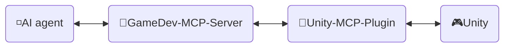
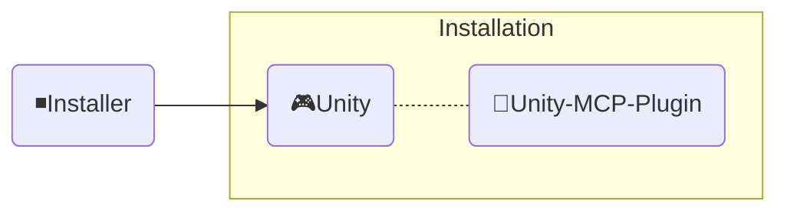

<div align="center" width="100%" dir="rtl">
  <h1>🛠️ توسعه ─ AI Game Developer</h1>

[](https://modelcontextprotocol.io/introduction)
[](https://openupm.com/packages/com.ivanmurzak.unity.mcp/)
[](https://hub.docker.com/r/aigamedeveloper/mcp-server)
[](https://unity.com/releases/editor/archive)
[](https://unity.com/releases/editor/archive)
[](https://github.com/IvanMurzak/Unity-MCP/actions/workflows/release.yml)</br>
[](https://discord.gg/cfbdMZX99G)
[](https://openupm.com/packages/com.ivanmurzak.unity.mcp/)
[](https://github.com/IvanMurzak/Unity-MCP/stargazers)
[](https://github.com/IvanMurzak/Unity-MCP/blob/main/LICENSE)
[](https://stand-with-ukraine.pp.ua)

  [English](Development.md) | [中文](Development.zh-CN.md) | [日本語](Development.ja.md) | [Español](Development.es.md) | <b>فارسی</b> | [हिन्दी](Development.hi.md) | [العربية](Development.ar.md)

</div>

<div dir="rtl">

این سند ساختار داخلی، طراحی، سبک کدنویسی و اصول اصلی Unity-MCP را توضیح می‌دهد. اگر مشارکت‌کننده هستید یا می‌خواهید پروژه را عمیقاً بشناسید، از آن استفاده کنید.

> **[💬 به سرور Discord ما بپیوندید](https://discord.gg/cfbdMZX99G)** - سؤال بپرسید، کارهایتان را به نمایش بگذارید و با دیگر توسعه‌دهندگان در ارتباط باشید!

## فهرست مطالب

- [دیدگاه و اهداف](#دیدگاه-و-اهداف)
- [الزامات](#الزامات)
- [پیکربندی محیط توسعه محلی](#پیکربندی-محیط-توسعه-محلی)
- [مشارکت](#مشارکت)
- [ساختار پروژه](#ساختار-پروژه)
  - [🔹MCP Server (shared GameDev-MCP-Server)](#mcp-server-shared-gamedev-mcp-server)
    - [ایمیج Docker](#ایمیج-docker)
  - [🔸Unity-MCP-Plugin](#unity-mcp-plugin)
    - [بسته UPM](#بسته-upm)
    - [Editor](#editor)
    - [Runtime](#runtime)
    - [امکانات MCP](#امکانات-mcp)
      - [افزودن `MCP Tool`](#افزودن-mcp-tool)
      - [افزودن `MCP Prompt`](#افزودن-mcp-prompt)
  - [◾Installer (Unity)](#installer-unity)
- [سبک کدنویسی](#سبک-کدنویسی)
  - [قراردادهای کلیدی](#قراردادهای-کلیدی)
- [اجرای تست](#اجرای-تست)
  - [اجرای محلی](#اجرای-محلی)
  - [مدهای تست](#مدهای-تست)
  - [تفسیر نتایج CI](#تفسیر-نتایج-ci)
- [CI/CD](#cicd)
  - [برای همکاران](#برای-همکاران)
  - [مرور کلی workflowها](#مرور-کلی-workflowها)
    - [🚀 release.yml](#-releaseyml)
    - [🧪 test\_pull\_request.yml](#-test_pull_requestyml)
    - [🔧 test\_unity\_plugin.yml](#-test_unity_pluginyml)
  - [پشته فناوری](#پشته-فناوری)
  - [ملاحظات امنیتی](#ملاحظات-امنیتی)
  - [مقصدهای استقرار](#مقصدهای-استقرار)

---

</div>


<div dir="rtl">

# دیدگاه و اهداف

ما باور داریم که هوش مصنوعی بخش مهمی از توسعه بازی خواهد بود (اگر همین حالا نباشد). رابط‌های هوش مصنوعی شگفت‌انگیزی مانند `Claude`، `Copilot`، `Cursor` و بسیاری دیگر وجود دارند که مدام بهتر می‌شوند. ما توسعه بازی را *با* این ابزارها پیوند می‌دهیم، نه در برابر آن‌ها — Unity MCP پایه‌ای برای سیستم‌های هوش مصنوعی در اکوسیستم Unity Engine است، نه یک پنجره چت ایزوله.

**اهداف پروژه**

- ارائه یک راهکار باکیفیت توسعه بازی با هوش مصنوعی، به‌صورت **رایگان** برای همه
- فراهم کردن پلتفرمی بسیار قابل سفارشی‌سازی تا توسعه‌دهندگان بازی بتوانند قابلیت‌های هوش مصنوعی را برای نیازهای خود گسترش دهند
- امکان استفاده از بهترین ابزارهای هوش مصنوعی برای توسعه بازی، همه در یک جا
- نگهداری و پشتیبانی از پیشرفته‌ترین فناوری‌های هوش مصنوعی، به‌ویژه در Unity Engine و فراتر از آن

---

</div>


<div dir="rtl">

# الزامات

پیش از مشارکت، مطمئن شوید ابزارهای زیر نصب شده‌اند:

| ابزار | نسخه | هدف |
| ---- | ------- | ------- |
| [Unity Editor](https://unity.com/releases/editor/archive) | 2022.3+ / 6000.0+ | اجرا و تست پلاگین |
| [.NET SDK](https://dotnet.microsoft.com/download) | 9.0+ | build و اجرای سرور MCP |
| [Node.js](https://nodejs.org/) | 18+ | اجرای MCP Inspector برای دیباگ |
| Python | 3.9+ | اجرای اسکریپت‌های build و ابزارهای کمکی |
| Docker *(اختیاری)* | آخرین نسخه | build و تست ایمیج‌های Docker |

> یک لایسنس رایگان Unity Personal برای مشارکت کافی است.

---

</div>


<div dir="rtl">

# پیکربندی محیط توسعه محلی

</div>

1. **مخزن را clone کنید**
   ```bash
   git clone https://github.com/IvanMurzak/Unity-MCP.git
   cd Unity-MCP
   ```

2. **پلاگین را در Unity باز کنید**
   - Unity Hub را باز کنید ← Add project ← پوشه `Unity-MCP-Plugin/` را انتخاب کنید
   - Unity در اولین باز شدن همه assemblyها را به‌طور خودکار کامپایل می‌کند

3. **سرور MCP را تهیه کنید** *(در مخزن جداگانه خودش قرار دارد)*
   - سرور همان [GameDev-MCP-Server](https://github.com/IvanMurzak/GameDev-MCP-Server) مشترک است — اگر نیاز به تغییر یا دیباگ خود سرور دارید، آن را جداگانه clone کنید
   - پلاگین فایل اجرایی نسخه‌ای را که با ثابت `ServerVersion` در `McpServerManager.cs` پین شده است به‌طور خودکار دانلود می‌کند، بنابراین برای توسعه فقط پلاگین، این‌جا کاری لازم نیست

4. **سرور را به‌صورت محلی اجرا کنید** *(اختیاری — فقط هنگام توسعه در برابر یک build سفارشی از سرور)*
   ```bash
   git clone https://github.com/IvanMurzak/GameDev-MCP-Server.git
   cd GameDev-MCP-Server
   dotnet run --project com.IvanMurzak.GameDev.MCP.Server.csproj -- --port 8080 --client-transport stdio
   ```

5. **پلاگین را به سرور محلی خود متصل کنید** *(اختیاری — از فایل اجرایی دانلودشده خودکار صرف‌نظر می‌کند)*
   - در Unity: `Window/AI Game Dev` را باز کنید
   - پورت را مطابق سرور محلی خود تنظیم کنید (به‌طور پیش‌فرض `8080`)
   - پلاگین به‌طور خودکار وصل می‌شود

6. **با MCP Inspector دیباگ کنید** *(اختیاری)*
   ```bash
   Unity-MCP-Plugin/Commands/start_mcp_inspector.bat   # Windows (.bat)
   ```
   به Node.js نیاز دارد. یک رابط مرورگر در `http://localhost:5173` برای بررسی زنده پیام‌های پروتکل MCP باز می‌کند.

<div dir="rtl">

---

</div>


<div dir="rtl">

# مشارکت

بیایید آینده روشن توسعه بازی را با هم بسازیم؛ در پروژه مشارکت کنید. از این سند برای درک ساختار پروژه و اینکه دقیقاً چگونه کار می‌کند استفاده کنید.

1. [پروژه را fork کنید](https://github.com/IvanMurzak/Unity-MCP/fork)
2. بهبودهای خود را اعمال کنید و از سبک کدنویسی پیروی کنید
3. [یک Pull Request بسازید](https://github.com/IvanMurzak/Unity-MCP/compare)

</div>


<div dir="rtl">

# ساختار پروژه

</div>



<div dir="rtl">

‏◽**AI agent** - هر رابط هوش مصنوعی مانند: *Claude*، *Copilot*، *Cursor* یا هر رابط دیگری؛ بخشی از این پروژه‌ها نیست، اما عنصر مهمی از معماری است.

‏🔹**GameDev-MCP-Server** - همان `MCP Server` مشترک (در مخزن جداگانه خودش قرار دارد: [GameDev-MCP-Server](https://github.com/IvanMurzak/GameDev-MCP-Server)) که به `AI agent` وصل می‌شود و با آن کار می‌کند. از طریق SignalR با `Unity-MCP-Plugin` ارتباط برقرار می‌کند. می‌تواند به‌صورت محلی یا در یک ابر با transport از نوع HTTP اجرا شود. پشته فناوری: `C#`، `ASP.NET Core`، `SignalR`

‏🔸**Unity-MCP-Plugin** - یک `Unity Plugin` که در یک پروژه Unity یکپارچه می‌شود و به API یونیتی دسترسی دارد. با `GameDev-MCP-Server` مشترک ارتباط برقرار می‌کند و دستورهای سرور را اجرا می‌کند. پشته فناوری: `C#`، `Unity`، `SignalR`

‏🎮**Unity** - Unity Engine، موتور بازی‌سازی.

---

## 🔹MCP Server (shared GameDev-MCP-Server)

یک اپلیکیشن C# مبتنی بر ASP.NET Core که به‌عنوان پلی میان عامل‌های هوش مصنوعی (رابط‌های هوش مصنوعی مانند Claude، Cursor) و نمونه‌های ویرایشگر Unity عمل می‌کند. سرور [Model Context Protocol](https://github.com/modelcontextprotocol) را با استفاده از [csharp-sdk](https://github.com/modelcontextprotocol/csharp-sdk) پیاده‌سازی می‌کند.

> محل پروژه: مخزن مشترک [GameDev-MCP-Server](https://github.com/IvanMurzak/GameDev-MCP-Server) — یک سرور مستقل از موتور که Unity-MCP، Godot-MCP و Unreal-MCP از آن استفاده می‌کنند. این سرور **دیگر بخشی از این مخزن نیست**.

**مسئولیت‌های اصلی** (برای جزئیات، [README سرور GameDev-MCP-Server](https://github.com/IvanMurzak/GameDev-MCP-Server#readme) را ببینید):

1. **پیاده‌سازی پروتکل MCP** — ابزارها، پرامپت‌ها و منابع از طریق transportهای STDIO و HTTP
2. **ارتباط از طریق SignalR Hub** — ارتباط دوطرفه بلادرنگ با پلاگین موتور، شامل handshake نسخه
3. **مسیریابی و اجرای درخواست‌ها** — درخواست‌های عامل هوش مصنوعی را به نمونه پلاگین متصل هدایت می‌کند
4. **سرویس اجرای راه دور** — درخواست/پاسخ ناهمگام با مهلت زمانی و لغو
5. **مدیریت چرخه حیات سرور** — میزبانی با Kestrel، لاگ‌گیری با NLog، خاموش شدن آرام

پلاگین فایل اجرایی نسخه‌ای (`gamedev-mcp-server-<rid>.zip`) را دانلود می‌کند که با ثابت `ServerVersion` در [McpServerManager.cs](../../Unity-MCP-Plugin/Packages/com.ivanmurzak.unity.mcp/Editor/Scripts/McpServerManager.cs) پین شده است. ارتقای سرور مصرفی = تغییر همان ثابت؛ نسخه متناظر `v<ServerVersion>` باید از قبل در GameDev-MCP-Server وجود داشته باشد.

### ایمیج Docker

سرور مشترک از مخزن GameDev-MCP-Server با نام [`aigamedeveloper/mcp-server`](https://hub.docker.com/r/aigamedeveloper/mcp-server) در Docker Hub منتشر می‌شود.

---

## 🔸Unity-MCP-Plugin

در محیط Unity یکپارچه می‌شود. از `Unity-MCP-Common` برای جستجوی *Tool*، *Resource* و *Prompt*های MCP در کد محلی با استفاده از reflection استفاده می‌کند. با `GameDev-MCP-Server` مشترک برای ارسال به‌روزرسانی‌ها درباره *Tool*، *Resource* و *Prompt*های MCP ارتباط برقرار می‌کند. دستورها را از سرور می‌گیرد و اجرا می‌کند.

> محل پروژه: `Unity-MCP-Plugin`

### بسته UPM

‏`Unity-MCP-Plugin` یک بسته UPM است؛ پوشه ریشه بسته در . قرار دارد. این پوشه شامل `package.json` است که برای بارگذاری مستقیم بسته از GitHub release در [OpenUPM](https://openupm.com/) استفاده می‌شود.

> محل `Unity-MCP-Plugin/Packages/com.ivanmurzak.unity.mcp`

### Editor

کامپوننت Editor یکپارچگی با ویرایشگر Unity را فراهم می‌کند، قابلیت‌های MCP (ابزارها، پرامپت‌ها، منابع) را پیاده‌سازی می‌کند و چرخه حیات `GameDev-MCP-Server` محلی را مدیریت می‌کند.

> محل `Unity-MCP-Plugin/Packages/com.ivanmurzak.unity.mcp/Editor`

**مسئولیت‌های اصلی:**

1. **مدیریت چرخه حیات پلاگین** ([Startup.cs](../../Unity-MCP-Plugin/Packages/com.ivanmurzak.unity.mcp/Editor/Scripts/Startup.cs))
   - هنگام بارگذاری ویرایشگر Unity از طریق `[InitializeOnLoad]` به‌طور خودکار مقداردهی اولیه می‌شود
   - پایداری اتصال را در رویدادهای چرخه حیات ویرایشگر (reload شدن assemblyها، تغییرات play mode) مدیریت می‌کند
   - اتصال دوباره خودکار پس از domain reload یا خروج از Play mode

2. **مدیریت فایل اجرایی سرور MCP** ([McpServerManager.cs](../../Unity-MCP-Plugin/Packages/com.ivanmurzak.unity.mcp/Editor/Scripts/McpServerManager.cs))
   - فایل اجرایی `GameDev-MCP-Server` مشترک را از GitHub releaseهای آن دانلود و مدیریت می‌کند (پین‌شده با ثابت `ServerVersion`)
   - انتخاب فایل اجرایی چندسکویی (Windows/macOS/Linux، x86/x64/ARM/ARM64)
   - اعمال سازگاری نسخه میان سرور و پلاگین
   - تولید پیکربندی برای عامل‌های هوش مصنوعی (JSON با مسیرهای فایل اجرایی و تنظیمات اتصال)

3. **پیاده‌سازی MCP API** ([Scripts/API/](../../Unity-MCP-Plugin/Packages/com.ivanmurzak.unity.mcp/Editor/Scripts/API/))
   - **ابزارها** (50+): GameObject، Scene، Assets، Prefabs، Scripts، Components، Editor Control، Test Runner، Console، Reflection
   - **پرامپت‌ها**: قالب‌های آماده برای کارهای رایج توسعه با Unity
   - **منابع**: دسترسی مبتنی بر URI به داده‌های ویرایشگر Unity با سریال‌سازی JSON
   - همه عملیات برای ایمنی thread روی main thread یونیتی اجرا می‌شوند
   - کشف مبتنی بر اتریبیوت با استفاده از `[AiTool]`، `[AiPrompt]`، `[AiResource]`

4. **رابط کاربری ویرایشگر** ([Scripts/UI/](../../Unity-MCP-Plugin/Packages/com.ivanmurzak.unity.mcp/Editor/Scripts/UI/))
   - پنجره پیکربندی برای مدیریت اتصال (`Window > AI Game Dev`)
   - مدیریت فایل اجرایی سرور و دسترسی به لاگ از طریق آیتم‌های منوی Unity

### Runtime

کامپوننت Runtime زیرساخت اصلی مشترک میان حالت‌های Editor و Runtime را فراهم می‌کند و ارتباط SignalR، سریال‌سازی و دسترسی thread-safe به API یونیتی را مدیریت می‌کند.

> محل `Unity-MCP-Plugin/Packages/com.ivanmurzak.unity.mcp/Runtime`

**مسئولیت‌های اصلی:**

1. **هسته پلاگین و اتصال SignalR** ([UnityMcpPlugin.cs](../../Unity-MCP-Plugin/Packages/com.ivanmurzak.unity.mcp/Runtime/UnityMcpPlugin.cs))
   - یک singleton امن از نظر thread که چرخه حیات پلاگین را از طریق `BuildAndStart()` مدیریت می‌کند
   - ابزارها/پرامپت‌ها/منابع MCP را با استفاده از reflection از assemblyها کشف می‌کند
   - اتصال SignalR به سرور MCP را با پایش واکنشی وضعیت (کتابخانه R3) برقرار می‌کند
   - مدیریت پیکربندی: میزبان، پورت، مهلت، سازگاری نسخه

2. **توزیع‌کننده Main Thread** ([MainThreadDispatcher.cs](../../Unity-MCP-Plugin/Packages/com.ivanmurzak.unity.mcp/Runtime/Utils/MainThreadDispatcher.cs))
   - فراخوانی‌های API یونیتی را از threadهای پس‌زمینه SignalR به main thread یونیتی منتقل می‌کند
   - اجرای مبتنی بر صف در حلقه Update یونیتی
   - برای اجرای thread-safe عملیات MCP حیاتی است

3. **سریال‌سازی نوع‌های Unity** ([Converter/Reflection/](../../Unity-MCP-Plugin/Packages/com.ivanmurzak.unity.mcp/Runtime/Converter/Reflection/)، [Converter/Json/](../../Unity-MCP-Plugin/Packages/com.ivanmurzak.unity.mcp/Runtime/Converter/Json/))
   - سریال‌سازی سفارشی JSON برای نوع‌های Unity (GameObject، Component، Transform، Vector3، Quaternion و غیره)
   - اشیای Unity را به قالب ارجاع (`GameObjectRef`، `ComponentRef`) با ردیابی instanceID تبدیل می‌کند
   - با ReflectorNet برای درون‌نگری اشیا و سریال‌سازی کامپوننت‌ها یکپارچه می‌شود
   - JSON schemaها را برای تعریف نوع‌ها در پروتکل MCP فراهم می‌کند

4. **لاگ‌گیری و عیب‌یابی** ([Logger/](../../Unity-MCP-Plugin/Packages/com.ivanmurzak.unity.mcp/Runtime/Logger/)، [Unity/Logs/](../../Unity-MCP-Plugin/Packages/com.ivanmurzak.unity.mcp/Runtime/Unity/Logs/))
   - Microsoft.Extensions.Logging را با سطوح رنگ‌بندی‌شده به Console یونیتی پل می‌زند
   - لاگ‌های Console یونیتی را برای بازیابی زمینه توسط هوش مصنوعی از طریق ابزارهای MCP جمع‌آوری می‌کند

### امکانات MCP

#### افزودن `MCP Tool`

</div>

```csharp
[AiToolType]
public class Tool_GameObject
{
    [AiTool
    (
        "MyCustomTask",
        Title = "Create a new GameObject"
    )]
    [Description("Explain here to LLM what is this, when it should be called.")]
    public string CustomTask
    (
        [Description("Explain to LLM what is this.")]
        string inputData
    )
    {
        // do anything in background thread

        return MainThread.Instance.Run(() =>
        {
            // do something in main thread if needed

            return $"[Success] Operation completed.";
        });
    }
}
```

<div dir="rtl">

#### افزودن `MCP Prompt`

‏`MCP Prompt` به شما اجازه می‌دهد پرامپت‌های سفارشی را در گفتگو با LLM تزریق کنید. از دو نقش فرستنده پشتیبانی می‌کند: User و Assistant. این راهی سریع برای دستور دادن به LLM برای انجام کارهای مشخص است. می‌توانید پرامپت‌ها را با داده‌های سفارشی تولید کنید و فهرست‌ها یا هر اطلاعات مرتبط دیگری را ارائه دهید.

</div>

```csharp
[AiPromptType]
public static class Prompt_ScriptingCode
{
    [AiPrompt(Name = "add-event-system", Role = Role.User)]
    [Description("Implement UnityEvent-based communication system between GameObjects.")]
    public static string AddEventSystem()
    {
        return "Create event system using UnityEvents, UnityActions, or custom event delegates for decoupled communication between game systems and components.";
    }
}
```

<div dir="rtl">

---

## ◾Installer (Unity)

</div>



<div dir="rtl">

‏**Installer** پلاگین `Unity-MCP-Plugin` و وابستگی‌ها را به‌صورت بسته‌های NPM در یک پروژه Unity نصب می‌کند.

> محل پروژه: `Installer`

---

</div>


<div dir="rtl">

# سبک کدنویسی

این پروژه از الگوهای یکپارچه کدنویسی C# پیروی می‌کند. همه کدهای جدید باید به این قراردادها پایبند باشند.

## قراردادهای کلیدی

1. **سربرگ فایل‌ها**: اعلان کپی‌رایت را در قالب کامنت جعبه‌ای در بالای هر فایل قرار دهید
2. **Nullable Context**: برای ایمنی در برابر null از `#nullable enable` استفاده کنید — بدون nullهای ضمنی
3. **اتریبیوت‌ها**: برای کشف MCP از `[AiTool]`، `[AiPrompt]`، `[AiResource]` استفاده کنید
4. **کلاس‌های Partial**: قابلیت‌ها را میان چند فایل تقسیم کنید (مثلاً `Tool_GameObject.Create.cs`، `Tool_GameObject.Destroy.cs`)
5. **اجرا روی Main Thread**: همه فراخوانی‌های API یونیتی را با `MainThread.Instance.Run()` بپوشانید
6. **مدیریت خطا**: برای خطاها استثنا پرتاب کنید — از `ArgumentException` یا `Exception` استفاده کنید، هرگز رشته خطا برنگردانید
7. **نوع‌های بازگشتی**: مدل‌های داده نوع‌دار با حاشیه‌نویسی `[Description]` برگردانید تا بازخورد ساختاریافته به هوش مصنوعی داده شود
8. **توضیحات**: همه APIها و پارامترهای عمومی را برای راهنمایی هوش مصنوعی با `[Description]` حاشیه‌نویسی کنید
9. **نام‌گذاری**: PascalCase برای اعضا و نوع‌های عمومی، `_camelCase` برای فیلدهای private readonly
10. **ایمنی در برابر Null**: از نوع‌های nullable (`?`) و عملگرهای null-coalescing (`??`، `??=`) استفاده کنید

مثال حاشیه‌نویسی‌شده زیر نشان می‌دهد این قراردادها چگونه با هم کار می‌کنند:

</div>

```csharp
/*
┌──────────────────────────────────────────────────────────────────┐
│  Author: Ivan Murzak (https://github.com/IvanMurzak)             │
│  Repository: GitHub (https://github.com/IvanMurzak/Unity-MCP)    │
│  Copyright (c) 2025 Ivan Murzak                                  │
│  Licensed under the Apache License, Version 2.0.                 │
│  See the LICENSE file in the project root for more information.  │
└──────────────────────────────────────────────────────────────────┘
*/

// Enable nullable reference types for better null safety
#nullable enable

// Conditional compilation for platform-specific code
#if UNITY_EDITOR
using UnityEditor;
#endif

using System;
using System.ComponentModel;
using com.IvanMurzak.McpPlugin;
using AIGD;
using com.IvanMurzak.Unity.MCP.Runtime.Utils;
using UnityEngine;

namespace com.IvanMurzak.Unity.MCP.Editor.API
{
    // Use [AiToolType] for tool classes - enables MCP discovery via reflection
    [AiToolType]
    // Partial classes allow splitting implementation across multiple files
    // Pattern: One file per operation (e.g., GameObject.Create.cs, GameObject.Destroy.cs)
    public partial class Tool_GameObject
    {
        // MCP Tool declaration with attribute-based metadata
        [AiTool(
            "gameobject-create",                    // Unique tool identifier (kebab-case)
            Title = "GameObject / Create"           // Human-readable title
        )]
        // Description attribute guides AI on when/how to use this tool
        [Description(@"Create a new GameObject in the scene.
Provide position, rotation, and scale to minimize subsequent operations.")]
        public CreateResult Create                   // Return a typed data model, not a string
        (
            // Parameter descriptions help AI understand expected inputs
            [Description("Name of the new GameObject.")]
            string name,

            [Description("Parent GameObject reference. If not provided, created at scene root.")]
            GameObjectRef? parentGameObjectRef = null,  // Nullable with default value

            [Description("Transform position of the GameObject.")]
            Vector3? position = null,                    // Unity struct, nullable

            [Description("Transform rotation in Euler angles (degrees).")]
            Vector3? rotation = null,

            [Description("Transform scale of the GameObject.")]
            Vector3? scale = null
        )
        {
            // Validate before entering the main thread — throw exceptions for errors
            if (string.IsNullOrEmpty(name))
                throw new ArgumentException("Name cannot be null or empty.", nameof(name));

            return MainThread.Instance.Run(() =>           // All Unity API calls MUST run on main thread
            {
                // Null-coalescing assignment for default values
                position ??= Vector3.zero;
                rotation ??= Vector3.zero;
                scale ??= Vector3.one;

                // Resolve optional parent — throw on bad reference, don't return error strings
                var parentGo = default(GameObject);
                if (parentGameObjectRef?.IsValid(out _) == true)
                {
                    parentGo = parentGameObjectRef.FindGameObject(out var error);
                    if (error != null)
                        throw new ArgumentException(error, nameof(parentGameObjectRef));
                }

                // Create GameObject using Unity API
                var go = new GameObject(name);

                // Set parent if provided
                if (parentGo != null)
                    go.transform.SetParent(parentGo.transform, worldPositionStays: false);

                // Apply transform values
                go.transform.localPosition = position.Value;
                go.transform.localRotation = Quaternion.Euler(rotation.Value);
                go.transform.localScale = scale.Value;

                // Mark as modified for Unity Editor
                EditorUtility.SetDirty(go);

                // Return a typed result — properties annotated with [Description] for AI
                return new CreateResult
                {
                    InstanceId = go.GetInstanceID(),
                    Path       = go.GetPath(),
                    Name       = go.name,
                };
            });
        }

        // Typed result class — structured data returned to the AI client
        public class CreateResult
        {
            [Description("Instance ID of the created GameObject.")]
            public int InstanceId { get; set; }

            [Description("Hierarchy path of the created GameObject.")]
            public string? Path { get; set; }

            [Description("Name of the created GameObject.")]
            public string? Name { get; set; }
        }
    }

    // Separate partial class file for prompts
    [AiPromptType]
    public static partial class Prompt_SceneManagement
    {
        // MCP Prompt with role definition (User or Assistant)
        [AiPrompt(Name = "setup-basic-scene", Role = Role.User)]
        [Description("Setup a basic scene with camera, lighting, and environment.")]
        public static string SetupBasicScene()
        {
            // Return prompt text for AI to process
            return "Create a basic Unity scene with Main Camera, Directional Light, and basic environment setup.";
        }
    }
}
```

<div dir="rtl">

---

</div>


<div dir="rtl">

# اجرای تست

تست‌ها سه حالت را در چهار نسخه Unity (2022.3، 6000.0، 6000.3، 6000.6) و دو سیستم‌عامل (Windows، Ubuntu) پوشش می‌دهند — در مجموع 24 ترکیب.

## اجرای محلی

‏**Unity Test Runner (GUI)**
1. پروژه `Unity-MCP-Plugin/` را در Unity باز کنید
2. به `Window > General > Test Runner` بروید
3. تب **EditMode** یا **PlayMode** را انتخاب کنید
4. روی **Run All** کلیک کنید یا تست‌های مشخصی را انتخاب کرده و **Run Selected** را بزنید

**اسکریپت Python (خط فرمان)**

</div>

```bash
# Run tests for a specific Unity editor and mode
python commands/run_unity_tests.py --unity-path "<path to the Unity editor executable>" --test-mode editmode
```

<div dir="rtl">

## مدهای تست

| حالت | چه چیزی را تست می‌کند | محل |
| ---- | ------------- | -------- |
| **EditMode** | منطق ابزارها، سریال‌سازی، ابزارهای کمکی ویرایشگر — بدون نیاز به Play mode | `Packages/com.ivanmurzak.unity.mcp/Tests/Editor` |
| **PlayMode** | پلاگین runtime، اتصال SignalR، توزیع روی main thread | `Packages/com.ivanmurzak.unity.mcp/Tests/Runtime` |
| **Standalone** | build کامل player با پلاگین تعبیه‌شده | به یک مرحله build برای player نیاز دارد |

## گنجاندن تست‌های بسته (testables)

در پروژه‌هایی که از چند بسته UPM استفاده می‌کنند، می‌توانید از طریق فیلد **`testables`** در [manifest پروژه](https://docs.unity3d.com/Manual/upm-manifestPrj.html) کنترل کنید تست‌های کدام بسته‌ها در Test Runner ظاهر شوند. فقط تست‌های بسته‌هایی که در `testables` فهرست شده‌اند کامپایل و نمایش داده می‌شوند. برای گنجاندن تست‌های این بسته (یا هر بسته دیگری)، آن را به `testables` در manifest پروژه خود اضافه کنید.

**مثال** — در `Packages/manifest.json`:

</div>

```json
{
  "dependencies": {
    "com.ivanmurzak.unity.mcp": "X.X.X"
  },
  "testables": [
    "com.ivanmurzak.unity.mcp"
  ]
}
```

<div dir="rtl">

برای مستندات کامل، [Unity: Add tests to your package](https://docs.unity3d.com/Manual/cus-tests.html) و [Unity: Project manifest (testables)](https://docs.unity3d.com/Manual/upm-manifestPrj.html#testables) را ببینید.

## تفسیر نتایج CI

نام هر job در CI به‌صورت `test-unity-{version}-{mode}` است (مثلاً `test-unity-6000-3-27f1-editmode`). وقتی یک job شکست می‌خورد:
1. job شکست‌خورده را در GitHub Actions باز کنید
2. مرحله **Unity Test Runner** را برای دیدن خروجی درون‌خطی باز کنید
3. artifact با نام **test-results** را برای گزارش کامل XML دانلود کنید
4. تست را اصلاح و push کنید — CI به‌طور خودکار دوباره اجرا می‌شود

---

</div>


<div dir="rtl">

# CI/CD

این پروژه یک pipeline جامع CI/CD را با استفاده از GitHub Actions پیاده‌سازی می‌کند که در آن چندین workflow فرایندهای build، تست و استقرار را هماهنگ می‌کنند.

## برای همکاران

آنچه هنگام کار با CI به‌عنوان مشارکت‌کننده باید بدانید:

- **PRهایی که از fork می‌آیند** پیش از شروع CI به یک نگهدارنده نیاز دارند تا برچسب `ci-ok` را اعمال کند. این یک تدبیر امنیتی برای جلوگیری از دسترسی کدهای غیرقابل اعتماد به secretهاست.
- **فایل‌های workflow** در `.github/workflows/` را در PR خود **تغییر ندهید** — اگر بررسی CI تغییراتی در این فایل‌ها از سوی یک مشارکت‌کننده غیرقابل اعتماد تشخیص دهد، متوقف می‌شود.
- **همه 18 ترکیب ماتریس تست باید قبول شوند** تا یک PR قابل merge باشد. اگر تغییر شما فقط یک ترکیب را خراب کند (مثلاً `2022-editmode`)، آن job یک ✗ قرمز نشان می‌دهد در حالی که بقیه سبز هستند.
- **اجرای دوباره jobهای شکست‌خورده:** به PR بروید ← تب **Checks** ← روی یک job شکست‌خورده کلیک کنید ← **Re-run failed jobs**. این برای crashهای گذرای ویرایشگر Unity مفید است.
- **ترتیب اجرای workflowها:** `test_pull_request.yml` روی PR شما اجرا می‌شود. merge به `main` هیچ چیزی منتشر نمی‌کند: یک نگهدارنده با dispatch دستی `release.yml` یک نسخه منتشر می‌کند.

## مرور کلی workflowها

> محل: `.github/workflows`

### 🚀 [release.yml](../../.github/workflows/release.yml)

**راه‌انداز:** فقط `workflow_dispatch` دستی (ورودی `dry_run`، پیش‌فرض `false`). merge به `main` هیچ چیزی منتشر نمی‌کند.
**هدف:** workflow اصلی انتشار که کل فرایند انتشار را هماهنگ می‌کند

</div>

```bash
gh workflow run release.yml -R IvanMurzak/Unity-MCP --ref main -f dry_run=true   # every test + build, publishes nothing
gh workflow run release.yml -R IvanMurzak/Unity-MCP --ref main                   # real release
```

<div dir="rtl">

**فرایند:**

1. **بررسی نسخه** - نسخه را از [package.json](../../Unity-MCP-Plugin/Packages/com.ivanmurzak.unity.mcp/package.json) استخراج می‌کند. یک اجرای واقعی اگر روی `main` نباشد یا تگ انتشار از قبل وجود داشته باشد شکست می‌خورد؛ یک اجرای آزمایشی (dry run) هشدار می‌دهد و ادامه می‌دهد
2. **build نصب‌کننده Unity** - نصب‌کننده بسته Unity (`AI-Game-Dev-Installer.unitypackage`) را تست و export می‌کند
3. **تست پلاگین Unity** - تست‌های جامع را روی این موارد اجرا می‌کند:
   - 4 نسخه Unity: `2022.3.62f3`، `6000.0.85f1`، `6000.3.27f1`، `6000.6.7f1`
   - 3 حالت تست: `editmode`، `playmode`، `standalone`
   - 2 سیستم‌عامل: `windows-latest`، `ubuntu-latest`
   - مجموع: **18 ترکیب ماتریس تست**
4. **استقرار** - بسته npm با نام `unity-mcp-cli` را همراه با provenance build، تست و منتشر می‌کند (OIDC Trusted Publishing، مستقیماً در `release.yml`؛ وقتی دقیقاً همان نسخه از قبل در npm باشد، رد می‌شود)
5. **ساخت انتشار** - تگ + GitHub Release را همراه با بسته نصب‌کننده Unity و بسته UPM امضاشده پیوست‌شده می‌سازد (OpenUPM آن را از همان‌جا برمی‌دارد)
6. **اعلان Discord** - یادداشت‌های انتشار قالب‌بندی‌شده را به کانال Discord می‌فرستد
7. **تأیید** - اجرا را شکست‌خورده اعلام می‌کند مگر اینکه GitHub Release، npm و OpenUPM همگی نسخه جدید را ارائه دهند
8. **پاک‌سازی** - پس از انتشار موفق، artifactهای build را حذف می‌کند

مراحل 4 تا 8 در اجرای آزمایشی رد می‌شوند.

> فایل‌های اجرایی سرور MCP این‌جا build یا منتشر **نمی‌شوند** — آن‌ها از مخزن مشترک [GameDev-MCP-Server](https://github.com/IvanMurzak/GameDev-MCP-Server) منتشر می‌شوند.

### 🧪 [test_pull_request.yml](../../.github/workflows/test_pull_request.yml)

**راه‌انداز:** Pull requestها به شاخه‌های `main` یا `dev`
**هدف:** تغییرات PR را پیش از merge اعتبارسنجی می‌کند

**فرایند:**

1. همان 18 ترکیب ماتریس تست Unity را مانند workflow انتشار اجرا می‌کند
2. همه تست‌ها باید پیش از merge شدن PR قبول شوند

### 🔧 [test_unity_plugin.yml](../../.github/workflows/test_unity_plugin.yml)

**نوع:** workflow قابل استفاده مجدد
**هدف:** workflow پارامتری تست Unity که هم workflow انتشار و هم workflowهای PR از آن استفاده می‌کنند

**ویژگی‌ها:**

- پارامترها را می‌پذیرد: `projectPath`، `unityVersion`، `testMode`
- روی ماتریسی از سیستم‌عامل‌ها (Windows، Ubuntu) اجرا می‌شود
- از Game CI Unity Test Runner با ایمیج‌های Docker سفارشی استفاده می‌کند
- بررسی‌های امنیتی را برای مشارکت‌کنندگان PR پیاده‌سازی می‌کند (برای PRهای غیرقابل اعتماد برچسب `ci-ok` لازم است)
- اگر فایل‌های workflow در PRها تغییر کرده باشند متوقف می‌شود
- پوشه Library یونیتی را برای اجراهای بعدی سریع‌تر cache می‌کند
- artifactهای تست را برای دیباگ بارگذاری می‌کند

## پشته فناوری

- **پلتفرم CI:** GitHub Actions
- **تست Unity:** [Game CI](https://game.ci/) همراه با Unity Test Runner
- **مدیریت بسته:** npm، OpenUPM
- **ابزارهای build:** .NET 9.0، اسکریپت‌های bash
- **ذخیره‌سازی artifact:** artifactهای GitHub Actions (موقت)، GitHub Releases (دائمی)

## ملاحظات امنیتی

- لایسنس، ایمیل و رمز عبور Unity به‌صورت GitHub secret ذخیره می‌شوند
- انتشار در npm از OIDC trusted publishing / provenance استفاده می‌کند
- workflow مربوط به PR شامل بررسی‌های ایمنی برای تغییر فایل‌های workflow است
- مشارکت‌های PR غیرقابل اعتماد به تأیید نگهدارنده از طریق برچسب `ci-ok` نیاز دارند

## مقصدهای استقرار

1. **GitHub Releases** - بسته نصب‌کننده Unity و بسته UPM امضاشده
2. **npm** - بسته `unity-mcp-cli`
3. **OpenUPM** - بسته پلاگین Unity (به‌طور خودکار از GitHub releases همگام‌سازی می‌شود)

> خود سرور MCP (فایل‌های اجرایی، ابزار NuGet، ایمیج Docker) از مخزن مشترک [GameDev-MCP-Server](https://github.com/IvanMurzak/GameDev-MCP-Server) منتشر می‌شود.

</div>


