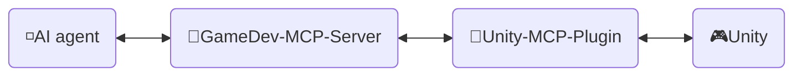
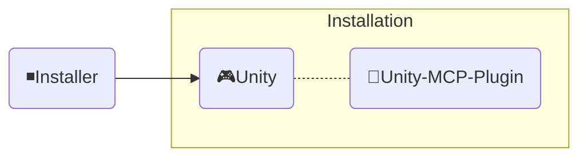

<div align="center" width="100%">
  <h1>🛠️ डेवलपमेंट ─ AI Game Developer</h1>

[](https://modelcontextprotocol.io/introduction)
[](https://openupm.com/packages/com.ivanmurzak.unity.mcp/)
[](https://hub.docker.com/r/aigamedeveloper/mcp-server)
[](https://unity.com/releases/editor/archive)
[](https://unity.com/releases/editor/archive)
[](https://github.com/IvanMurzak/Unity-MCP/actions/workflows/release.yml)</br>
[](https://discord.gg/cfbdMZX99G)
[](https://openupm.com/packages/com.ivanmurzak.unity.mcp/)
[](https://github.com/IvanMurzak/Unity-MCP/stargazers)
[](https://github.com/IvanMurzak/Unity-MCP/blob/main/LICENSE)
[](https://stand-with-ukraine.pp.ua)

  [English](Development.md) | [中文](Development.zh-CN.md) | [日本語](Development.ja.md) | [Español](Development.es.md) | [فارسی](Development.fa.md) | <b>हिन्दी</b> | [العربية](Development.ar.md)

</div>

यह दस्तावेज़ Unity-MCP की आंतरिक संरचना, डिज़ाइन, कोड शैली और मुख्य सिद्धांतों को समझाता है। यदि आप योगदानकर्ता हैं या प्रोजेक्ट को गहराई से समझना चाहते हैं, तो इसका उपयोग करें।

> **[💬 हमारे Discord सर्वर से जुड़ें](https://discord.gg/cfbdMZX99G)** - प्रश्न पूछें, अपना काम दिखाएँ, और अन्य डेवलपर्स से जुड़ें!

## सामग्री

- [दृष्टि और लक्ष्य](#दृष्टि-और-लक्ष्य)
- [पूर्वापेक्षाएँ](#पूर्वापेक्षाएँ)
- [लोकल डेवलपमेंट सेटअप](#लोकल-डेवलपमेंट-सेटअप)
- [योगदान दें](#योगदान-दें)
- [प्रोजेक्ट संरचना](#प्रोजेक्ट-संरचना)
  - [🔹MCP Server (shared GameDev-MCP-Server)](#mcp-server-shared-gamedev-mcp-server)
    - [Docker इमेज](#docker-इमेज)
  - [🔸Unity-MCP-Plugin](#unity-mcp-plugin)
    - [UPM पैकेज](#upm-पैकेज)
    - [Editor](#editor)
    - [Runtime](#runtime)
    - [MCP सुविधाएँ](#mcp-सुविधाएँ)
      - [`MCP Tool` जोड़ें](#mcp-tool-जोड़ें)
      - [`MCP Prompt` जोड़ें](#mcp-prompt-जोड़ें)
  - [◾Installer (Unity)](#installer-unity)
- [कोड शैली](#कोड-शैली)
  - [मुख्य परिपाटियाँ](#मुख्य-परिपाटियाँ)
- [टेस्ट चलाना](#टेस्ट-चलाना)
  - [लोकल रूप से चलाना](#लोकल-रूप-से-चलाना)
  - [टेस्ट मोड](#टेस्ट-मोड)
  - [CI परिणामों की व्याख्या](#ci-परिणामों-की-व्याख्या)
- [CI/CD](#cicd)
  - [योगदानकर्ताओं के लिए](#योगदानकर्ताओं-के-लिए)
  - [वर्कफ़्लो अवलोकन](#वर्कफ़्लो-अवलोकन)
    - [🚀 release.yml](#-releaseyml)
    - [🧪 test\_pull\_request.yml](#-test_pull_requestyml)
    - [🔧 test\_unity\_plugin.yml](#-test_unity_pluginyml)
  - [टेक्नोलॉजी स्टैक](#टेक्नोलॉजी-स्टैक)
  - [सुरक्षा संबंधी विचार](#सुरक्षा-संबंधी-विचार)
  - [डिप्लॉयमेंट लक्ष्य](#डिप्लॉयमेंट-लक्ष्य)

---


# दृष्टि और लक्ष्य

हमारा मानना है कि AI गेम डेवलपमेंट का एक महत्वपूर्ण हिस्सा बनेगा (यदि पहले से नहीं बन चुका है)। `Claude`, `Copilot`, `Cursor` जैसे कई अद्भुत AI इंटरफ़ेस हैं जो लगातार बेहतर हो रहे हैं। हम गेम डेवलपमेंट को इन टूल्स के *साथ* जोड़ते हैं, उनके विरुद्ध नहीं — Unity MCP, Unity Engine इकोसिस्टम में AI सिस्टम्स की एक नींव है, कोई अलग-थलग चैट विंडो नहीं।

**प्रोजेक्ट के लक्ष्य**

- सभी को उच्च गुणवत्ता वाला AI गेम डेवलपमेंट समाधान **मुफ़्त** में देना
- गेम डेवलपर्स को अपनी ज़रूरतों के अनुसार AI सुविधाओं का विस्तार करने के लिए एक अत्यधिक अनुकूलन योग्य प्लेटफ़ॉर्म प्रदान करना
- गेम डेवलपमेंट के लिए सर्वश्रेष्ठ AI उपकरणों का एक ही स्थान पर उपयोग संभव बनाना
- विशेष रूप से Unity Engine और उससे आगे, अत्याधुनिक AI तकनीकों को बनाए रखना और उनका समर्थन करना

---


# पूर्वापेक्षाएँ

योगदान देने से पहले, सुनिश्चित करें कि निम्नलिखित टूल्स इंस्टॉल हैं:

| टूल | वर्ज़न | उद्देश्य |
| ---- | ------- | ------- |
| [Unity Editor](https://unity.com/releases/editor/archive) | 2022.3+ / 6000.0+ | प्लगइन चलाना और टेस्ट करना |
| [.NET SDK](https://dotnet.microsoft.com/download) | 9.0+ | MCP Server बिल्ड करना और चलाना |
| [Node.js](https://nodejs.org/) | 18+ | डीबगिंग के लिए MCP Inspector चलाना |
| Python | 3.9+ | बिल्ड और यूटिलिटी स्क्रिप्ट्स चलाना |
| Docker *(वैकल्पिक)* | नवीनतम | Docker इमेज बिल्ड और टेस्ट करना |

> योगदान के लिए मुफ़्त Unity Personal लाइसेंस पर्याप्त है।

---


# लोकल डेवलपमेंट सेटअप

1. **रिपॉज़िटरी क्लोन करें**
   ```bash
   git clone https://github.com/IvanMurzak/Unity-MCP.git
   cd Unity-MCP
   ```

2. **Unity में प्लगइन खोलें**
   - Unity Hub खोलें → Add project → `Unity-MCP-Plugin/` फ़ोल्डर चुनें
   - पहली बार खोलने पर Unity सभी असेंबली अपने आप कंपाइल कर देगा

3. **MCP Server प्राप्त करें** *(यह अपनी अलग रिपॉज़िटरी में है)*
   - सर्वर साझा [GameDev-MCP-Server](https://github.com/IvanMurzak/GameDev-MCP-Server) है — यदि आपको सर्वर को स्वयं संशोधित या डीबग करना है, तो इसे अलग से क्लोन करें
   - प्लगइन `McpServerManager.cs` में `ServerVersion` कॉन्स्टेंट द्वारा पिन की गई रिलीज़ बाइनरी अपने आप डाउनलोड कर लेता है, इसलिए केवल प्लगइन डेवलपमेंट के लिए यहाँ कुछ करने की ज़रूरत नहीं है

4. **सर्वर को लोकल रूप से चलाएँ** *(वैकल्पिक — केवल तब जब आप कस्टम सर्वर बिल्ड के विरुद्ध डेवलप कर रहे हों)*
   ```bash
   git clone https://github.com/IvanMurzak/GameDev-MCP-Server.git
   cd GameDev-MCP-Server
   dotnet run --project com.IvanMurzak.GameDev.MCP.Server.csproj -- --port 8080 --client-transport stdio
   ```

5. **प्लगइन को अपने लोकल सर्वर की ओर इंगित करें** *(वैकल्पिक — अपने आप डाउनलोड की गई बाइनरी को छोड़ देता है)*
   - Unity में: `Window/AI Game Dev` खोलें
   - पोर्ट को अपने लोकल सर्वर से मेल खाने के लिए सेट करें (डिफ़ॉल्ट रूप से `8080`)
   - प्लगइन अपने आप कनेक्ट हो जाएगा

6. **MCP Inspector से डीबग करें** *(वैकल्पिक)*
   ```bash
   Unity-MCP-Plugin/Commands/start_mcp_inspector.bat   # Windows (.bat)
   ```
   Node.js आवश्यक है। MCP प्रोटोकॉल संदेशों के लाइव निरीक्षण के लिए `http://localhost:5173` पर एक ब्राउज़र UI खोलता है।

---


# योगदान दें

आइए मिलकर गेम डेवलपमेंट का उज्ज्वल भविष्य बनाएँ, प्रोजेक्ट में योगदान दें। प्रोजेक्ट की संरचना और यह ठीक कैसे काम करता है, यह समझने के लिए इस दस्तावेज़ का उपयोग करें।

1. [प्रोजेक्ट को Fork करें](https://github.com/IvanMurzak/Unity-MCP/fork)
2. अपने सुधार करें, कोड शैली का पालन करें
3. [Pull Request बनाएँ](https://github.com/IvanMurzak/Unity-MCP/compare)


# प्रोजेक्ट संरचना



◽**AI agent** - कोई भी AI इंटरफ़ेस जैसे: *Claude*, *Copilot*, *Cursor* या कोई अन्य; यह इस प्रोजेक्ट का हिस्सा नहीं है, लेकिन आर्किटेक्चर का एक महत्वपूर्ण तत्व है।

🔹**GameDev-MCP-Server** - साझा `MCP Server` (अपनी अलग रिपॉज़िटरी में: [GameDev-MCP-Server](https://github.com/IvanMurzak/GameDev-MCP-Server)) जो `AI agent` से कनेक्ट होता है और उसके साथ काम करता है। यह `Unity-MCP-Plugin` के साथ SignalR पर संवाद करता है। HTTP ट्रांसपोर्ट के साथ लोकल रूप से या क्लाउड में चल सकता है। टेक स्टैक: `C#`, `ASP.NET Core`, `SignalR`

🔸**Unity-MCP-Plugin** - `Unity Plugin` जो Unity प्रोजेक्ट में एकीकृत होता है और Unity के API तक पहुँच रखता है। साझा `GameDev-MCP-Server` के साथ संवाद करता है और सर्वर से आने वाली कमांड्स को एक्ज़िक्यूट करता है। टेक स्टैक: `C#`, `Unity`, `SignalR`

🎮**Unity** - Unity Engine, गेम इंजन।

---

## 🔹MCP Server (shared GameDev-MCP-Server)

एक C# ASP.NET Core एप्लिकेशन जो AI एजेंट (Claude, Cursor जैसे AI इंटरफ़ेस) और Unity Editor इंस्टेंस के बीच पुल का काम करता है। सर्वर [csharp-sdk](https://github.com/modelcontextprotocol/csharp-sdk) का उपयोग करके [Model Context Protocol](https://github.com/modelcontextprotocol) को लागू करता है।

> प्रोजेक्ट स्थान: साझा [GameDev-MCP-Server](https://github.com/IvanMurzak/GameDev-MCP-Server) रिपॉज़िटरी — एक इंजन-स्वतंत्र सर्वर जिसका उपयोग Unity-MCP, Godot-MCP और Unreal-MCP करते हैं। यह **अब इस रिपॉज़िटरी का हिस्सा नहीं है**।

**मुख्य ज़िम्मेदारियाँ** (विवरण के लिए [GameDev-MCP-Server README](https://github.com/IvanMurzak/GameDev-MCP-Server#readme) देखें):

1. **MCP प्रोटोकॉल कार्यान्वयन** — STDIO और HTTP ट्रांसपोर्ट पर Tools, Prompts और Resources
2. **SignalR Hub संचार** — इंजन प्लगइन के साथ रियल-टाइम द्विदिश संचार, वर्ज़न हैंडशेक सहित
3. **अनुरोध रूटिंग और एक्ज़िक्यूशन** — AI एजेंट के अनुरोधों को कनेक्टेड प्लगइन इंस्टेंस तक रूट करता है
4. **रिमोट एक्ज़िक्यूशन सर्विस** — टाइमआउट और रद्दीकरण के साथ async अनुरोध/प्रतिक्रिया
5. **सर्वर लाइफ़साइकल प्रबंधन** — Kestrel होस्टिंग, NLog लॉगिंग, शालीन शटडाउन

प्लगइन [McpServerManager.cs](../../Unity-MCP-Plugin/Packages/com.ivanmurzak.unity.mcp/Editor/Scripts/McpServerManager.cs) में `ServerVersion` कॉन्स्टेंट द्वारा पिन की गई रिलीज़ बाइनरी (`gamedev-mcp-server-<rid>.zip`) डाउनलोड करता है। उपयोग किए जाने वाले सर्वर को बढ़ाना = उस कॉन्स्टेंट को बदलना; संबंधित `v<ServerVersion>` रिलीज़ GameDev-MCP-Server पर पहले से मौजूद होनी चाहिए।

### Docker इमेज

साझा सर्वर GameDev-MCP-Server रिपॉज़िटरी से Docker Hub पर [`aigamedeveloper/mcp-server`](https://hub.docker.com/r/aigamedeveloper/mcp-server) के रूप में प्रकाशित होता है।

---

## 🔸Unity-MCP-Plugin

Unity एनवायरनमेंट में एकीकृत होता है। लोकल कोडबेस में reflection का उपयोग करके MCP *Tool*, *Resource* और *Prompt* खोजने के लिए `Unity-MCP-Common` का उपयोग करता है। MCP *Tool*, *Resource* और *Prompt* के बारे में अपडेट भेजने के लिए साझा `GameDev-MCP-Server` के साथ संवाद करता है। सर्वर से कमांड्स लेता है और उन्हें एक्ज़िक्यूट करता है।

> प्रोजेक्ट स्थान: `Unity-MCP-Plugin`

### UPM पैकेज

`Unity-MCP-Plugin` एक UPM पैकेज है, पैकेज का रूट फ़ोल्डर यहाँ स्थित है। इसमें `package.json` है, जिसका उपयोग पैकेज को सीधे GitHub रिलीज़ से [OpenUPM](https://openupm.com/) पर अपलोड करने के लिए किया जाता है।

> स्थान `Unity-MCP-Plugin/Packages/com.ivanmurzak.unity.mcp`

### Editor

Editor कंपोनेंट Unity Editor एकीकरण प्रदान करता है, MCP क्षमताओं (Tools, Prompts, Resources) को लागू करता है और लोकल `GameDev-MCP-Server` के लाइफ़साइकल का प्रबंधन करता है।

> स्थान `Unity-MCP-Plugin/Packages/com.ivanmurzak.unity.mcp/Editor`

**मुख्य ज़िम्मेदारियाँ:**

1. **प्लगइन लाइफ़साइकल प्रबंधन** ([Startup.cs](../../Unity-MCP-Plugin/Packages/com.ivanmurzak.unity.mcp/Editor/Scripts/Startup.cs))
   - `[InitializeOnLoad]` के ज़रिए Unity Editor लोड होने पर अपने आप इनिशियलाइज़ होता है
   - Editor लाइफ़साइकल इवेंट्स (assembly reload, play mode परिवर्तन) के दौरान कनेक्शन की निरंतरता का प्रबंधन करता है
   - domain reload या Play mode से बाहर निकलने के बाद स्वचालित पुनः कनेक्शन

2. **MCP Server बाइनरी प्रबंधन** ([McpServerManager.cs](../../Unity-MCP-Plugin/Packages/com.ivanmurzak.unity.mcp/Editor/Scripts/McpServerManager.cs))
   - साझा `GameDev-MCP-Server` executable को उसकी GitHub रिलीज़ से डाउनलोड और प्रबंधित करता है (`ServerVersion` कॉन्स्टेंट द्वारा पिन किया गया)
   - क्रॉस-प्लेटफ़ॉर्म बाइनरी चयन (Windows/macOS/Linux, x86/x64/ARM/ARM64)
   - सर्वर और प्लगइन के बीच वर्ज़न संगतता लागू करना
   - AI एजेंट के लिए कॉन्फ़िगरेशन जनरेशन (executable पाथ और कनेक्शन सेटिंग्स के साथ JSON)

3. **MCP API कार्यान्वयन** ([Scripts/API/](../../Unity-MCP-Plugin/Packages/com.ivanmurzak.unity.mcp/Editor/Scripts/API/))
   - **Tools** (50+): GameObject, Scene, Assets, Prefabs, Scripts, Components, Editor Control, Test Runner, Console, Reflection
   - **Prompts**: सामान्य Unity डेवलपमेंट कार्यों के लिए पूर्व-निर्मित टेम्पलेट
   - **Resources**: JSON सीरियलाइज़ेशन के साथ Unity Editor डेटा तक URI-आधारित पहुँच
   - थ्रेड सुरक्षा के लिए सभी ऑपरेशन Unity के मुख्य थ्रेड पर एक्ज़िक्यूट होते हैं
   - `[AiTool]`, `[AiPrompt]`, `[AiResource]` का उपयोग करके एट्रिब्यूट-आधारित खोज

4. **Editor UI** ([Scripts/UI/](../../Unity-MCP-Plugin/Packages/com.ivanmurzak.unity.mcp/Editor/Scripts/UI/))
   - कनेक्शन प्रबंधन के लिए कॉन्फ़िगरेशन विंडो (`Window > AI Game Dev`)
   - Unity मेनू आइटम के ज़रिए सर्वर बाइनरी प्रबंधन और लॉग तक पहुँच

### Runtime

Runtime कंपोनेंट Editor और Runtime मोड के बीच साझा मुख्य इन्फ़्रास्ट्रक्चर प्रदान करता है, जो SignalR संचार, सीरियलाइज़ेशन और थ्रेड-सुरक्षित Unity API पहुँच को संभालता है।

> स्थान `Unity-MCP-Plugin/Packages/com.ivanmurzak.unity.mcp/Runtime`

**मुख्य ज़िम्मेदारियाँ:**

1. **प्लगइन कोर और SignalR कनेक्शन** ([UnityMcpPlugin.cs](../../Unity-MCP-Plugin/Packages/com.ivanmurzak.unity.mcp/Runtime/UnityMcpPlugin.cs))
   - `BuildAndStart()` के ज़रिए प्लगइन लाइफ़साइकल का प्रबंधन करने वाला थ्रेड-सुरक्षित singleton
   - reflection का उपयोग करके असेंबली से MCP Tools/Prompts/Resources खोजता है
   - reactive स्थिति निगरानी (R3 लाइब्रेरी) के साथ MCP सर्वर से SignalR कनेक्शन स्थापित करता है
   - कॉन्फ़िगरेशन प्रबंधन: host, port, timeout, वर्ज़न संगतता

2. **Main Thread Dispatcher** ([MainThreadDispatcher.cs](../../Unity-MCP-Plugin/Packages/com.ivanmurzak.unity.mcp/Runtime/Utils/MainThreadDispatcher.cs))
   - Unity API कॉल्स को SignalR बैकग्राउंड थ्रेड से Unity के मुख्य थ्रेड पर भेजता है
   - Unity के Update लूप में क्यू-आधारित एक्ज़िक्यूशन
   - थ्रेड-सुरक्षित MCP ऑपरेशन एक्ज़िक्यूशन के लिए अत्यंत महत्वपूर्ण

3. **Unity टाइप सीरियलाइज़ेशन** ([ReflectionConverters/](../../Unity-MCP-Plugin/Packages/com.ivanmurzak.unity.mcp/Runtime/ReflectionConverters/), [JsonConverters/](../../Unity-MCP-Plugin/Packages/com.ivanmurzak.unity.mcp/Runtime/JsonConverters/))
   - Unity टाइप्स (GameObject, Component, Transform, Vector3, Quaternion, आदि) के लिए कस्टम JSON सीरियलाइज़ेशन
   - instanceID ट्रैकिंग के साथ Unity ऑब्जेक्ट्स को रेफ़रेंस फ़ॉर्मैट (`GameObjectRef`, `ComponentRef`) में बदलता है
   - ऑब्जेक्ट introspection और कंपोनेंट सीरियलाइज़ेशन के लिए ReflectorNet के साथ एकीकृत होता है
   - MCP प्रोटोकॉल टाइप परिभाषाओं के लिए JSON schemas प्रदान करता है

4. **लॉगिंग और डायग्नोस्टिक्स** ([Logger/](../../Unity-MCP-Plugin/Packages/com.ivanmurzak.unity.mcp/Runtime/Logger/), [Unity/Logs/](../../Unity-MCP-Plugin/Packages/com.ivanmurzak.unity.mcp/Runtime/Unity/Logs/))
   - Microsoft.Extensions.Logging को रंग-कोडित स्तरों के साथ Unity Console से जोड़ता है
   - MCP Tools के ज़रिए AI संदर्भ प्राप्ति के लिए Unity Console लॉग एकत्र करता है

### MCP सुविधाएँ

#### `MCP Tool` जोड़ें

```csharp
[AiToolType]
public class Tool_GameObject
{
    [AiTool
    (
        "MyCustomTask",
        Title = "Create a new GameObject"
    )]
    [Description("Explain here to LLM what is this, when it should be called.")]
    public string CustomTask
    (
        [Description("Explain to LLM what is this.")]
        string inputData
    )
    {
        // do anything in background thread

        return MainThread.Instance.Run(() =>
        {
            // do something in main thread if needed

            return $"[Success] Operation completed.";
        });
    }
}
```

#### `MCP Prompt` जोड़ें

`MCP Prompt` आपको LLM के साथ बातचीत में कस्टम प्रॉम्प्ट्स डालने देता है। यह दो प्रेषक भूमिकाओं का समर्थन करता है: User और Assistant। यह LLM को विशिष्ट कार्य करने का निर्देश देने का एक त्वरित तरीका है। आप कस्टम डेटा का उपयोग करके, सूचियाँ या कोई अन्य प्रासंगिक जानकारी देकर प्रॉम्प्ट्स जनरेट कर सकते हैं।

```csharp
[AiPromptType]
public static class Prompt_ScriptingCode
{
    [AiPrompt(Name = "add-event-system", Role = Role.User)]
    [Description("Implement UnityEvent-based communication system between GameObjects.")]
    public string AddEventSystem()
    {
        return "Create event system using UnityEvents, UnityActions, or custom event delegates for decoupled communication between game systems and components.";
    }
}
```

---

## ◾Installer (Unity)



**Installer** `Unity-MCP-Plugin` और डिपेंडेंसी को NPM पैकेज के रूप में Unity प्रोजेक्ट में इंस्टॉल करता है।

> प्रोजेक्ट स्थान: `Installer`

---


# कोड शैली

यह प्रोजेक्ट सुसंगत C# कोडिंग पैटर्न का पालन करता है। सभी नए कोड को इन परिपाटियों का पालन करना चाहिए।

## मुख्य परिपाटियाँ

1. **फ़ाइल हेडर**: हर फ़ाइल के शीर्ष पर बॉक्स कमेंट फ़ॉर्मैट में कॉपीराइट सूचना शामिल करें
2. **Nullable संदर्भ**: null सुरक्षा के लिए `#nullable enable` का उपयोग करें — कोई अंतर्निहित null नहीं
3. **एट्रिब्यूट**: MCP खोज के लिए `[AiTool]`, `[AiPrompt]`, `[AiResource]` का लाभ उठाएँ
4. **Partial क्लासेस**: कार्यक्षमता को फ़ाइलों में विभाजित करें (जैसे `Tool_GameObject.Create.cs`, `Tool_GameObject.Destroy.cs`)
5. **मुख्य थ्रेड एक्ज़िक्यूशन**: सभी Unity API कॉल्स को `MainThread.Instance.Run()` में लपेटें
6. **एरर हैंडलिंग**: एरर के लिए एक्सेप्शन फेंकें — `ArgumentException` या `Exception` का उपयोग करें, कभी एरर strings न लौटाएँ
7. **रिटर्न टाइप्स**: संरचित AI फ़ीडबैक के लिए `[Description]` से एनोटेट किए गए टाइप्ड डेटा मॉडल लौटाएँ
8. **विवरण**: AI मार्गदर्शन के लिए सभी सार्वजनिक APIs और पैरामीटर को `[Description]` से एनोटेट करें
9. **नामकरण**: सार्वजनिक मेंबर्स और टाइप्स के लिए PascalCase, private readonly फ़ील्ड के लिए `_camelCase`
10. **Null सुरक्षा**: nullable टाइप्स (`?`) और null-coalescing ऑपरेटर (`??`, `??=`) का उपयोग करें

नीचे दिया गया एनोटेट उदाहरण दिखाता है कि ये परिपाटियाँ एक साथ कैसे काम करती हैं:

```csharp
/*
┌──────────────────────────────────────────────────────────────────┐
│  Author: Ivan Murzak (https://github.com/IvanMurzak)             │
│  Repository: GitHub (https://github.com/IvanMurzak/Unity-MCP)    │
│  Copyright (c) 2025 Ivan Murzak                                  │
│  Licensed under the Apache License, Version 2.0.                 │
│  See the LICENSE file in the project root for more information.  │
└──────────────────────────────────────────────────────────────────┘
*/

// Enable nullable reference types for better null safety
#nullable enable

// Conditional compilation for platform-specific code
#if UNITY_EDITOR
using UnityEditor;
#endif

using System;
using System.ComponentModel;
using com.IvanMurzak.McpPlugin;
using AIGD;
using com.IvanMurzak.Unity.MCP.Runtime.Utils;
using UnityEngine;

namespace com.IvanMurzak.Unity.MCP.Editor.API
{
    // Use [AiToolType] for tool classes - enables MCP discovery via reflection
    [AiToolType]
    // Partial classes allow splitting implementation across multiple files
    // Pattern: One file per operation (e.g., GameObject.Create.cs, GameObject.Destroy.cs)
    public partial class Tool_GameObject
    {
        // MCP Tool declaration with attribute-based metadata
        [AiTool(
            "gameobject-create",                    // Unique tool identifier (kebab-case)
            Title = "GameObject / Create"           // Human-readable title
        )]
        // Description attribute guides AI on when/how to use this tool
        [Description(@"Create a new GameObject in the scene.
Provide position, rotation, and scale to minimize subsequent operations.")]
        public CreateResult Create                   // Return a typed data model, not a string
        (
            // Parameter descriptions help AI understand expected inputs
            [Description("Name of the new GameObject.")]
            string name,

            [Description("Parent GameObject reference. If not provided, created at scene root.")]
            GameObjectRef? parentGameObjectRef = null,  // Nullable with default value

            [Description("Transform position of the GameObject.")]
            Vector3? position = null,                    // Unity struct, nullable

            [Description("Transform rotation in Euler angles (degrees).")]
            Vector3? rotation = null,

            [Description("Transform scale of the GameObject.")]
            Vector3? scale = null
        )
        {
            // Validate before entering the main thread — throw exceptions for errors
            if (string.IsNullOrEmpty(name))
                throw new ArgumentException("Name cannot be null or empty.", nameof(name));

            return MainThread.Instance.Run(() =>           // All Unity API calls MUST run on main thread
            {
                // Null-coalescing assignment for default values
                position ??= Vector3.zero;
                rotation ??= Vector3.zero;
                scale ??= Vector3.one;

                // Resolve optional parent — throw on bad reference, don't return error strings
                var parentGo = default(GameObject);
                if (parentGameObjectRef?.IsValid(out _) == true)
                {
                    parentGo = parentGameObjectRef.FindGameObject(out var error);
                    if (error != null)
                        throw new ArgumentException(error, nameof(parentGameObjectRef));
                }

                // Create GameObject using Unity API
                var go = new GameObject(name);

                // Set parent if provided
                if (parentGo != null)
                    go.transform.SetParent(parentGo.transform, worldPositionStays: false);

                // Apply transform values
                go.transform.localPosition = position.Value;
                go.transform.localRotation = Quaternion.Euler(rotation.Value);
                go.transform.localScale = scale.Value;

                // Mark as modified for Unity Editor
                EditorUtility.SetDirty(go);

                // Return a typed result — properties annotated with [Description] for AI
                return new CreateResult
                {
                    InstanceId = go.GetInstanceID(),
                    Path       = go.GetPath(),
                    Name       = go.name,
                };
            });
        }

        // Typed result class — structured data returned to the AI client
        public class CreateResult
        {
            [Description("Instance ID of the created GameObject.")]
            public int InstanceId { get; set; }

            [Description("Hierarchy path of the created GameObject.")]
            public string? Path { get; set; }

            [Description("Name of the created GameObject.")]
            public string? Name { get; set; }
        }
    }

    // Separate partial class file for prompts
    [AiPromptType]
    public static partial class Prompt_SceneManagement
    {
        // MCP Prompt with role definition (User or Assistant)
        [AiPrompt(Name = "setup-basic-scene", Role = Role.User)]
        [Description("Setup a basic scene with camera, lighting, and environment.")]
        public static string SetupBasicScene()
        {
            // Return prompt text for AI to process
            return "Create a basic Unity scene with Main Camera, Directional Light, and basic environment setup.";
        }
    }
}
```

---


# टेस्ट चलाना

टेस्ट चार Unity वर्ज़न (2022.3, 6000.0, 6000.3, 6000.6) और दो OS (Windows, Ubuntu) पर तीन मोड कवर करते हैं — कुल 24 संयोजन।

## लोकल रूप से चलाना

**Unity Test Runner (GUI)**
1. Unity में `Unity-MCP-Plugin/` प्रोजेक्ट खोलें
2. `Window > General > Test Runner` पर जाएँ
3. **EditMode** या **PlayMode** टैब चुनें
4. **Run All** पर क्लिक करें या विशिष्ट टेस्ट चुनकर **Run Selected** पर क्लिक करें

**Python स्क्रिप्ट (कमांड लाइन)**
```bash
# Run tests for a specific Unity editor and mode
python commands/run_unity_tests.py --unity-path "<path to the Unity editor executable>" --test-mode editmode
```

## टेस्ट मोड

| मोड | यह क्या टेस्ट करता है | स्थान |
| ---- | ------------- | -------- |
| **EditMode** | टूल लॉजिक, सीरियलाइज़ेशन, एडिटर यूटिलिटीज़ — Play mode की ज़रूरत नहीं | `Packages/com.ivanmurzak.unity.mcp/Tests/Editor` |
| **PlayMode** | Runtime प्लगइन, SignalR कनेक्शन, मुख्य थ्रेड डिस्पैच | `Packages/com.ivanmurzak.unity.mcp/Tests/Runtime` |
| **Standalone** | एम्बेडेड प्लगइन के साथ पूर्ण player बिल्ड | एक player बिल्ड चरण की आवश्यकता है |

## पैकेज टेस्ट शामिल करना (testables)

कई UPM पैकेज उपयोग करने वाले प्रोजेक्ट में, आप [project manifest](https://docs.unity3d.com/Manual/upm-manifestPrj.html) के **`testables`** फ़ील्ड के ज़रिए नियंत्रित कर सकते हैं कि Test Runner में किन पैकेजों के टेस्ट दिखें। केवल `testables` में सूचीबद्ध पैकेजों के टेस्ट कंपाइल होते और दिखाए जाते हैं। इस पैकेज (या किसी अन्य) के टेस्ट शामिल करने के लिए उसे अपने project manifest में `testables` में जोड़ें।

**उदाहरण** — `Packages/manifest.json` में:

```json
{
  "dependencies": {
    "com.ivanmurzak.unity.mcp": "X.X.X"
  },
  "testables": [
    "com.ivanmurzak.unity.mcp"
  ]
}
```

पूर्ण दस्तावेज़ के लिए [Unity: Add tests to your package](https://docs.unity3d.com/Manual/cus-tests.html) और [Unity: Project manifest (testables)](https://docs.unity3d.com/Manual/upm-manifestPrj.html#testables) देखें।

## CI परिणामों की व्याख्या

हर CI जॉब का नाम `test-unity-{version}-{mode}` होता है (जैसे `test-unity-6000-3-27f1-editmode`)। जब कोई जॉब विफल होता है:
1. GitHub Actions में विफल जॉब खोलें
2. इनलाइन आउटपुट के लिए **Unity Test Runner** चरण को विस्तृत करें
3. पूर्ण XML रिपोर्ट के लिए **test-results** artifact डाउनलोड करें
4. टेस्ट ठीक करें और push करें — CI अपने आप दोबारा चलता है

---


# CI/CD

प्रोजेक्ट GitHub Actions का उपयोग करके एक व्यापक CI/CD पाइपलाइन लागू करता है, जिसमें कई वर्कफ़्लो बिल्ड, टेस्ट और डिप्लॉयमेंट प्रक्रियाओं का संचालन करते हैं।

## योगदानकर्ताओं के लिए

योगदानकर्ता के रूप में CI के साथ काम करते समय आपको यह जानना चाहिए:

- **Forks से आए PRs** के लिए CI शुरू होने से पहले किसी maintainer को `ci-ok` लेबल लगाना होता है। यह अविश्वसनीय कोड को secrets तक पहुँचने से रोकने का एक सुरक्षा उपाय है।
- अपने PR में `.github/workflows/` की **वर्कफ़्लो फ़ाइलें संशोधित न करें** — यदि CI जाँच किसी अविश्वसनीय योगदानकर्ता से इन फ़ाइलों में बदलाव पाती है, तो वह रद्द हो जाएगी।
- PR मर्ज होने से पहले **सभी 18 टेस्ट मैट्रिक्स संयोजन पास होने चाहिए**। यदि आपका बदलाव केवल एक संयोजन (जैसे `2022-editmode`) को तोड़ता है, तो वह जॉब लाल ✗ दिखाएगा जबकि बाकी हरे होंगे।
- **विफल जॉब दोबारा चलाना:** PR → **Checks** टैब → किसी विफल जॉब पर क्लिक करें → **Re-run failed jobs** पर जाएँ। यह Unity Editor के अस्थायी क्रैश के लिए उपयोगी है।
- **वर्कफ़्लो रन क्रम:** `test_pull_request.yml` आपके PR पर चलता है। `main` में मर्ज करने से कुछ भी प्रकाशित नहीं होता: एक maintainer `release.yml` को मैन्युअल रूप से dispatch करके रिलीज़ बनाता है।

## वर्कफ़्लो अवलोकन

> स्थान: `.github/workflows`

### 🚀 [release.yml](../../.github/workflows/release.yml)

**ट्रिगर:** केवल मैन्युअल `workflow_dispatch` (इनपुट `dry_run`, डिफ़ॉल्ट `false`)। `main` में मर्ज करने से कुछ भी प्रकाशित नहीं होता।
**उद्देश्य:** मुख्य रिलीज़ वर्कफ़्लो जो पूरी रिलीज़ प्रक्रिया का संचालन करता है

```bash
gh workflow run release.yml -R IvanMurzak/Unity-MCP --ref main -f dry_run=true   # every test + build, publishes nothing
gh workflow run release.yml -R IvanMurzak/Unity-MCP --ref main                   # real release
```

**प्रक्रिया:**

1. **वर्ज़न जाँच** - [package.json](../../Unity-MCP-Plugin/Packages/com.ivanmurzak.unity.mcp/package.json) से वर्ज़न निकालता है। वास्तविक रन विफल होता है यदि वह `main` पर नहीं है या रिलीज़ टैग पहले से मौजूद है; dry run चेतावनी देकर जारी रहता है
2. **Unity Installer बिल्ड करें** - Unity पैकेज इंस्टॉलर (`AI-Game-Dev-Installer.unitypackage`) को टेस्ट और एक्सपोर्ट करता है
3. **Unity प्लगइन टेस्टिंग** - इन पर व्यापक टेस्ट चलाता है:
   - 4 Unity वर्ज़न: `2022.3.62f3`, `6000.0.85f1`, `6000.3.27f1`, `6000.6.7f1`
   - 3 टेस्ट मोड: `editmode`, `playmode`, `standalone`
   - 2 ऑपरेटिंग सिस्टम: `windows-latest`, `ubuntu-latest`
   - कुल: **18 टेस्ट मैट्रिक्स संयोजन**
4. **डिप्लॉय** - provenance के साथ `unity-mcp-cli` npm पैकेज को बिल्ड, टेस्ट और प्रकाशित करता है (OIDC Trusted Publishing, सीधे `release.yml` में; जब वही वर्ज़न npm पर पहले से हो तो छोड़ दिया जाता है)
5. **रिलीज़ निर्माण** - टैग + GitHub Release बनाता है, जिसमें Unity इंस्टॉलर पैकेज और हस्ताक्षरित UPM पैकेज संलग्न होते हैं (OpenUPM इसे वहीं से उठाता है)
6. **Discord सूचना** - Discord चैनल पर फ़ॉर्मैट किए गए रिलीज़ नोट्स भेजता है
7. **सत्यापन** - रन को विफल करता है जब तक GitHub Release, npm और OpenUPM सभी नया वर्ज़न सर्व न करें
8. **सफ़ाई** - सफल प्रकाशन के बाद बिल्ड artifacts हटाता है

dry run पर चरण 4-8 छोड़ दिए जाते हैं।

> MCP सर्वर बाइनरी यहाँ बिल्ड या रिलीज़ नहीं की जातीं — वे साझा [GameDev-MCP-Server](https://github.com/IvanMurzak/GameDev-MCP-Server) रिपॉज़िटरी से रिलीज़ होती हैं।

### 🧪 [test_pull_request.yml](../../.github/workflows/test_pull_request.yml)

**ट्रिगर:** `main` या `dev` ब्रांच पर Pull requests
**उद्देश्य:** मर्ज से पहले PR बदलावों को सत्यापित करता है

**प्रक्रिया:**

1. रिलीज़ वर्कफ़्लो वाले वही 18 Unity टेस्ट मैट्रिक्स संयोजन चलाता है
2. PR मर्ज होने से पहले सभी टेस्ट पास होने चाहिए

### 🔧 [test_unity_plugin.yml](../../.github/workflows/test_unity_plugin.yml)

**प्रकार:** पुन: प्रयोज्य वर्कफ़्लो
**उद्देश्य:** पैरामीटराइज़्ड Unity टेस्टिंग वर्कफ़्लो जिसका उपयोग रिलीज़ और PR दोनों वर्कफ़्लो करते हैं

**सुविधाएँ:**

- पैरामीटर स्वीकार करता है: `projectPath`, `unityVersion`, `testMode`
- ऑपरेटिंग सिस्टम (Windows, Ubuntu) के मैट्रिक्स पर चलता है
- कस्टम Docker इमेज के साथ Game CI Unity Test Runner का उपयोग करता है
- PR योगदानकर्ताओं के लिए सुरक्षा जाँच लागू करता है (अविश्वसनीय PRs के लिए `ci-ok` लेबल आवश्यक)
- PRs में वर्कफ़्लो फ़ाइलें संशोधित होने पर रद्द हो जाता है
- बाद के तेज़ रन के लिए Unity Library को कैश करता है
- डीबगिंग के लिए टेस्ट artifacts अपलोड करता है

## टेक्नोलॉजी स्टैक

- **CI प्लेटफ़ॉर्म:** GitHub Actions
- **Unity टेस्टिंग:** Unity Test Runner के साथ [Game CI](https://game.ci/)
- **पैकेज प्रबंधन:** npm, OpenUPM
- **बिल्ड टूल्स:** .NET 9.0, bash स्क्रिप्ट्स
- **Artifact स्टोरेज:** GitHub Actions artifacts (अस्थायी), GitHub Releases (स्थायी)

## सुरक्षा संबंधी विचार

- Unity लाइसेंस, ईमेल और पासवर्ड GitHub secrets के रूप में संग्रहीत
- npm प्रकाशन OIDC trusted publishing / provenance का उपयोग करता है
- PR वर्कफ़्लो में वर्कफ़्लो फ़ाइल संशोधनों के लिए सुरक्षा जाँच शामिल है
- अविश्वसनीय PR योगदानों के लिए `ci-ok` लेबल के ज़रिए maintainer की स्वीकृति आवश्यक है

## डिप्लॉयमेंट लक्ष्य

1. **GitHub Releases** - Unity इंस्टॉलर पैकेज और हस्ताक्षरित UPM पैकेज
2. **npm** - `unity-mcp-cli` पैकेज
3. **OpenUPM** - Unity प्लगइन पैकेज (GitHub releases से अपने आप सिंक)

> MCP सर्वर स्वयं (बाइनरी, NuGet टूल, Docker इमेज) साझा [GameDev-MCP-Server](https://github.com/IvanMurzak/GameDev-MCP-Server) रिपॉज़िटरी से रिलीज़ होता है।


