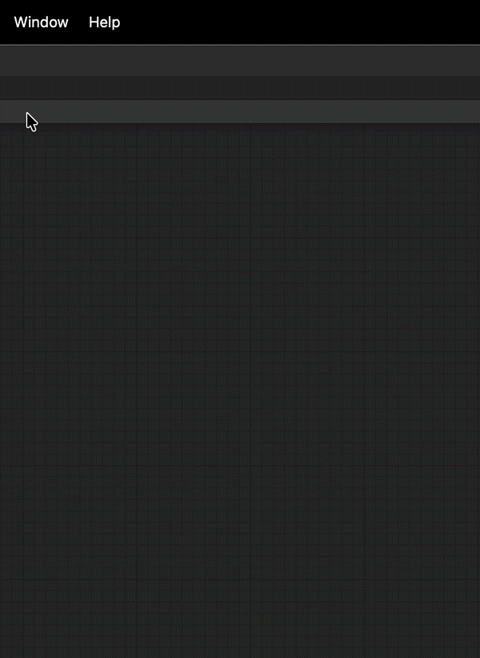

<div dir="rtl">

[English](installation.md) | [中文](installation.zh-CN.md) | [日本語](installation.ja.md) | [Español](installation.es.md) | [فارسی](installation.fa.md) | [हिन्दी](installation.hi.md) | <b>العربية</b>

# دليل التثبيت

ثبّت إضافة **AI Game Developer** في مشروع Unity، واربط بها وكيل ذكاء اصطناعي، ثم أزلها مجددًا عند الحاجة. العودة إلى [README](README.ar.md).

## المتطلبات

- ‏**Unity 2022.3** أو أحدث.
- مسار مشروع **بدون مسافات**. تسجّل الإضافة خطأً عند بدء التشغيل إذا احتوى المسار على مسافة.
  - ‏✅ `C:/MyProjects/MyProject`
  - ‏❌ `C:/My Projects/MyProject`
- لواجهة سطر الأوامر (CLI): [Node.js](https://nodejs.org/) 22.14 أو أحدث.

## 1. تثبيت الإضافة

### الخيار 1: المثبّت

1. نزّل **[AI-Game-Dev-Installer.unitypackage](https://github.com/IvanMurzak/Unity-MCP/releases/latest/download/AI-Game-Dev-Installer.unitypackage)**.
2. انقر عليه نقرًا مزدوجًا والمشروع مفتوح، أو استخدم **Assets ▸ Import Package ▸ Custom Package** في Unity.

### الخيار 2: OpenUPM

</div>

```bash
openupm add com.ivanmurzak.unity.mcp
```

<div dir="rtl">

### الخيار 3: CLI

‏[`unity-mcp-cli`](https://github.com/IvanMurzak/Unity-MCP/blob/main/cli/README.md) يعدّل `Packages/manifest.json` نيابةً عنك، لذا لا يلزم أن يكون المحرر مفتوحًا:

</div>

```bash
npm install -g unity-mcp-cli

unity-mcp-cli install-unity                      # optional: install a Unity Editor
unity-mcp-cli create-project ./MyUnityProject    # optional: create a project
unity-mcp-cli install-plugin ./MyUnityProject    # add the plugin
unity-mcp-cli login                              # sign in to ai-game.dev (browser device flow)
unity-mcp-cli open ./MyUnityProject              # open Unity; it connects and generates skills
unity-mcp-cli wait-for-ready ./MyUnityProject    # wait until tools can be called
```

<div dir="rtl">

‏`npx unity-mcp-cli <command>` يعمل دون تثبيت عام.

**تسجيل الدخول وتثبيت المشروع (pinning).** يخزّن الأمر `login` بيانات الاعتماد في `~/.ai-game-dev/credentials.json`؛ ولا يوجد رمز (token) عليك لصقه. افتراضيًا يشير إعداد الوكيل الذي يكتبه `setup-mcp` إلى نقطة نهاية **مثبّتة** خاصة بكل مشروع (`https://ai-game.dev/mcp/p/<pin>`)؛ مرّر `--no-pin` لاستخدام نقطة النهاية المشتركة `https://ai-game.dev/mcp`. يمكن للفرق مشاركة الوصول عبر رمز تسجيل (enrollment code): `unity-mcp-cli install-plugin --enroll <code>`.

## 2. اختر وكيل ذكاء اصطناعي

تحتاج إلى وكيل واحد؛ فهو نافذة المحادثة التي تعمل فيها. يجب أن يدعم Skills أو أدوات MCP التي تتحدّث أثناء تشغيله. يُوصى بـ Claude Code. تكتب نافذة AI Game Developer والأمر `unity-mcp-cli setup-mcp` الإعداد نيابةً عنك لكلٍّ من Claude Code وClaude Desktop وCodex وCursor وGemini وGitHub Copilot (CLI وVS Code وVisual Studio) وAntigravity وCline وOpen Code وRider (Junie) وUnity AI وغيرها؛ ويطبع الأمر `unity-mcp-cli setup-mcp --list` القائمة الكاملة. ويعمل أي عميل MCP آخر بإعداد JSON المعروض في النافذة.

## 3. اربط الوكيل

### تلقائيًا

1. افتح المشروع في Unity.
2. افتح **Window ▸ AI Game Dev**.
3. انقر **Auto-generate** لإنشاء Skills (موصى به)، أو **Configure** لإعداد MCP لوكيلك.

</div>



<div dir="rtl">

الأمر نفسه من الطرفية:

</div>

```bash
unity-mcp-cli setup-skills claude-code ./MyUnityProject
unity-mcp-cli setup-mcp claude-code ./MyUnityProject             # http (default)
unity-mcp-cli setup-mcp cursor ./MyUnityProject --transport stdio
```

<div dir="rtl">

### يدويًا

إذا لم يكن وكيلك في القائمة، فانسخ JSON المعروض في نافذة AI Game Developer إلى إعداد MCP الخاص به.

للوكيل الذي يضيف الخوادم من سطر أوامره الخاص، أنشئ `<command>` الذي يشغّل الخادم المحلي (وضع Custom). استبدل `<unityProjectPath>` بالمسار الكامل للمشروع و`<port>` بالمنفذ الظاهر في نافذة AI Game Developer:

</div>

| المنصة | `<command>` |
| --- | --- |
| Windows x64 | `"<unityProjectPath>/Library/mcp-server/win-x64/gamedev-mcp-server.exe" port=<port> client-transport=stdio` |
| Windows x86 | `"<unityProjectPath>/Library/mcp-server/win-x86/gamedev-mcp-server.exe" port=<port> client-transport=stdio` |
| Windows arm64 | `"<unityProjectPath>/Library/mcp-server/win-arm64/gamedev-mcp-server.exe" port=<port> client-transport=stdio` |
| macOS Apple Silicon | `"<unityProjectPath>/Library/mcp-server/osx-arm64/gamedev-mcp-server" port=<port> client-transport=stdio` |
| macOS Intel | `"<unityProjectPath>/Library/mcp-server/osx-x64/gamedev-mcp-server" port=<port> client-transport=stdio` |
| Linux x64 | `"<unityProjectPath>/Library/mcp-server/linux-x64/gamedev-mcp-server" port=<port> client-transport=stdio` |
| Linux arm64 | `"<unityProjectPath>/Library/mcp-server/linux-arm64/gamedev-mcp-server" port=<port> client-transport=stdio` |

<div dir="rtl">

ثم أضفه:

</div>

```bash
claude mcp add ai-game-developer <command>    # Claude Code
gemini mcp add ai-game-developer <command>    # Gemini CLI
```

<div dir="rtl">

‏GitHub Copilot CLI: شغّل `copilot`، ثم `/mcp add` باسم الخادم `ai-game-developer` والنوع `local` و`<command>` أعلاه.

> في VS Code مع Copilot، تأكد من تفعيل وضع **Agent**.

## إعدادات الفريق: إشعارات التحديث

تعرض الإضافة نافذة تحديث منبثقة عند بدء تشغيل المحرر إذا توفّر إصدار أحدث على OpenUPM. الخيار *"Do not show again"* إعداد خاص بكل مستخدم. لإيقاف النافذة المنبثقة **للفريق بأكمله**، افتح **Edit ▸ Project Settings ▸ AI Game Developer** وفعّل *"Disable update notifications for the entire team"*. يُحفظ الإعداد في `ProjectSettings/AI-Game-Developer-UpdateSettings.asset`؛ أضف هذا الملف إلى المستودع (commit). ويوجد المفتاح نفسه في **Tools ▸ AI Game Developer ▸ Updates ▸ Disable Update Notifications (Team)**.

## إلغاء التثبيت

1. افتح **Window ▸ Package Manager**، واختر **AI Game Developer — MCP**، وانقر **Remove** (أو شغّل `unity-mcp-cli remove-plugin ./MyUnityProject`).
2. أغلق Unity، ثم احذف المجلد `Assets/Plugins/NuGet` وملفه `Assets/Plugins/NuGet.meta`.

## التالي

- [أدوات MCP الافتراضية](default-mcp-tools.ar.md)
- [الأدوات المخصصة ووقت التشغيل](custom-tools.ar.md)
- [خادم MCP والاتصال](mcp-server.ar.md)
- ‏[Wiki](https://github.com/IvanMurzak/Unity-MCP/wiki)

</div>
